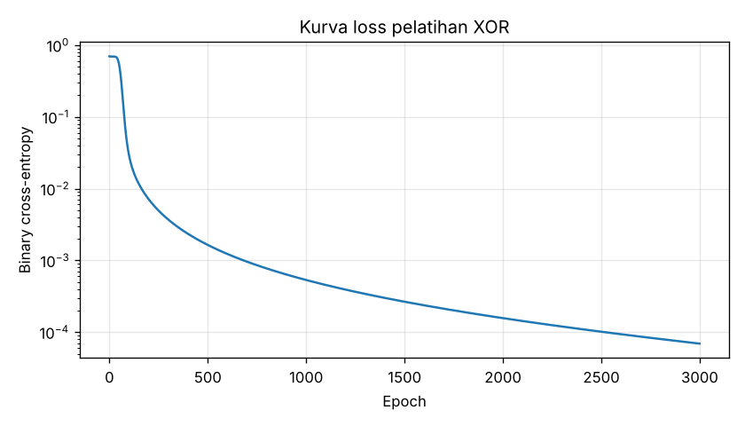

# 01 — Deep Learning Dasar

**Bagian:** UAS · **Status:** ✅ Selesai

## Tujuan
Memahami hubungan AI, Machine Learning, dan Deep Learning, lalu membuat jaringan saraf pertama dengan Keras: meniru gerbang logika **XOR**.

## Ringkasan Materi
- **AI ⊃ Machine Learning ⊃ Deep Learning.** ML belajar pola dari data. DL adalah ML dengan jaringan saraf berlapis banyak yang mempelajari fitur secara otomatis.
- **Arsitektur penting:** DBN (Deep Belief Network), **CNN** (konvolusi, untuk citra, dasar YOLO), RNN/LSTM (data berurutan).
- **Framework:** TensorFlow/**Keras**, PyTorch, Caffe, MXNet, ONNX (format pertukaran model), Darknet (asal YOLO).
- **Kenapa XOR?** XOR tidak bisa dipisahkan satu garis lurus (tidak *linearly separable*), jadi butuh minimal satu lapisan tersembunyi. XOR adalah "hello world" untuk membuktikan manfaat lapisan tersembunyi.

## Praktik / Kode
| File | Keterangan |
|---|---|
| [`xor_keras.py`](xor_keras.py) | Arsitektur ebook: Dense(2, sigmoid) → Dense(2, sigmoid) → Dense(1, sigmoid), Adam, binary cross-entropy |
| [`xor_hasil.txt`](xor_hasil.txt) | Hasil 10 kali pelatihan dengan inisialisasi berbeda |

Ebook memakai `epochs=100000, batch_size=1`, yang sangat lama. Di sini dipakai full batch (4 sampel), learning rate 0,05, dan 3000 epoch, dengan hasil yang setara.

## Hasil
| Seed | Loss akhir | Akurasi |
|---|---|---|
| 0, 4, 7, 8 | 0,4774 | 75 % |
| 2, 6 | 0,3466 | 75 % |
| 3 | 0,3467 | 50 % |
| **1, 5, 9** | **≤ 0,0002** | **100 %** |

Hanya **3 dari 10** pelatihan berhasil. Model terbaik (seed 1):

| Input | Target | Prediksi |
|---|---|---|
| 0 0 | 0 | 0,0001 |
| 0 1 | 1 | 0,9999 |
| 1 0 | 1 | 0,9999 |
| 1 1 | 0 | 0,0001 |

 

**Temuan:** jaringan sekecil ini (15 parameter, 2 neuron tersembunyi) sering **terjebak di local minimum**. Contohnya seed 0 menghasilkan prediksi 0,333 untuk tiga input. Solusinya: ulangi pelatihan dengan beberapa inisialisasi bobot, atau tambah neuron tersembunyi supaya permukaan loss lebih "mulus". Bidang keputusan model terbaik membentuk pita diagonal yang memisahkan (0,1)/(1,0) dari (0,0)/(1,1), sesuatu yang mustahil dibuat model linear.

## Yang Sudah Saya Kuasai
- [x] Menjelaskan hubungan AI, ML, DL dan arsitektur DBN/CNN
- [x] Membangun, melatih, dan mengevaluasi jaringan Keras
- [x] Menjelaskan mengapa XOR butuh lapisan tersembunyi
- [x] Mengenali masalah local minimum dan cara mengatasinya

## Referensi
- Rahmat & Muljono, *Pemrograman IoT dengan Arduino dan Python* Jilid 2, Bab 1–2
