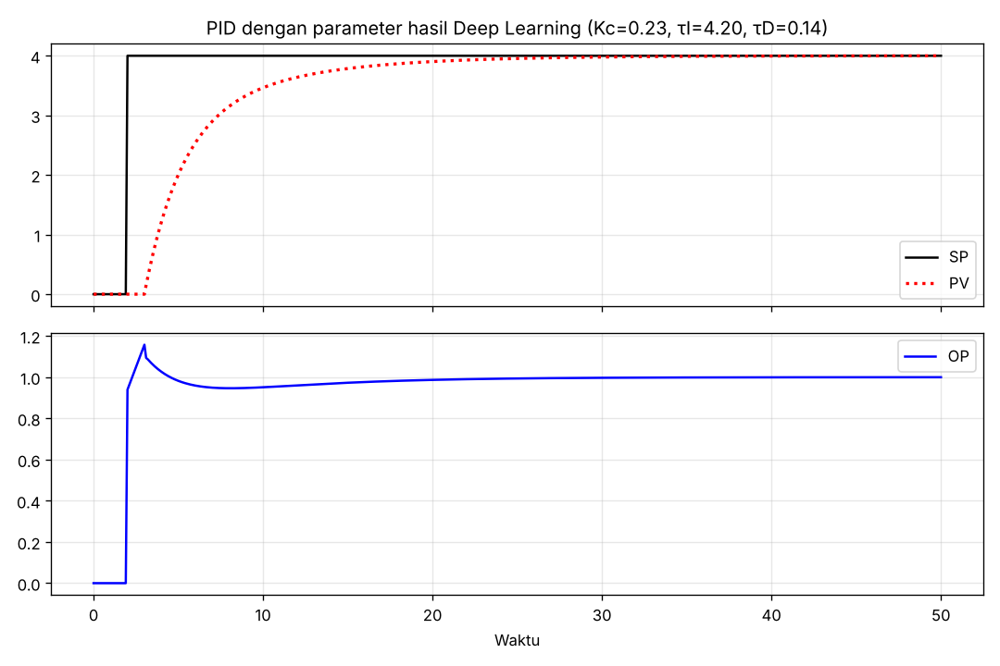
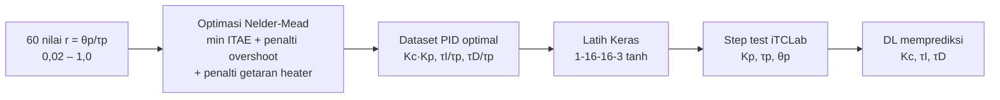
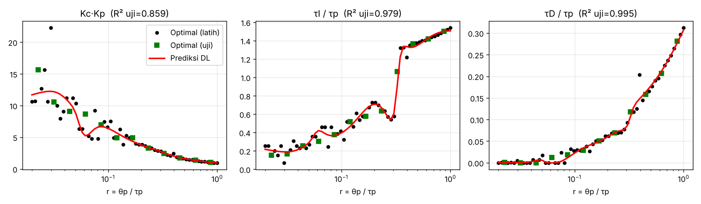

# 02 — Tuning PID dengan Deep Learning

**Bagian:** UAS · **Status:** ✅ Selesai (simulasi)

## Tujuan
Memakai deep learning untuk menentukan parameter PID ($K_c, \tau_I, \tau_D$) secara otomatis dan menerapkannya pada iTCLab.

## Ringkasan Materi
Di ebook, jaringan saraf menerima **error** $e(t)$ dan **delta error** $\Delta e(t)$, lalu mengeluarkan $K_c, \tau_I, \tau_D$. Jika error sudah konvergen ke nol, parameter dipertahankan. Jika belum, bobot jaringan diperbarui. Arsitektur: Dense(2) → Dense(3) → Dense(3), aktivasi sigmoid.

## Praktik 1 — Reproduksi contoh ebook
[`dl_pid_ebook.py`](dl_pid_ebook.py): 4 data latih ebook, lalu prediksi untuk $[e, \Delta e] = [1, 1]$. Parameter hasil prediksi kemudian dipakai mengendalikan proses $K_p$=4, $\tau_p$=3, $\theta_p$=1.

| | Kc | τI | τD |
|---|---|---|---|
| Label ebook | 0,25 | 4,31 | 0,20 |
| Prediksi DL | 0,229 | 4,204 | 0,144 |

Hasil: PV mencapai setpoint (3,999 dari 4) tanpa overshoot. 

**Catatan:** keluaran sigmoid hanya bernilai 0–1, padahal label $\tau_I$ ≈ 4. Karena itu di ebook nilai $\tau_I$ keluaran hanya 0,71. Di sini target diskalakan (÷5) sebelum dilatih, lalu dikalikan 5 kembali.

## Praktik 2 — Pengembangan: DL auto-tuner untuk plant FOPDT
Contoh ebook hanya memakai 4 data buatan tangan. Saya mengembangkannya menjadi **auto-tuner** yang belajar dari data optimal hasil simulasi ([`dl_pid_autotune.py`](dl_pid_autotune.py)):

Semua besaran dibuat **tak berdimensi**, sehingga satu model berlaku untuk plant FOPDT apa pun. Cukup ukur $K_p, \tau_p, \theta_p$ lewat step test (folder UTS/03).

**Akurasi model** pada 20 % data uji: R² = 0,859 ($K_c K_p$), 0,979 ($\tau_I/\tau_p$), 0,995 ($\tau_D/\tau_p$).

**Penerapan ke iTCLab** ($K_p$=0,5, $\tau_p$=120 s, $\theta_p$=10 s, setpoint 23 → 40 °C):

| Metode | Kc | τI (s) | τD (s) | Overshoot (%) | Rise (s) | Settling (s) | IAE | Aktivitas heater* |
|---|---|---|---|---|---|---|---|---|
| PID default ebook | 10,00 | 50,0 | 1,00 | 2,1 | 45 | 74 | 643 | 1,87 |
| PID IMC agresif | 14,71 | 125,0 | 4,80 | 1,3 | 53 | 193 | 765 | 10,11 |
| PID IMC moderat | 2,00 | 125,0 | 4,80 | 1,1 | 250 | 430 | 2129 | 1,29 |
| **PID hasil Deep Learning** | **13,33** | **43,9** | **1,08** | **1,1** | **41** | **68** | **620** | 2,63 |

*simpangan baku perubahan heater per detik setelah t = 300 s.

**Analisis:**
- Parameter hasil DL memberi **IAE terkecil, settling tercepat (68 s), dan overshoot terkecil (1,1 %)** dibanding semua metode lain.
- Harganya: heater sedikit lebih aktif (2,63 vs 1,87) karena $K_c$ lebih besar. Ini masih jauh lebih halus daripada IMC agresif (10,11).
- Data optimal pada r kecil tampak "berisik" (scatter). Pada daerah itu permukaan biaya landai, sehingga banyak kombinasi parameter memberi hasil hampir sama. Jaringan saraf berperan sebagai *smoother* yang merata-ratakan noise tersebut.
- Lompatan $\tau_I/\tau_p$ di r ≈ 0,35 muncul karena perubahan rezim: untuk delay besar, heater makin sering saturasi, sehingga strategi optimal berubah.

## Yang Sudah Saya Kuasai
- [x] Menjelaskan konsep penalaan PID berbasis deep learning di ebook
- [x] Mereproduksi contoh ebook dan memperbaiki masalah skala keluaran sigmoid
- [x] Membuat dataset PID optimal lewat simulasi + optimasi numerik
- [x] Melatih jaringan auto-tuner dan menerapkannya pada model iTCLab
- [ ] Menguji parameter hasil DL pada kit fisik

## Referensi
- Rahmat & Muljono, *Pemrograman IoT dengan Arduino dan Python* Jilid 2, Bab 2–3
- https://github.com/bsrahmat/ebook-10-11
