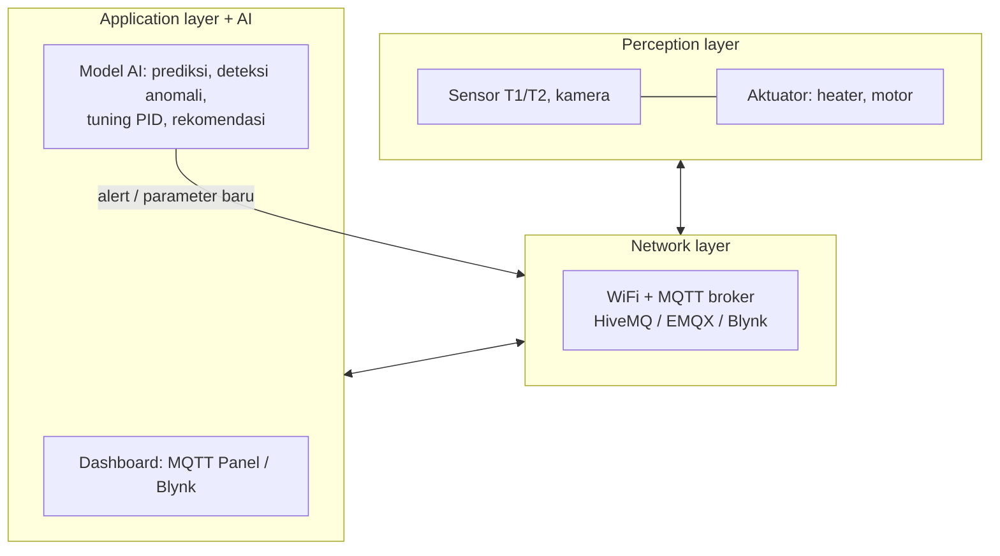

# 03 — Integrasi AI dan IoT pada Sistem Kendali Cerdas

**Bagian:** UAS · **Status:** ✅ Selesai (simulasi + uji MQTT lokal)

## Tujuan
Menempatkan AI di **application layer** arsitektur IoT, sehingga sistem tidak hanya menampilkan data tetapi juga mengenali pola, memprediksi, dan mendeteksi anomali secara otomatis.

## Ringkasan Materi

Metode AI untuk sistem kendali yang dibahas dosen:
- **Machine Learning:** ANN, DNN, CNN, RNN, LSTM, Transformer, PINN, ANFIS, SVR
- **Reinforcement Learning:** Q-Learning, DQN, DDPG, TD3, PPO, SAC
- **Evolutionary/Swarm:** GA, PSO, DE, ACO, ABC, GWO, WOA
- **Bayesian:** Bayesian Optimization, Gaussian Process
- **Hybrid:** LSTM-PID, GA-PID, PSO-PID, DDPG-PID, PINN-PID, dan *PID emulation* (GRU, Transformer, Digital Twin, Explainable AI)
- **Plant:** iTCLab, iMCLab, Robot BNU Gen 2, BNU ARMADIRRO 1.0 (lengan robot industri)

Tuning PID dengan AI sudah dikerjakan di folder 02. Di folder ini saya fokus pada **deteksi anomali**.

## Praktik — Deteksi Anomali Berbasis Model
Masalah: jika heater mulai rusak (dayanya turun), PID akan **menutupinya** dengan menaikkan output, sehingga suhu tetap terlihat normal di dashboard. Kerusakan baru ketahuan saat heater sudah tidak sanggup.

Solusi: model AI **ARX** dilatih dari data normal untuk memprediksi suhu berikutnya:
$T_{k+1} = a_1T_k + a_2T_{k-1} + b_1Q_{k-10} + b_2Q_{k-11} + c$.
Jika residual (pengukuran − prediksi), dirata-rata 30 sampel, melewati ±4σ selama 5 sampel berturut-turut, sistem mengirim **ALARM**.

| File | Keterangan |
|---|---|
| [`ai_anomaly_detector.py`](ai_anomaly_detector.py) | Model ARX (least squares) + detektor offline & online |
| [`experiment_anomaly.py`](experiment_anomaly.py) | Uji dengan 2 gangguan buatan |
| [`ai_iot_node.py`](ai_iot_node.py) | Node AI MQTT: belajar dari data stream, lalu publish `kelvin341/itclab/ai/alert` |
| [`ai_iot_node_uji_lokal.txt`](ai_iot_node_uji_lokal.txt) | Log uji online dengan digital twin |

## Hasil

| Gangguan | Mulai | Terdeteksi | Waktu deteksi |
|---|---|---|---|
| (a) Sensor glitch +3 °C (kabel longgar) | t = 400 s | t = 404 s | **4 s** |
| (b) Efisiensi heater turun 40 % | t = 800 s | t = 808 s | **8 s** |
| Alarm palsu saat kondisi normal | — | — | **0 sampel** |

Perhatikan gangguan (b): setelah t = 800 s **suhu kembali ke setpoint** karena PID menaikkan heater dari ±43 % ke ±75 %. Operator yang hanya melihat grafik suhu tidak akan sadar ada masalah, tetapi residual model AI langsung keluar dari ambang.

**Uji online lewat MQTT:** node AI belajar dari 800 sampel stream digital twin, lalu memantau. Fault disuntikkan di twin (t = 1500 s) dan terdeteksi pada sampel ke-711 periode pemantauan. Periode pemantauan dimulai sekitar sampel ke-800 twin, jadi fault berada di sekitar sampel ke-700 dan terdeteksi dalam hitungan detik. Tidak ada alarm palsu sebelumnya.

## Yang Sudah Saya Kuasai
- [x] Menjelaskan arsitektur IoT 3 layer dan posisi AI di application layer
- [x] Menyebutkan dan mengelompokkan metode AI untuk tuning/emulasi PID
- [x] Membuat model prediktif (ARX) dari data dan memakainya untuk deteksi anomali
- [x] Mengintegrasikan model AI ke aliran data MQTT secara real-time
- [ ] Menampilkan alert di Blynk / MQTT Panel saat praktikum

## Referensi
- Basuki Rahmat, *Integrasi AI dan IoT pada Sistem Kendali Cerdas*
- https://github.com/bsrahmat/imclab · https://github.com/bsrahmat/publications
