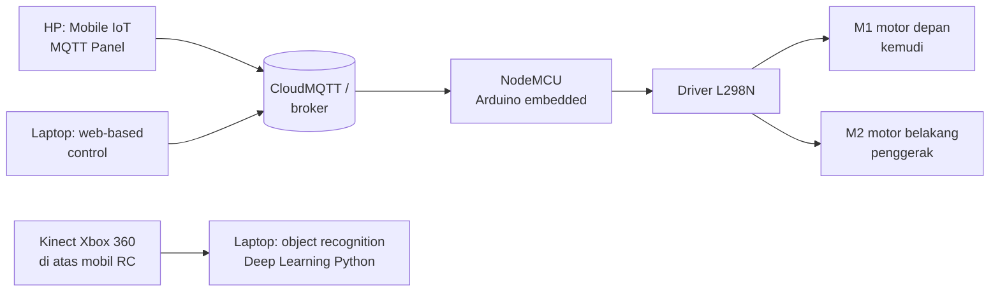

# 04 — Robot BNU Generasi I

**Bagian:** UAS · **Status:** ✅ Kode & simulasi selesai · ⬜ Uji di robot

## Tujuan
Memahami arsitektur Robot Cerdas Bela Negara (BNU) generasi pertama: mobil RC yang dikendalikan lewat IoT (web & HP) dan dilengkapi pengenalan objek berbasis deep learning.

## Arsitektur (dari materi dosen)

- **NodeMCU (ESP8266)** menerima perintah MQTT lalu mengatur L298N.
- **L298N**: driver H-bridge untuk 2 motor DC. IN1/IN2 dan IN3/IN4 mengatur arah, ENA/ENB (PWM) mengatur kecepatan.
- **Kinect Xbox 360**: kamera RGB + depth. Gambarnya diproses di laptop dengan deep learning (contoh pada materi: botol terdeteksi 47,68 %).
- Publikasi dosen: *Deep Learning-Based Object Recognition Robot Control via Web and Mobile Using an IoT Connection*, Jurnal Ilmiah KURSOR 10(4), 2020. Buku: *Pemrograman Robot Cerdas dengan Arduino*.

## Praktik / Kode
| File | Keterangan |
|---|---|
| [`BNU_Gen1_NodeMCU/BNU_Gen1_NodeMCU.ino`](BNU_Gen1_NodeMCU/BNU_Gen1_NodeMCU.ino) | Firmware NodeMCU: MQTT → L298N (MAJU/MUNDUR/KIRI/KANAN/STOP), atur kecepatan, **failsafe** berhenti jika 1,5 s tanpa perintah |
| [`web_control.html`](web_control.html) | Web control: tombol tekan-tahan, slider kecepatan, status robot (MQTT over WebSocket, wss://broker.hivemq.com:8884) |
| [`teleop_mqtt.py`](teleop_mqtt.py) | Kendali keyboard laptop (w/a/s/d) atau urutan perintah terskrip |
| [`robot_sim_mqtt.py`](robot_sim_mqtt.py) | Simulasi mobil RC (model kinematika Ackermann/bicycle) yang menerima perintah MQTT seperti NodeMCU |

**Pengaturan IoT MQTT Panel (HP):** buat 5 *Button* yang mem-publish ke `kelvin341/bnu/cmd` dengan payload `MAJU`, `MUNDUR`, `KIRI`, `KANAN`, `STOP`, dan 1 *Text Log* yang subscribe `kelvin341/bnu/status`.

## Hasil
Uji end-to-end dengan broker lokal. `teleop_mqtt.py` mengirim urutan MAJU 3 s → KIRI 3,5 s → MAJU 2 s → KANAN 2 s → STOP, lalu simulator mengubahnya menjadi lintasan:

- Semua jenis perintah diterima: MAJU 100, KIRI 70, KANAN 40, STOP 49 langkah (@50 ms).
- Jarak tempuh 5,25 m (0,5 m/s × 10,5 s), sesuai dengan total durasi bergerak.
- Mobil RC **tidak bisa berbelok di tempat**. Radius belok minimum = L / tan(30°) = 0,25/0,577 ≈ 0,43 m, terlihat dari lengkungan lintasan. Ini batasan utama robot Gen I dibanding Gen II (differential drive, folder 05).

## Yang Sudah Saya Kuasai
- [x] Menjelaskan arsitektur Robot BNU Gen I (NodeMCU, L298N, Kinect, MQTT)
- [x] Menulis firmware kendali motor via MQTT dengan failsafe
- [x] Membuat antarmuka kendali web, keyboard, dan konfigurasi HP
- [x] Mensimulasikan kinematika mobil dan memverifikasi alur perintah MQTT
- [ ] Uji pada robot fisik

## Referensi
- Basuki Rahmat, *Produk Robot Cerdas Bela Negara BNU Generasi I*, 2025
- Rahmat, B., & Nugroho, B. (2020). Deep Learning-Based Object Recognition Robot Control via Web and Mobile Using an IoT Connection. *Jurnal Ilmiah KURSOR*, 10(4). https://doi.org/10.21107/kursor.v10i4.242
