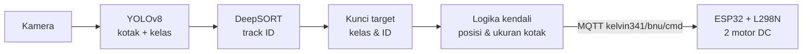
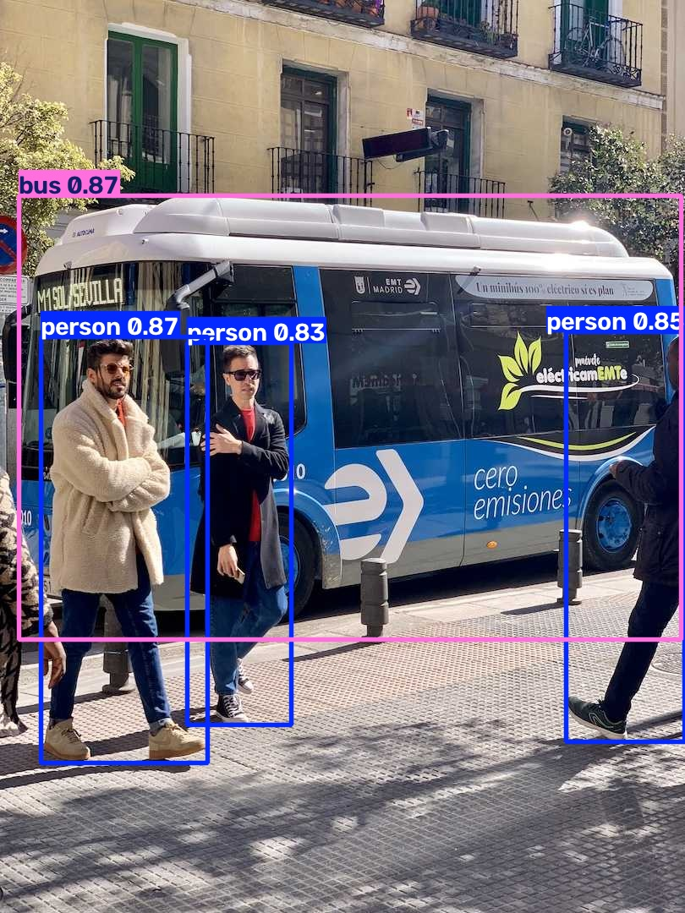
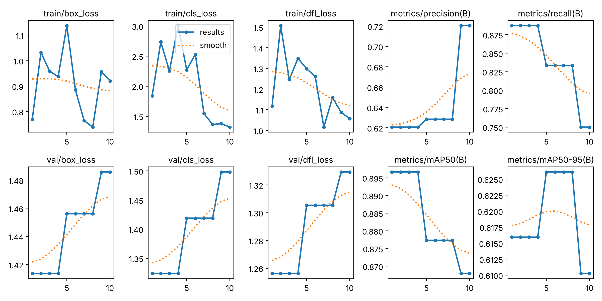

# 05 — Robot BNU Generasi II: Deep Learning, YOLOv8 & DeepSORT

**Bagian:** UAS · **Status:** ✅ Deteksi + tracking + logika kendali diuji · ⬜ Uji di robot

## Tujuan
Membuat robot yang bisa **mendeteksi** objek (YOLOv8), **melacak** objek yang sama antar-frame (DeepSORT), lalu **mengikutinya** dengan mengirim perintah ke ESP32 lewat MQTT.

## Ringkasan Materi
**YOLOv8** (You Only Look Once): detektor satu tahap berbasis CNN. Satu kali lewat jaringan langsung menghasilkan kotak + kelas + confidence, sehingga cukup cepat untuk real-time.

**Metrik evaluasi:**
- Precision = TP/(TP+FP): dari yang dideteksi, berapa yang benar
- Recall = TP/(TP+FN): dari objek yang ada, berapa yang terdeteksi
- mAP50 = rata-rata AP pada IoU ≥ 0,5; mAP50-95 = rata-rata AP pada IoU 0,5 s.d. 0,95 (lebih ketat)

**Artikel Rasjid, Rahmat & Sihananto (2024):** 7 kelas (botol, kursi, manusia, pot, galon, tong sampah, ember), 150 gambar per kelas, robot ESP32 + driver motor + laptop. Precision & Recall ≥ 0,994 untuk kursi, manusia, tong sampah. mAP50-95 antara 0,705 (pot) dan 0,908 (galon).

**DeepSORT** = Kalman filter (memprediksi posisi kotak) + algoritma Hungaria (mencocokkan prediksi dengan deteksi) + *appearance embedding* CNN (mengenali objek yang sama walau sempat tertutup). Hasilnya **ID tetap** untuk tiap objek, sehingga robot tidak bingung saat ada beberapa orang.

## Praktik / Kode
| File | Keterangan |
|---|---|
| [`deteksi_yolov8.py`](deteksi_yolov8.py) | Deteksi pada gambar/folder/video/webcam |
| [`train_yolov8.py`](train_yolov8.py) + [`data_bnu.yaml`](data_bnu.yaml) | Fine-tuning YOLOv8 untuk dataset 7 kelas seperti artikel |
| [`tracking_yolov8_deepsort.py`](tracking_yolov8_deepsort.py) | YOLOv8 + DeepSORT + logika ikut-target + kirim MQTT |
| [`make_demo_video.py`](make_demo_video.py) | Membuat video uji sintetis dari `sample/bus.jpg` |
| [`BNU_Gen2_ESP32/BNU_Gen2_ESP32.ino`](BNU_Gen2_ESP32/BNU_Gen2_ESP32.ino) | Firmware ESP32 differential drive + failsafe 1 s |

Logika kendali (`robot_command`): posisi horizontal pusat kotak menentukan **KIRI/KANAN/MAJU** (zona mati ±15 % lebar frame), tinggi kotak > 55 % frame berarti target sudah dekat (**STOP**), dan jika target hilang robot berputar pelan (**CARI**).

## Hasil

### 1. Deteksi (YOLOv8n pralatih COCO)

`bus` 0,87 · `person` 0,87 · `person` 0,85 · `person` 0,83, sekitar 150 ms/gambar di CPU.

### 2. Alur training (dataset mini COCO8, 10 epoch, CPU)
Dataset 7 kelas artikel tidak tersedia di repo, jadi alur `train_yolov8.py` diuji dengan COCO8 (8 gambar) untuk memastikan training → validasi → metrik per kelas berjalan:

| | Precision | Recall | mAP50 | mAP50-95 |
|---|---|---|---|---|
| COCO8 demo | 0,631 | 0,833 | 0,877 | 0,626 |

Angka ini **bukan** ukuran kualitas model (data validasi hanya 4 gambar), hanya bukti alur berjalan. Untuk robot BNU, ganti `--data data_bnu.yaml` setelah dataset dilabeli.

### 3. Tracking + logika robot (video sintetis 120 frame, target `person`)

- **ID stabil:** objek utama dilacak 119 dari 120 frame dengan ID yang sama (ID 3 bus, ID 4 orang). Target terkunci (ID 1) terlacak 97 frame.
- Ketika target ID 1 keluar frame, robot **otomatis mengunci target baru** (ID 4) dan tidak kehilangan arah.
- Distribusi perintah: KIRI 56, MAJU 52, STOP 7, KANAN 4, CARI 1. Saat objek membesar (robot "mendekat"), perintah berubah menjadi STOP.

## Yang Sudah Saya Kuasai
- [x] Menjelaskan cara kerja YOLOv8 dan metrik P, R, mAP50, mAP50-95
- [x] Menjalankan deteksi dan menyiapkan alur fine-tuning dataset sendiri
- [x] Menjelaskan komponen DeepSORT dan menggabungkannya dengan YOLOv8
- [x] Mengubah hasil tracking menjadi perintah gerak robot dan mengirimnya lewat MQTT
- [ ] Mengumpulkan & melabeli dataset 7 kelas, lalu training sesungguhnya
- [ ] Uji pada robot fisik

## Catatan
- `yolov8n.pt` dan video tidak di-commit (`.gitignore`). Bobot diunduh otomatis oleh ultralytics saat pertama kali dijalankan.
- `sample/bus.jpg` adalah gambar contoh bawaan paket ultralytics.

## Referensi
- Basuki Rahmat, *Robot BNU Generasi II dengan Deep Learning* dan *dengan YOLOv8-DeepSORT*, 2025
- Rasjid, A. A., Rahmat, B., & Sihananto, A. N. (2024). Implementasi YOLOv8 Pada Robot Deteksi Objek. *JTSI*, 1(3), 1–9. https://doi.org/10.47134/jtsi.v1i3.2969
