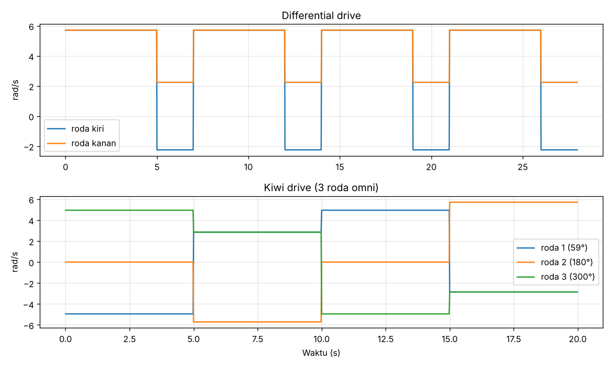

# 06 — Mobile Robot & ROS

**Bagian:** UAS · **Status:** ✅ Kajian + simulasi kinematika · ⬜ Uji ROS

## Tujuan
Membandingkan platform mobile robot dari literatur sebagai wawasan pengembangan robot BNU, terutama soal **kinematika** dan **ROS**.

## Ringkasan Literatur
**1. Android Based Mobile Robot for Monitoring and Surveillance (Azeta dkk., 2019).** Robot pengintai berbiaya rendah dengan komponen berikut:
- Arduino + motor shield, 4 roda motor DC, sensor ultrasonik untuk menghindari halangan
- Kamera video + WiFi robot link untuk merekam dan mengirim video real-time
- Kendali dari smartphone Android berdasarkan umpan balik video dari kamera robot

Konsepnya mirip Robot BNU Gen I: kendali jarak jauh lewat HP + kamera. Bedanya, BNU menambahkan pengenalan objek berbasis deep learning, sehingga robot bisa mengambil keputusan sendiri.

**2. ROBOTONT (Raudmäe dkk., HardwareX 2023).** Robot **omnidirectional** open-source untuk pendidikan & riset:
- 3 modul roda omni dipasang tiap 120° (**Kiwi drive**), motor DC + encoder
- STM32 NUCLEO-L476RG untuk kendali motor, komputer onboard x64
- Kamera RGB-D Intel RealSense D435i, tombol E-Stop, rel untuk modul tambahan, payload hingga 10 kg
- Dukungan **ROS** penuh + *digital twin*, biaya hardware ±€2000
- Mengisi celah antara robot edukasi murah (< €500, terbatas) dan robot riset (€15.000–100.000)

**ROS (Robot Operating System)** adalah framework standar robotika berbasis *node* dan *topic* (mirip publish/subscribe MQTT). Contoh: perintah gerak dikirim ke topic `/cmd_vel` (`geometry_msgs/Twist`), lalu driver robot menerjemahkannya ke kecepatan roda.

## Praktik / Kode
| File | Keterangan |
|---|---|
| [`kinematika_mobile_robot.py`](kinematika_mobile_robot.py) | Inverse & forward kinematics differential drive vs Kiwi drive, simulasi lintasan persegi |
| [`kinematika_hasil.txt`](kinematika_hasil.txt) | Hasil numerik |
| [`ros2_square_cmd_vel.py`](ros2_square_cmd_vel.py) | Node ROS 2 untuk lintasan persegi via `/cmd_vel` (**belum diuji**, ROS tidak tersedia saat penyusunan) |

**Inverse kinematics Kiwi drive** (roda $i$ di sudut $\alpha_i$ = 60°, 180°, 300°, jarak ke pusat $L$, jari-jari roda $r$; nilai $L$ = 0,146 m dan $r$ = 0,035 m di simulasi adalah asumsi, bukan spesifikasi Robotont):
$$\omega_i = \frac{1}{r}\left(-\sin\alpha_i\,v_x + \cos\alpha_i\,v_y + L\,\omega\right)$$

**Differential drive:** $\omega_{kiri} = (v - \omega B/2)/r$, $\omega_{kanan} = (v + \omega B/2)/r$.

## Hasil
| Perintah ke robot omni | Kecepatan roda (rad/s) | FK kembali |
|---|---|---|
| maju 0,2 m/s | [−4,95; 0; 4,95] | [0,2; 0; 0] ✔ |
| geser kiri 0,2 m/s | [2,86; −5,71; 2,86] | [0; 0,2; 0] ✔ |
| putar 1 rad/s | [4,17; 4,17; 4,17] | [0; 0; 1,0] ✔ |

| Lintasan persegi 1 m | Waktu | Rotasi badan |
|---|---|---|
| Omnidirectional (Robotont) | **20,0 s** | 0° (tetap menghadap depan) |
| Differential drive (BNU Gen II) | 28,0 s | 360° (berhenti & berputar 4 × 90°) |

**Analisis:** robot omni **holonomic**, bisa bergerak ke segala arah tanpa memutar badan. Kamera bisa tetap mengarah ke target sambil robot bergeser, cocok untuk tracking (folder 05). Harganya: mekanik lebih rumit (roda omni, 3 motor), dan traksi lebih rendah. Differential drive lebih sederhana dan murah, tapi harus berhenti dan berputar untuk berbelok. Robot BNU Gen I (mobil RC) bahkan tidak bisa berputar di tempat.

## Yang Sudah Saya Kuasai
- [x] Merangkum dua paper mobile robot dan posisinya terhadap robot BNU
- [x] Menurunkan & memverifikasi kinematika differential dan Kiwi drive
- [x] Menjelaskan konsep ROS (node, topic, `/cmd_vel`)
- [ ] Menjalankan node ROS 2 di turtlesim / simulator Robotont

## Referensi
- Azeta, J. et al. (2019). An Android Based Mobile Robot for Monitoring and Surveillance. *Procedia Manufacturing*, 35, 1129–1134.
- Raudmäe, R. et al. (2023). ROBOTONT – Open-source and ROS-supported omnidirectional mobile robot for education and research. *HardwareX*, 14, e00436. https://doi.org/10.1016/j.ohx.2023.e00436
