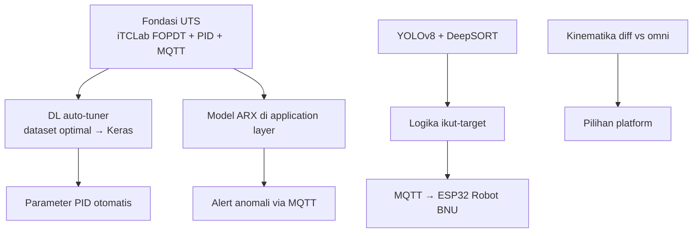
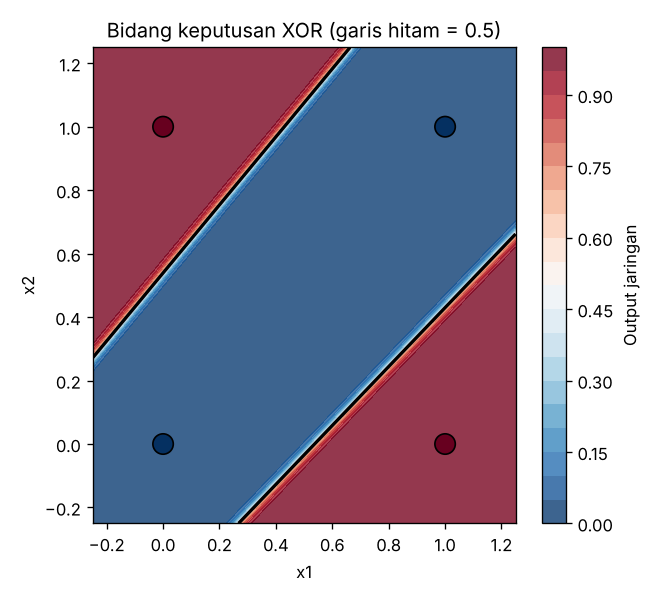
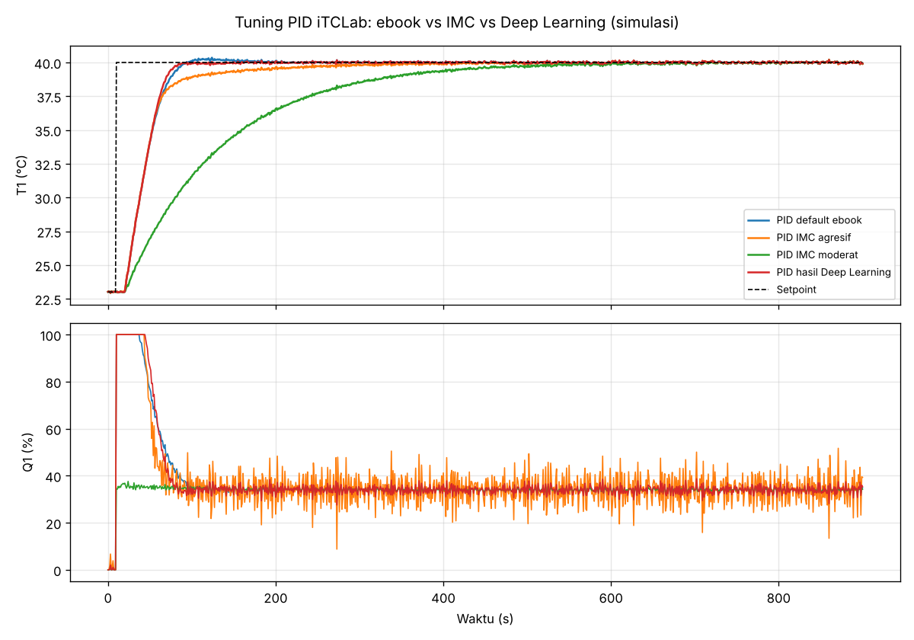
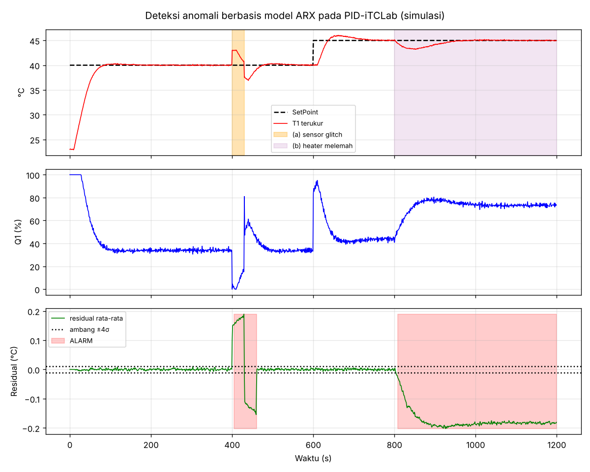
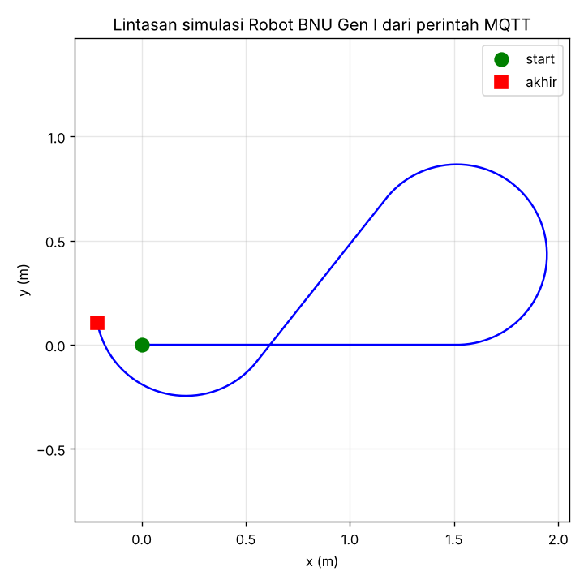
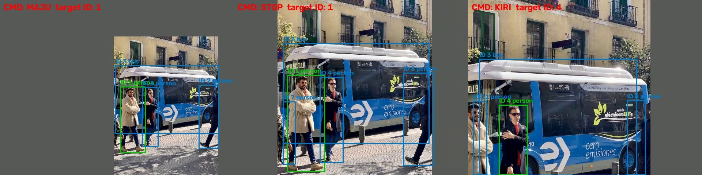
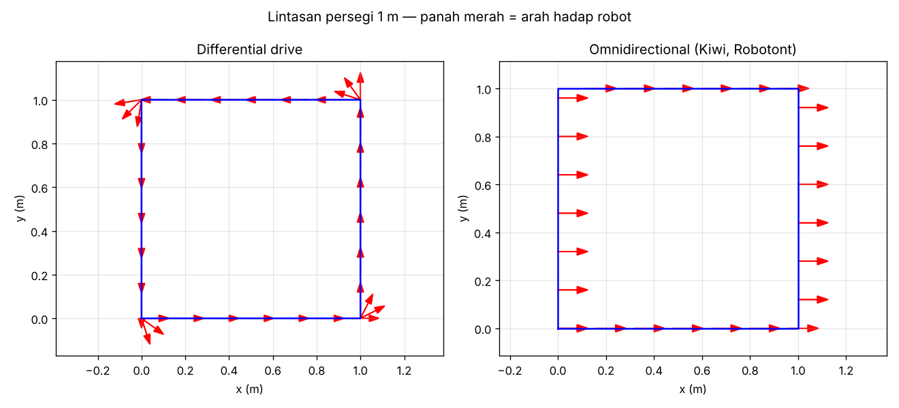

# Project Report UAS — Robotika

| | |
|---|---|
| **Nama** | Kelvin Sitorus |
| **NPM** | 24081010341 |
| **Program Studi** | Informatika, UPN "Veteran" Jawa Timur |
| **Mata Kuliah** | Robotika |
| **Dosen** | Prof. Basuki Rahmat |
| **Judul** | Integrasi AI–IoT untuk Sistem Kendali Cerdas dan Robot BNU Pengikut Objek Berbasis YOLOv8–DeepSORT |

## Abstrak
Bagian UAS melanjutkan sistem PID-iTCLab berbasis IoT dari UTS dengan menambahkan kecerdasan buatan di tiga titik. **(1) Tuning:** jaringan Keras dilatih dari 60 solusi PID optimal hasil simulasi untuk menala PID secara otomatis dari parameter step test. Pada model iTCLab, parameter hasil DL ($K_c$=13,3; $\tau_I$=43,9 s; $\tau_D$=1,08 s) memberi IAE terkecil (620), settling tercepat (68 s), dan overshoot terkecil (1,1 %) dibanding parameter default ebook dan aturan IMC. **(2) Pemantauan:** model ARX di application layer IoT mendeteksi sensor glitch dalam 4 s dan pelemahan heater dalam 8 s tanpa alarm palsu, termasuk kerusakan yang "ditutupi" PID sehingga tidak terlihat dari grafik suhu. **(3) Persepsi robot:** YOLOv8 + DeepSORT melacak objek dengan ID stabil dan menghasilkan perintah gerak (MAJU/KIRI/KANAN/STOP/CARI) yang dikirim lewat MQTT ke firmware Robot BNU Gen II. Kinematika differential drive dan omnidirectional (Robotont) juga dibandingkan: pada lintasan persegi 1 m, robot omni 29 % lebih cepat karena tidak perlu berputar. Semua pengujian dilakukan dengan simulasi, digital twin, dan broker MQTT lokal. Uji hardware dijadwalkan saat praktikum.

## 1. Pendahuluan
Sistem kendali klasik (PID) bekerja baik jika parameternya tepat dan plant-nya sehat. Robot cerdas butuh lebih dari itu: kemampuan **menyesuaikan diri** (tuning otomatis), **menyadari kondisi dirinya** (deteksi anomali), dan **memahami lingkungan** (visi komputer). Mata kuliah ini memakai pendekatan dosen: iTCLab sebagai plant latihan dan Robot Cerdas Bela Negara (BNU) sebagai platform robot, lalu ditambah AI di atas fondasi IoT.

## 2. Tujuan
1. Membuat model deep learning dengan Keras.
2. Menerapkan deep learning untuk menala parameter PID.
3. Mengintegrasikan AI ke arsitektur IoT untuk sistem kendali cerdas.
4. Memahami arsitektur Robot BNU Gen I & II serta deteksi dan pelacakan objek.
5. Membandingkan platform mobile robot dan memahami ROS.

## 3. Peta Kemajuan

| No | Topik | Folder | Status |
|---|---|---|---|
| 1 | Deep Learning Dasar (XOR) | [`01-Deep-Learning-Dasar`](01-Deep-Learning-Dasar/) | ✅ |
| 2 | Tuning PID dengan Deep Learning | [`02-Tuning-PID-Deep-Learning`](02-Tuning-PID-Deep-Learning/) | ✅ simulasi |
| 3 | Integrasi AI–IoT (deteksi anomali) | [`03-Integrasi-AI-IoT`](03-Integrasi-AI-IoT/) | ✅ simulasi + MQTT |
| 4 | Robot BNU Generasi I | [`04-Robot-BNU-Generasi-1`](04-Robot-BNU-Generasi-1/) | ✅ kode + simulasi · ⬜ robot |
| 5 | Robot BNU Gen II — YOLOv8-DeepSORT | [`05-Robot-BNU-Gen2-YOLOv8-DeepSORT`](05-Robot-BNU-Gen2-YOLOv8-DeepSORT/) | ✅ deteksi + tracking · ⬜ robot |
| 6 | Mobile Robot & ROS | [`06-Mobile-Robot-ROS`](06-Mobile-Robot-ROS/) | ✅ kinematika · ⬜ ROS |

## 4. Landasan Teori

### 4.1 Deep Learning
Jaringan saraf berlapis yang mempelajari pemetaan input → output dengan menurunkan nilai loss memakai gradien (backpropagation + optimizer Adam). XOR membuktikan perlunya lapisan tersembunyi untuk masalah non-linear. CNN adalah dasar detektor objek seperti YOLO.

### 4.2 Tuning PID Berbasis AI
Ebook memetakan $[e, \Delta e] \rightarrow [K_c, \tau_I, \tau_D]$ dengan jaringan saraf. Pengembangan lain yang dibahas dosen: LSTM-PID, ANFIS-PID, GA/PSO-PID, reinforcement learning (DDPG, PPO), dan PID emulation (Transformer, PINN, Digital Twin).

### 4.3 Arsitektur AI–IoT
IoT terdiri dari perception layer (sensor/aktuator), network layer (WiFi, MQTT, cloud), dan application layer. AI ditempatkan di application layer untuk analisis pola, prediksi, deteksi anomali, dan aksi otomatis.

### 4.4 Robot BNU
- **Gen I:** mobil RC + NodeMCU + L298N + Kinect Xbox 360, dikendalikan via CloudMQTT, MQTT Panel, dan web, dengan pengenalan objek deep learning di laptop.
- **Gen II:** ESP32 + driver motor + motor DC, deteksi objek YOLOv8 dan pelacakan DeepSORT.

### 4.5 YOLOv8, Metrik, dan DeepSORT
Precision = TP/(TP+FP), Recall = TP/(TP+FN), mAP50 / mAP50-95 = rata-rata AP pada ambang IoU tertentu. DeepSORT = Kalman filter + Hungarian matching + appearance embedding, sehingga ID objek stabil antar-frame.

### 4.6 Kinematika Mobile Robot & ROS
Differential drive bersifat non-holonomic (harus berputar untuk berbelok). Kiwi drive dengan 3 roda omni bersifat holonomic. ROS menyediakan node/topic standar (mis. `/cmd_vel`).

## 5. Metodologi


## 6. Implementasi & Hasil

### 6.1 Deep Learning XOR
Arsitektur ebook (15 parameter) dilatih dengan 10 inisialisasi. **Hanya 3/10 berhasil** (akurasi 100 %, loss ≤ 0,0002). Sisanya terjebak di local minimum (akurasi 50–75 %).


### 6.2 Tuning PID dengan Deep Learning
Reproduksi ebook: prediksi $K_c$=0,229, $\tau_I$=4,204, $\tau_D$=0,144 (label 0,25 / 4,31 / 0,20). Masalah skala keluaran sigmoid diperbaiki dengan normalisasi target.

Auto-tuner (R² uji 0,86 / 0,98 / 0,995) diterapkan ke iTCLab:

| Metode | Kc | τI | τD | Overshoot | Settling | IAE |
|---|---|---|---|---|---|---|
| Default ebook | 10,00 | 50,0 | 1,00 | 2,1 % | 74 s | 643 |
| IMC agresif | 14,71 | 125,0 | 4,80 | 1,3 % | 193 s | 765 |
| IMC moderat | 2,00 | 125,0 | 4,80 | 1,1 % | 430 s | 2129 |
| **Deep Learning** | **13,33** | **43,9** | **1,08** | **1,1 %** | **68 s** | **620** |



### 6.3 Deteksi Anomali AI–IoT
| Gangguan | Waktu deteksi |
|---|---|
| Sensor glitch +3 °C | 4 s |
| Heater melemah 40 % | 8 s |
| Alarm palsu (kondisi normal) | 0 |



Versi online (`ai_iot_node.py`) diuji lewat MQTT dengan digital twin: model belajar dari 800 sampel stream, lalu fault yang disuntikkan terdeteksi dan alert dipublikasikan.

### 6.4 Robot BNU Gen I
Firmware NodeMCU (MQTT → L298N, failsafe 1,5 s), web control, dan teleop keyboard dibuat. Uji end-to-end dengan simulator kinematika: semua perintah diterima, jarak tempuh 5,25 m sesuai durasi gerak.


### 6.5 Robot BNU Gen II — YOLOv8 + DeepSORT
Deteksi: bus 0,87, person 0,83–0,87 (±150 ms/gambar di CPU). Alur fine-tuning diuji dengan COCO8. Tracking 120 frame: objek utama mempertahankan ID yang sama 119/120 frame. Robot otomatis mengunci target baru saat target lama keluar frame.


### 6.6 Kinematika Mobile Robot
| Lintasan persegi 1 m | Waktu | Rotasi badan |
|---|---|---|
| Omnidirectional (Kiwi) | 20,0 s | 0° |
| Differential drive | 28,0 s | 360° |



## 7. Pembahasan
1. **AI paling berguna saat dipadukan dengan model fisik.** Auto-tuner bekerja karena datanya berasal dari simulasi FOPDT yang sudah divalidasi di UTS. Detektor anomali bekerja karena memprediksi *dinamika* plant, bukan sekadar membatasi nilai suhu.
2. **Kendali yang baik bisa menyembunyikan kerusakan.** Saat heater melemah, PID menaikkan output dan suhu tetap normal. Hanya pembanding model (residual) yang menangkapnya. Ini alasan kuat menaruh AI di application layer IoT.
3. **Jaringan kecil rawan local minimum** (XOR 3/10 berhasil). Hal yang sama berlaku untuk auto-tuner: data optimal di daerah r kecil berisik, dan jaringan saraf berfungsi sebagai penghalus.
4. **Pembagian kerja robot BNU Gen II:** inferensi berat (YOLOv8, DeepSORT) di laptop, sedangkan ESP32 hanya mengeksekusi perintah sederhana + failsafe. Desain ini aman, karena robot berhenti sendiri jika koneksi putus, dan murah karena ESP32 tidak perlu menjalankan CNN.
5. **Platform:** robot omni (Robotont) lebih fleksibel untuk tracking karena kamera bisa tetap menghadap target sambil bergeser, tetapi mekaniknya lebih rumit dan mahal (±€2000). Differential drive tetap pilihan rasional untuk BNU.

## 8. Apa yang Telah Saya Kuasai
- Membangun, melatih, dan mendiagnosis jaringan Keras (termasuk masalah local minimum dan skala keluaran).
- Merancang pipeline *simulation-based learning*: membuat dataset optimal lewat optimasi numerik lalu melatih model auto-tuner PID.
- Membuat model prediktif dari data (ARX) dan memakainya untuk deteksi anomali real-time di jalur MQTT.
- Menulis firmware robot berbasis MQTT (NodeMCU & ESP32) dengan failsafe, serta antarmuka web/keyboard/HP.
- Menjalankan YOLOv8, menyiapkan fine-tuning dataset sendiri, menggabungkan DeepSORT, dan mengubah hasil persepsi menjadi perintah gerak.
- Menurunkan dan memverifikasi kinematika differential drive dan omnidirectional, serta memahami konsep dasar ROS.

## 9. Kendala & Solusi
| Kendala | Solusi |
|---|---|
| Output sigmoid (0–1) tidak bisa mencapai label $\tau_I$ ≈ 4 di contoh ebook | Normalisasi target sebelum dilatih |
| XOR sering gagal konvergen | Multi-restart (10 seed), pilih loss terendah |
| Dataset PID optimal berisik pada delay kecil | Multi-restart optimasi + jaringan saraf sebagai penghalus |
| Dataset 7 kelas artikel tidak tersedia | Alur training diuji dengan COCO8; `data_bnu.yaml` disiapkan untuk dataset sendiri |
| Library `deep-sort-realtime` butuh `pkg_resources` | Pasang `setuptools<81` (dicatat di requirements) |
| Belum ada akses robot fisik setiap saat | Simulator kinematika + digital twin MQTT dengan topic identik firmware |

## 10. Kesimpulan & Rencana Pengembangan
1. Deep learning berhasil dipakai sebagai auto-tuner PID dan pada model iTCLab mengungguli parameter default maupun IMC pada IAE, settling, dan overshoot.
2. AI di application layer IoT mampu mendeteksi kerusakan sensor dan aktuator dalam hitungan detik, termasuk kerusakan yang tidak terlihat dari grafik suhu.
3. Pipeline YOLOv8 → DeepSORT → logika kendali → MQTT → ESP32 siap dipasang di Robot BNU Gen II.

**Rencana berikutnya:**
- Menguji semua firmware dan parameter pada kit iTCLab dan robot fisik, lalu membandingkannya dengan hasil simulasi.
- Mengumpulkan dan melabeli ±150 gambar per kelas, lalu fine-tuning YOLOv8 untuk 7 kelas robot BNU.
- Mencoba metode tuning lain dari materi dosen (PSO-PID, DDPG-PID) dan membandingkannya dengan auto-tuner DL.
- Menjalankan node ROS 2 di turtlesim dan, jika memungkinkan, simulator Robotont.

## Cara Menjalankan
```bash
pip install -r requirements.txt            # dari root repo
python UAS/01-Deep-Learning-Dasar/xor_keras.py
python UAS/02-Tuning-PID-Deep-Learning/dl_pid_autotune.py
python UAS/03-Integrasi-AI-IoT/experiment_anomaly.py
python UAS/05-Robot-BNU-Gen2-YOLOv8-DeepSORT/deteksi_yolov8.py --source UAS/05-Robot-BNU-Gen2-YOLOv8-DeepSORT/sample
python UAS/06-Mobile-Robot-ROS/kinematika_mobile_robot.py
```

## Referensi
1. Rahmat, B., & Muljono. *Pemrograman Internet of Things (IoT) dengan Arduino dan Python*, Jilid 2. CV. Eureka Media Aksara.
2. Rahmat, B. *Integrasi AI dan IoT pada Sistem Kendali Cerdas* (materi kuliah).
3. Rahmat, B. *Produk Robot Cerdas Bela Negara BNU* Generasi I, Generasi II (Deep Learning), Generasi II (YOLOv8-DeepSORT), 2025.
4. Rahmat, B., & Nugroho, B. (2020). Deep Learning-Based Object Recognition Robot Control via Web and Mobile Using an IoT Connection. *Jurnal Ilmiah KURSOR*, 10(4). https://doi.org/10.21107/kursor.v10i4.242
5. Rasjid, A. A., Rahmat, B., & Sihananto, A. N. (2024). Implementasi YOLOv8 Pada Robot Deteksi Objek. *JTSI*, 1(3), 1–9. https://doi.org/10.47134/jtsi.v1i3.2969
6. Azeta, J. et al. (2019). An Android Based Mobile Robot for Monitoring and Surveillance. *Procedia Manufacturing*, 35, 1129–1134.
7. Raudmäe, R. et al. (2023). ROBOTONT – Open-source and ROS-supported omnidirectional mobile robot for education and research. *HardwareX*, 14, e00436. https://doi.org/10.1016/j.ohx.2023.e00436
