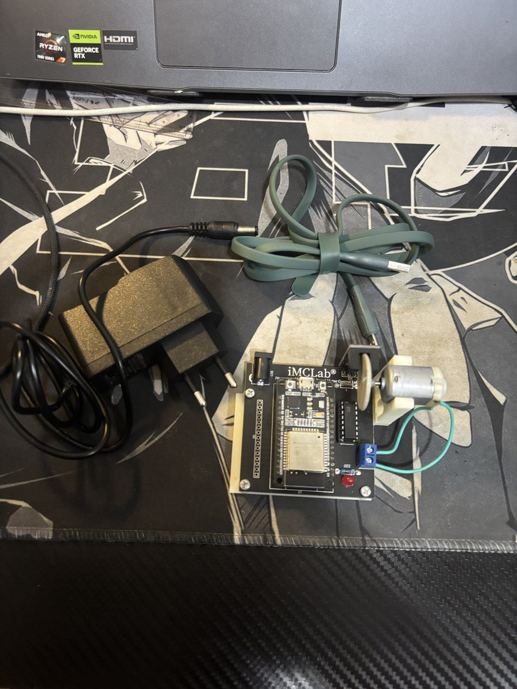
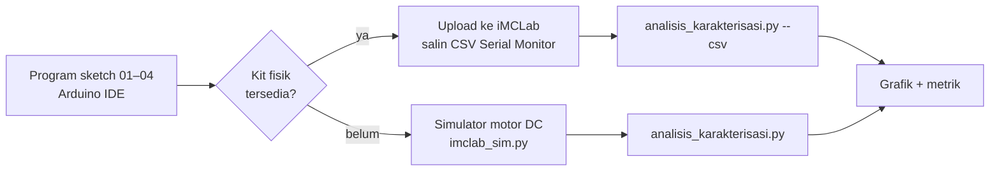
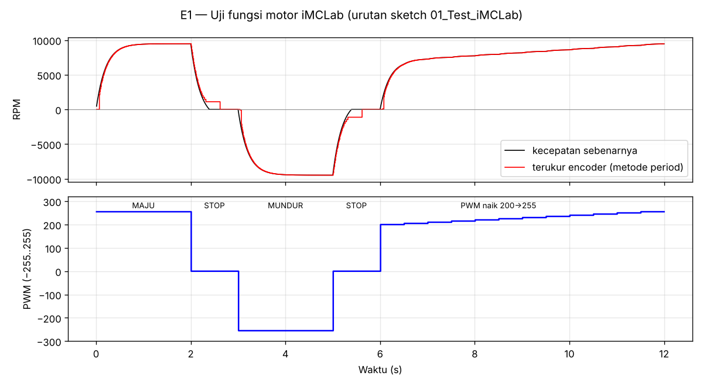
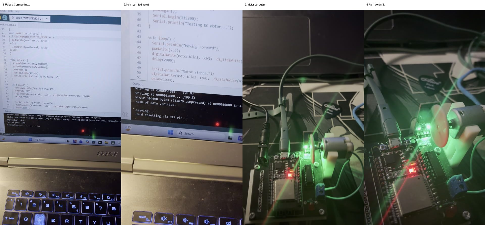
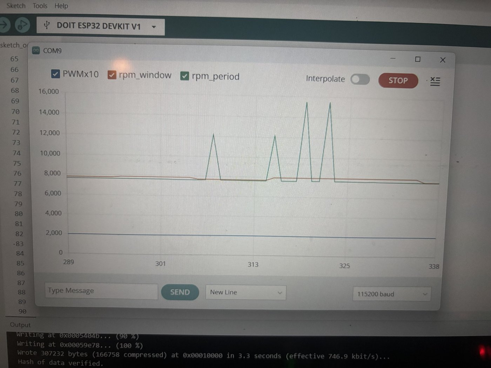
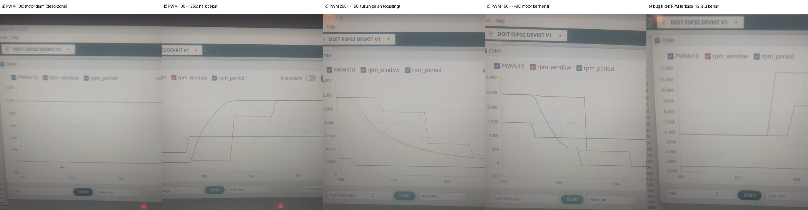
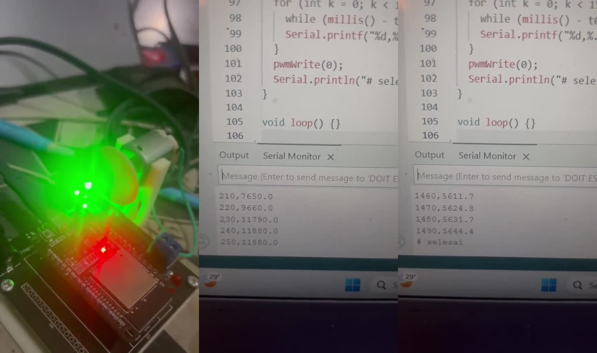
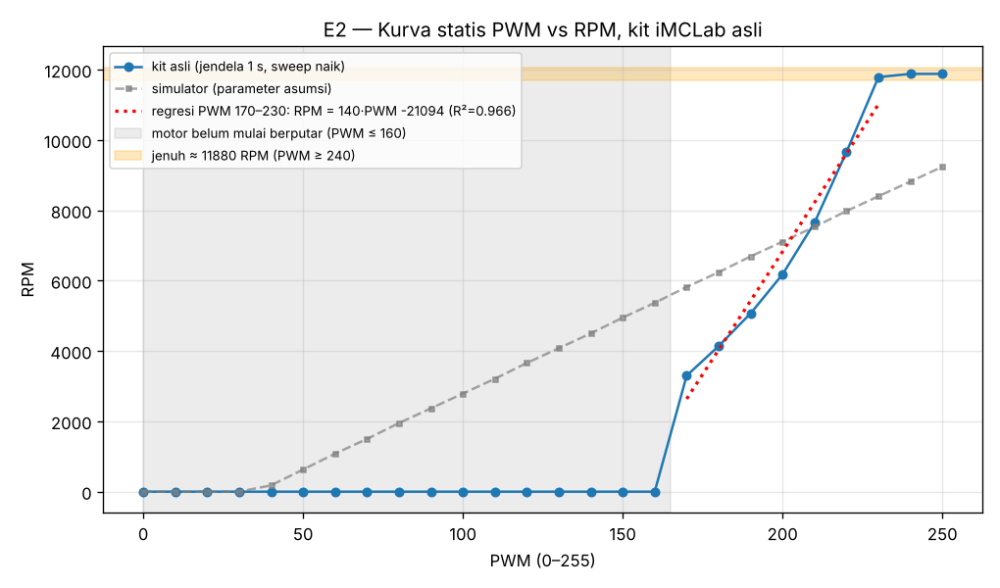
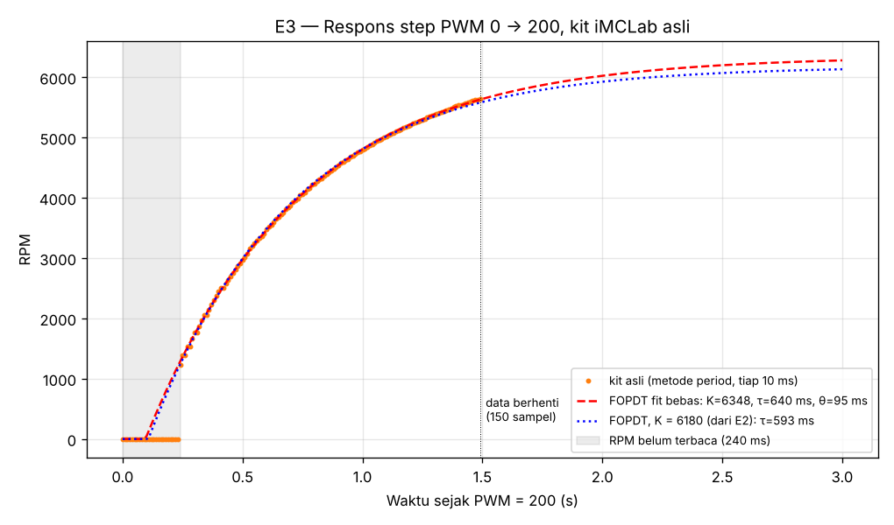
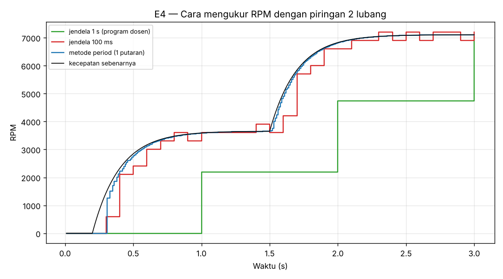

# Laporan Riset Modul 1 — Pemrograman Dasar Robotika dengan Kit iMCLab

| | |
|---|---|
| **Nama / NPM** | Kelvin Sitorus / 24081010341 |
| **Mata kuliah** | Robotika — Prof. Basuki Rahmat |
| **Kit** | iMCLab (Internet-Based Motor Control Lab) |
| **Status** | ✅ Program & analisis selesai · ✅ Uji kit fisik: uji fungsi, encoder, variasi PWM, karakterisasi E2/E3 |

## Abstrak
Modul ini membahas dasar aktuator robot, yaitu motor DC, memakai Kit iMCLab: mengatur arah dan kecepatan dengan PWM, membaca kecepatan dengan encoder optik, dan mengkarakterisasi motor secara kuantitatif. Eksperimen awalnya dirancang pada simulator (parameter asumsi), lalu diuji di **kit iMCLab asli**. Hasilnya: (E1) urutan maju–stop–mundur–stop–percepatan dari program dosen berjalan di kit sesuai harapan (ada video); (E2) data kit menunjukkan motor baru berputar dari diam pada **PWM 170**, tetapi yang sudah berputar bertahan sampai ±PWM 95 (histeresis gesekan statis), kurvanya tidak linear (±84–210 RPM/PWM) dan jenuh di **11.880 RPM**; (E3) respons step kit mengikuti model FOPDT dengan **τ ≈ 0,6 s dan θ ≈ 0,1 s**, tiga kali lebih lambat dari asumsi simulasi; (E4) karena piringan hanya punya **2 lubang**, cara hitung pulsa per 1 s (program dosen) tertinggal jauh saat transien (galat RMS 2.676 RPM), sedangkan **metode period** (mengukur waktu satu putaran) memberi galat RMS 188 RPM dan dipakai di modul 2–4. Konfigurasi pin dan encoder (GPIO 13, piringan 2 lubang) diambil dari program dosen. Perbedaan besar antara kit dan simulasi menjadi dasar kalibrasi ulang simulator untuk modul 2–3.

## 1. Latar Belakang
Hampir semua robot bergerak dengan motor DC, termasuk Robot BNU (UAS). Sebelum motor bisa dikendalikan otomatis, kita perlu tahu tiga hal: (1) cara memberi perintah arah & kecepatan, (2) cara mengukur kecepatannya, dan (3) bagaimana motor merespons perintah, yaitu karakteristik statis dan dinamisnya. Kit iMCLab menyediakan ketiganya dalam satu papan.

## 2. Tujuan & Pertanyaan Riset
1. Bagaimana memprogram arah dan kecepatan motor DC lewat driver H-bridge dan PWM ESP32?
2. Bagaimana mengukur kecepatan motor dengan encoder optik, dan seberapa akurat?
3. Seperti apa hubungan PWM–kecepatan (statis) dan seberapa cepat motor merespons (dinamis)?

## 3. Alat & Bahan

*Gambar 1. Kit iMCLab (foto dari repositori dosen, github.com/bsrahmat/imclab).*

*Gambar 2. Kit iMCLab yang saya pakai: papan iMCLab, adaptor DC, dan kabel micro-USB.*

| Komponen | Fungsi | Pin |
|---|---|---|
| ESP32 DevKit (ESP-WROOM-32) | otak, WiFi, PWM, interrupt | — |
| IC driver motor (H-bridge, DIP-16) | membalik arah & menguatkan arus | IN1 = GPIO 27, IN2 = GPIO 26, EN = GPIO 12 |
| Motor DC + piringan berlubang | aktuator + piringan encoder | — |
| Sensor optik celah (slot) + piringan **2 lubang** | encoder: 2 pulsa per putaran | GPIO 13 (`INPUT_PULLUP`, `FALLING`) |
| LED + resistor 220 Ω | indikator | GPIO 2 |
| Adaptor DC + kabel micro-USB | catu motor & pemrograman | — |

Semua pin dipastikan dari program yang dibagikan dosen di kelas ([`../referensi_dosen`](../referensi_dosen/)). Ringkasannya ada di [`imclab_pins.h.txt`](imclab_pins.h.txt). Arah "maju" mengikuti program dosen: IN1 HIGH, IN2 LOW.

**Logika H-bridge:**

| IN1 | IN2 | EN (PWM) | Motor |
|---|---|---|---|
| HIGH | LOW | duty | maju (sesuai program dosen) |
| LOW | HIGH | duty | mundur |
| LOW | LOW | — | berhenti (rem) |

## 4. Metode

**Model simulator** (persamaan motor DC, induktansi diabaikan):
$J\dot\omega = K_t\frac{V - K_e\omega}{R} - b\omega - T_c\,\text{sign}(\omega)$, dengan $V = \frac{PWM}{255}(V_s - V_{drop})$.
Parameter asumsi: $V_s$ = 12 V, $V_{drop}$ = 1,8 V, $R$ = 3 Ω, $K_e=K_t$ = 0,0085, $J$ = 5·10⁻⁶ kg·m², $T_c$ = 4 mN·m. Encoder disimulasikan dengan benar-benar menghitung 2 lubang yang lewat, sehingga efek kuantisasi dan keterlambatan pengukurannya ikut muncul.

| Program | Isi |
|---|---|
| [`00_Cari_Pin_Encoder`](00_Cari_Pin_Encoder/00_Cari_Pin_Encoder.ino) | (Opsional) membuktikan secara eksperimen bahwa encoder ada di GPIO 13 |
| [`01_Test_iMCLab`](01_Test_iMCLab/01_Test_iMCLab.ino) | Program uji dosen (diadaptasi ESP32 core 2.x/3.x) |
| [`02_Kecepatan_PWM`](02_Kecepatan_PWM/02_Kecepatan_PWM.ino) | Atur arah & PWM −255..255 dari Serial Monitor |
| [`03_Encoder_RPM`](03_Encoder_RPM/03_Encoder_RPM.ino) | Interrupt encoder + debounce, RPM dua metode (jendela 1 s & period) dalam format CSV |
| [`04_Karakterisasi_Otomatis`](04_Karakterisasi_Otomatis/04_Karakterisasi_Otomatis.ino) | Eksperimen otomatis: sweep PWM + respons step |
| [`analisis_karakterisasi.py`](analisis_karakterisasi.py) | Mengolah data, membuat grafik & metrik |

## 5. Hasil & Analisis

### E1 — Uji fungsi

- Motor mencapai ±9.480 RPM pada PWM 255 (maju) dan −9.480 RPM (mundur). Arah dikendalikan oleh IN1/IN2, bukan oleh PWM.
- Saat IN1 = IN2 = LOW, motor berhenti dalam **±0,39 s**. Terminal motor terhubung lewat driver, sehingga GGL balik motor menghasilkan arus yang mengerem (*dynamic braking*).
- Kurva terukur (merah, metode period) mengikuti kecepatan sebenarnya dengan baik. Saat motor baru mulai berputar, nilai pertama baru muncul setelah 3 pulsa (±1 putaran), sehingga awal kurva sedikit tertinggal (dibahas di E4).
- Pada fase PWM 200 → 255, kecepatan naik bertahap mengikuti tiap kenaikan PWM.

#### Bukti praktik di kit fisik (22 Oktober 2026)
| | |
|---|---|
| Compile | `Sketch uses 304458 bytes (23%) … Maximum is 1310720 bytes` ([screenshot](img/bukti_compile_01_test.png)) |
| Upload | `Wrote 304608 bytes (164876 compressed) … in 3.2 seconds`, `Hash of data verified` ([screenshot](img/bukti_upload_01_test.png)) |
| Hasil | Motor berputar ±2 s, berhenti, lalu berputar ke **arah berlawanan**, sesuai urutan program. Driver H-bridge terbukti bisa membalik arah motor. |
| Video | [`video/uji_fungsi_01_test.mp4`](video/uji_fungsi_01_test.mp4) (38 s) |

Batas program 1.310.720 byte (1,25 MB) pada output compile juga membuktikan bahwa board memakai partisi dengan 2 slot OTA. Ini dipakai di analisis modul 4.

#### Bukti praktik encoder di kit fisik (22 Oktober 2026)
Sketch `03_Encoder_RPM` diupload ke kit, motor dijalankan pada PWM 200, dan data dilihat di Serial Plotter (115200 baud). Video: [`video/encoder_plotter_pwm200.mp4`](video/encoder_plotter_pwm200.mp4).

| Pengamatan | Nilai |
|---|---|
| RPM pada PWM 200, metode jendela 1 s (cara dosen) | **±7.300–7.600 RPM**, stabil |
| RPM pada PWM 200, metode period (versi awal) | ±7.300 RPM, tetapi ada **lonjakan palsu** sesekali ke 12.000–15.000 RPM |
| Prediksi simulator (parameter asumsi) | 7.096 RPM, selisih ±5 % dari kit |

**Analisis temuan:**
- Encoder GPIO 13 **berfungsi**, dan kedua metode sepakat di sekitar 7.300–7.600 RPM. Simulator dengan parameter motor asumsi ternyata hanya meleset ±5 %.
- Lonjakan ke 12.000–15.000 RPM adalah **pulsa palsu**. Sesekali sensor mengirim pulsa tambahan dari tepi lubang yang tidak rata atau dari gangguan listrik PWM motor. Dengan hanya 2 lubang, satu pulsa palsu langsung memperpendek waktu "1 putaran" yang terukur, sehingga RPM terbaca hampir 2× lipat. Metode jendela 1 s tidak terlalu terpengaruh karena satu pulsa ekstra hanya menambah 30 RPM pada rata-rata 1 detik.
- **Perbaikan** (sudah diterapkan di semua firmware):
  1. *Filter interval*: pulsa yang datang < 60 % dari interval sebelumnya dianggap palsu dan dibuang.
  2. *Median putaran*: RPM diambil dari median beberapa waktu putaran terakhir, jadi bacaan aneh tidak lolos (versi akhir: median 5, lihat uji variasi PWM di bawah).

  Logika ini diuji dengan urutan pulsa sintetis berisi glitch di berbagai posisi, dan hasilnya tetap 7.400 RPM tanpa lonjakan. Uji ulang di kit dijadwalkan untuk membuktikannya.

#### Uji variasi PWM di kit fisik (23 Oktober 2026)
PWM diubah lewat Serial Plotter: 100 → 255 → 150 → ±95. Video: [`video/encoder_variasi_pwm.mp4`](video/encoder_variasi_pwm.mp4).

| PWM | RPM terukur (kit) | Prediksi simulator (asumsi) |
|---|---|---|
| 100 (dari diam) | **0**, motor tidak mulai berputar | 2.792 |
| ±95 (dari 2.450 RPM) | turun ke **0**, motor berhenti | 2.580 |
| 150 | **±2.450** | 4.949 |
| 200 | **±7.400** | 7.096 |
| 255 | **±11.600** | 9.480 |

**Analisis temuan:**
1. **Dead-zone asli jauh lebih besar** dari asumsi simulator. Motor kit tidak mulai berputar pada PWM 100 dan berhenti di sekitar PWM 95. Dari titik 150 dan 200, kemiringannya ±99 RPM/PWM, sehingga perpotongan dengan 0 RPM ada di **PWM ±125**. Gesekan statis motor + drop tegangan driver lebih besar dari perkiraan. *(Karakterisasi otomatis E2 kemudian menunjukkan bahwa dari keadaan diam motor baru berputar di PWM 170, lihat E2.)*
2. **Kemiringan lebih curam** (±76–99 RPM/PWM vs 43 di simulasi), karena kecepatan maksimum motor lebih tinggi (±11.600 RPM).
3. **Naik cepat, turun lambat.** Dari PWM 100 → 255, RPM naik dalam ±1 s. Dari 255 → 150, RPM turun perlahan selama **> 10 s**. Saat sinyal PWM *low*, driver motor melepas motor (*coasting*), bukan mengerem, sehingga perlambatan hanya ditahan gesekan. Simulator mengasumsikan pengereman, jadi untuk modul 2 parameter simulator harus dikalibrasi ulang dari data kit. Ini juga berarti untuk menurunkan kecepatan dengan cepat, pengendali perlu **membalik arah sesaat** atau memakai mode rem (IN1 = IN2).
4. **Bug filter yang ditemukan dan diperbaiki.** Pada PWM 255 tetap, RPM sempat terbaca 5.900 lalu melompat ke 11.600, yaitu tepat setengahnya. Filter versi pertama membuang pulsa yang datang < 60 % dari interval sebelumnya. Ternyata **dua lubang piringan tidak berjarak tepat 180°**, sehingga interval pendek yang asli ikut terbuang dan RPM terbaca ½. Perbaikannya: pulsa dibanding dengan rata-rata setengah putaran terakhir (ambang 30 %), lalu RPM diambil dari median 5 putaran. Diuji dengan pulsa sintetis (lubang asimetris 35/65 % + glitch acak).

### E2 & E3 dari kit asli (23 Oktober 2026)
Sketch `04_Karakterisasi_Otomatis` dijalankan di kit. Output Serial Monitor disimpan apa adanya di [`data_kit.csv`](data_kit.csv), lalu dianalisis dengan `python analisis_karakterisasi.py --csv data_kit.csv`. Hasil numerik ada di [`hasil_karakterisasi_kit.txt`](hasil_karakterisasi_kit.txt). Video: [`video/karakterisasi_otomatis.mp4`](video/karakterisasi_otomatis.mp4).

*Catatan data: baris PWM 0–50 tidak ikut tersalin dari Serial Monitor. Baris itu diisi 0 karena PWM 60–160 pun terbaca 0. Versi sketch yang dijalankan masih memakai jeda 4 s antara bagian A dan B. Ini tidak mengganggu hasil, karena bagian B mulai dari RPM 0.*

### E2 — Kurva statis PWM vs kecepatan

Pada sweep ini PWM dinaikkan 0 → 250 dengan langkah 10. Tiap langkah ditahan 2 s, lalu RPM diukur dengan jendela 1 s.

| Metrik | Kit asli | Simulator (asumsi) |
|---|---|---|
| PWM mulai berputar (dari diam) | **170** (160 masih diam) | 40 |
| RPM pertama saat mulai berputar | 3.300 | ±200 |
| Kemiringan (PWM 170–230) | **±140 RPM/PWM** (R² = 0,966) | 43 RPM/PWM (linear) |
| RPM pada PWM 200 | 6.180 | 7.096 |
| Kecepatan maksimum (jenuh) | **11.880 RPM** pada PWM ≥ 240 | 9.480 RPM |

**Analisis:**
1. **Ada histeresis gesekan.** Dari keadaan diam, motor baru berputar di PWM 170. Padahal pada uji variasi PWM, motor yang *sudah berputar* tetap jalan di PWM 150 (±2.450 RPM) dan baru berhenti di sekitar PWM 95. Ini ciri gesekan statis (*stiction*) yang lebih besar dari gesekan kinetis: untuk mulai butuh torsi besar, untuk mempertahankan putaran cukup torsi kecil. Akibatnya motor "meloncat" dari 0 langsung ke 3.300 RPM, dan tidak bisa berputar pelan dari keadaan diam.
2. **Kurva tidak linear.** Kemiringannya makin curam dari 84 RPM/PWM (170→180) sampai ±210 RPM/PWM (220→230), lalu jenuh di 11.880 RPM. Model linear tunggal (R² 0,966) hanya pendekatan kasar. Untuk kendali PI, ini berarti penguatan plant berubah ±2,5 kali tergantung titik kerja, sehingga tuning sebaiknya dilakukan di sekitar titik kerja yang dipakai.
3. **Kalibrasi simulator.** Simulator dengan parameter asumsi meleset jauh: dead-zone 4 kali terlalu kecil, kemiringan 3 kali terlalu landai, dan tidak ada histeresis. Simulator perlu dikalibrasi ulang dari data ini sebelum dipakai di modul 2–3.
4. Nilai RPM pada E2 selalu kelipatan 30. Ini wajar karena jendela 1 s dengan 2 pulsa per putaran punya resolusi 30 RPM (lihat E4).

### E3 — Respons step PWM 0 → 200

PWM langsung diubah 0 → 200, lalu RPM dicatat tiap 10 ms dengan metode period selama 1,49 s. Data di-*fit* dengan model orde-1 plus waktu tunda (FOPDT): $y(t) = K\,(1 - e^{-(t-\theta)/\tau})$ untuk $t > \theta$.

| Metrik | Kit asli | Simulator (asumsi) |
|---|---|---|
| RPM mulai terbaca | 240 ms | — |
| Waktu tunda θ (fit) | **±95–108 ms** | ≈ 0 |
| Konstanta waktu τ (fit) | **0,59–0,64 s** | 0,20 s |
| Penguatan K (fit bebas) | 6.348 RPM (E2: 6.180) | 7.096 |
| RMSE fit | 15 RPM | — |
| RPM di akhir data (1,49 s) | 5.644 (91 % dari tunak) | — |

**Analisis:**
1. **Motor ±3 kali lebih lambat dari asumsi.** τ ≈ 0,6 s, sehingga butuh ±2,5 s (4τ) untuk mencapai tunak. Data 150 sampel (1,49 s) belum sampai tunak, karena itu K diestimasi dua cara: fit bebas (6.348) dan dari kurva statis E2 (6.180). Kedua cara memberi τ yang hampir sama (0,59 vs 0,64 s), jadi hasilnya konsisten.
2. **Mengapa 240 ms pertama terbaca 0?** Ada dua penyebab. (a) Waktu tunda nyata ±0,1 s: motor harus mengatasi gesekan statis dulu. (b) Tunda pengukuran: metode period baru melapor setelah 5 putaran lengkap (median 5 putaran). Saat motor masih pelan, 5 putaran memakan ±100 ms. Fit FOPDT memisahkan keduanya: θ ≈ 0,1 s adalah tunda fisik, sisanya tunda pengukuran.
3. **Model kendali.** Plant kecepatan kit (pada PWM 200): $G(s) \approx \dfrac{K e^{-0{,}1 s}}{0{,}6 s + 1}$, dengan penguatan lokal $K$ ±140 RPM/PWM. Periode sampling loop kendali 50 ms (≈ τ/12) sudah memadai. Model ini menggantikan model simulasi (τ = 0,2 s, θ = 0) untuk tuning PI di modul 2.

*Sebagai pembanding, grafik versi simulasi tetap disimpan:* [`img/e2_kurva_statis.png`](img/e2_kurva_statis.png), [`img/e3_respons_step.png`](img/e3_respons_step.png).

### E4 — Cara mengukur RPM dengan piringan 2 lubang

| Metode | Resolusi | Galat RMS vs kecepatan sebenarnya |
|---|---|---|
| Hitung pulsa per **1 s** (program dosen) | 30 RPM | 2.676 RPM |
| Hitung pulsa per 100 ms | 300 RPM | 469 RPM |
| **Period**: waktu 1 putaran (2 pulsa) dengan `micros()` | ≈ 1 µs (sangat halus) | **188 RPM** |

**Analisis:** dengan hanya 2 pulsa per putaran, menghitung pulsa dalam jendela waktu menghadapi dilema. Jendela 1 s halus (30 RPM) tetapi **terlambat hingga 1 detik**, dan galat terbesarnya justru muncul saat motor berubah kecepatan. Ini cocok untuk *display* seperti di program dosen, tapi tidak untuk kendali. Jendela 100 ms lebih cepat, tetapi angkanya melompat-lompat per 300 RPM. **Metode period** mengukur langsung waktu satu putaran penuh, sehingga hasilnya halus dan tertunda hanya ±1 putaran (6–60 ms tergantung kecepatan). Dua lubang diukur bersama (satu putaran) supaya ketidakrataan jarak antar-lubang tidak membuat angka berayun. Jika tidak ada pulsa > 0,3 s, motor dianggap berhenti. Metode ini dipakai di semua firmware modul 2–4.

## 6. Kesimpulan
1. Arah motor diatur oleh IN1/IN2 dan besar kecepatan oleh duty PWM pada EN. Program dosen berhasil diadaptasi agar kompatibel dengan ESP32 core 2.x dan 3.x.
2. Data kit asli: motor baru mulai berputar dari diam pada **PWM 170**, tetapi yang sudah berputar baru berhenti di sekitar **PWM 95** (histeresis gesekan statis). Kurvanya tidak linear (±84–210 RPM/PWM) dan jenuh di **±11.880 RPM**. Simulator awal (dead-zone 40, 43 RPM/PWM) meleset jauh dan harus dikalibrasi ulang.
3. Dinamika motor kit ≈ FOPDT dengan **τ ≈ 0,6 s** dan **θ ≈ 0,1 s** (simulasi awal: τ = 0,2 s). Loop kendali dengan periode 50 ms sudah memadai.
4. Karena piringan hanya 2 lubang, RPM untuk kendali harus diukur dengan **metode period** (waktu satu putaran). Hitung pulsa per 1 s seperti program dosen cukup untuk tampilan, tapi terlalu lambat untuk kendali.

## 7. Keterbatasan & Rencana Uji Kit
- E2 dan E3 sudah memakai **data kit asli**. E1 dan E4 masih dari simulasi (E1 sudah dibuktikan secara kualitatif lewat video uji fungsi).
- Sweep E2 hanya arah naik. Sweep turun (255 → 0) perlu dijalankan untuk mengukur histeresis secara lengkap. Ini akan dijalankan dengan coasting diperhitungkan (jeda lebih lama tiap langkah).
- Respons step hanya direkam 1,49 s (91 % tunak). Untuk data berikutnya, bagian B diperpanjang menjadi ±3 s.
- Hasil berasal dari satu kali percobaan. Nilai RPM pada PWM 200 berbeda antara uji manual (±7.400) dan sweep (6.180), kemungkinan karena riwayat putaran (histeresis/coasting) dan kondisi catu daya.
- GPIO 12 adalah *strapping pin* ESP32. Jika board gagal boot saat terpasang di kit, catat sebagai temuan.

## Referensi
- Rahmat, B. iMCLab — Internet-Based Motor Control Lab. https://github.com/bsrahmat/imclab
- Rahmat, B. Program kelas `imclab_naik_turun.ino` dan `imclab_Blynk_kelas.ino` (lihat `UTS/referensi_dosen`).
- Rahmat, B. & Muljono. *Pemrograman IoT dengan Arduino dan Python*, Jilid 1 (Bab 2: ESP32).
