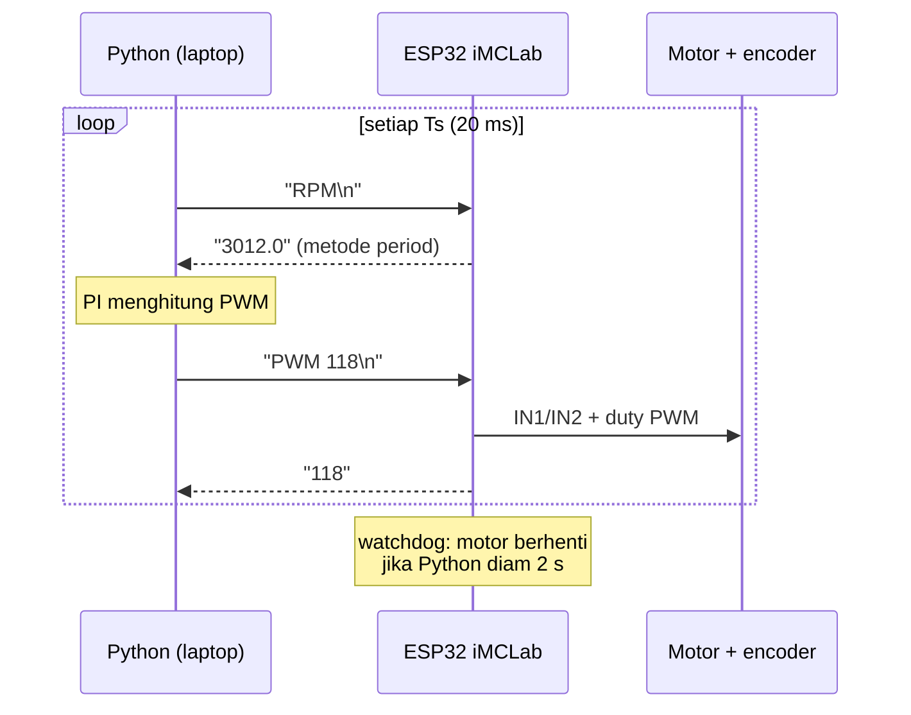

# Laporan Riset Modul 2 — Pemrograman Robotika Kit iMCLab menggunakan Python

| | |
|---|---|
| **Nama / NPM** | Kelvin Sitorus / 24081010341 |
| **Mata kuliah** | Robotika — Prof. Basuki Rahmat |
| **Status** | ✅ Program & analisis selesai (data simulasi) · ⬜ Uji di kit fisik |

## Abstrak
Pada modul ini ESP32 hanya berperan sebagai antarmuka sensor–aktuator, sedangkan "otak" kendali dipindah ke **Python di laptop** lewat komunikasi serial. Firmware perintah teks dibuat **kompatibel dengan protokol program dosen** (`1`, `0`, `+`, `-`, `PWM:xxx`, `R`), ditambah perintah untuk eksperimen (`PWM <n>`, `RPM`, `VER`, `X`). Class Python `iMCLab` dibuat dengan antarmuka yang identik dengan simulator, sehingga program yang sama bisa dijalankan pada simulasi maupun kit. (P1) Uji step dari Python menghasilkan model orde-1 **Kp = 43,1 RPM/PWM, τ = 198 ms**, dengan waktu tunda praktis nol berkat pengukuran RPM metode period. Hasil ini konsisten dengan karakterisasi modul 1. (P2) PI yang ditala dengan aturan IMC dari model tersebut mencapai setpoint tanpa overshoot berarti (≤ 0,1 %), settling 0,32–0,56 s, error akhir 0 RPM, dan pulih dari gangguan beban. Kendali P saja menyisakan error 1.183 RPM, sesuai perhitungan teori yang menyertakan dead-zone. (P3) Memperlambat loop Python dari 20 ms ke 200 ms membuat sistem **tidak stabil** (berosilasi hingga motor berbalik arah), karena periode sampling menyamai konstanta waktu motor.

## 1. Latar Belakang
Python memudahkan eksperimen: grafik, optimasi, machine learning, dan logging data tersedia lengkap. Pertanyaannya: apakah kendali motor yang cepat (τ ≈ 0,2 s, modul 1) masih bisa dijalankan dari laptop lewat kabel USB-serial, dan apa batasannya?

## 2. Tujuan & Pertanyaan Riset
1. Membangun protokol serial ESP32 ↔ Python untuk iMCLab.
2. Mengidentifikasi model dinamis motor dari Python (P1).
3. Merancang dan menguji PI berbasis model (P2).
4. Menentukan seberapa cepat loop Python harus berjalan agar kendali stabil (P3).

## 3. Arsitektur


| File | Isi |
|---|---|
| [`imclab_firmware/imclab_firmware.ino`](imclab_firmware/imclab_firmware.ino) | Firmware serial: perintah dosen (`1`, `0`, `+`, `-`, `PWM:xxx`, `R`) + `PWM <n>`, `RPM` (metode period), `CNT`, `VER`, `X` + **watchdog 2 s** |
| [`imclab.py`](imclab.py) | Class Python untuk kit asli (pyserial, deteksi port CP210x otomatis, abaikan port Bluetooth seperti notebook dosen) |
| [`imclab_sim.py`](imclab_sim.py) | Simulator motor DC + encoder dengan antarmuka yang sama |
| [`step_test_imclab.py`](step_test_imclab.py) | P1: uji step + identifikasi FOPDT |
| [`pid_python_imclab.py`](pid_python_imclab.py) | P2 & P3: PI di Python, variasi periode loop |
| [`live_plot_imclab.py`](live_plot_imclab.py) | Grafik real-time + ubah setpoint dengan panah keyboard |

```bash
pip install pyserial numpy scipy matplotlib
python step_test_imclab.py --port COM5      # kit asli (atau --sim)
python pid_python_imclab.py --port COM5
python live_plot_imclab.py --port COM5
```

## 4. Hasil & Analisis

### P1 — Identifikasi model dari Python


Step dilakukan dari PWM 100 → 180 (di daerah linear) agar dead-zone tidak terbaca sebagai waktu tunda.

| Parameter | Hasil P1 | Pembanding modul 1 |
|---|---|---|
| Gain Kp | 43,09 RPM/PWM | kemiringan E2: 43,1 |
| Konstanta waktu τ | 198 ms | E3: 200 ms |
| Waktu tunda θ | ≈ 0 ms | metode period hanya tertunda ±½–1 putaran (±5–21 ms pada 2.800–6.200 RPM), jauh lebih kecil dari τ |
| RMSE | 16,8 RPM | — |

**Analisis:** tiga cara berbeda (kurva statis, respons step di ESP32, dan uji step dari Python) memberi angka yang konsisten. Waktu tunda pada model sebenarnya berasal dari **cara mengukur**, bukan dari motor. Pada versi awal laporan (jendela hitung 50 ms dengan asumsi 20 lubang) muncul θ = 24 ms. Dengan metode period, θ praktis hilang, sehingga PI bisa ditala lebih agresif.

### P2 — PI dari Python vs P saja
Aturan IMC (versi SIMC, Skogestad 2003): $K_c = \frac{\tau}{K_p(\tau_c+\theta)}$ = **0,0460 PWM/RPM**, $\tau_I = \tau$ = **0,198 s**, dengan $\tau_c$ = 0,1 s.


| Kasus | Overshoot 0→3000 | Settling ±3 % | Overshoot 3000→6000 | Settling | Error di 2000 RPM | Turun saat beban |
|---|---|---|---|---|---|---|
| **PI-IMC, Ts 20 ms** | 0,1 % | 0,56 s | 0,1 % | 0,32 s | **0 RPM** | 342 RPM, lalu pulih |
| P saja, Ts 20 ms | 0 % | tidak tercapai | 0 % | tidak tercapai | **1.183 RPM** | 1.666 RPM, tidak pulih |

**Analisis:**
- **Error P saja bisa dihitung.** Dengan model statis modul 1, RPM = 43,1·PWM − 1513, dan PWM = Kc·(SP − RPM), dengan Kc·43,1 = 1,98. Untuk SP = 2000: RPM = (1,98·2000 − 1513)/2,98 ≈ 822, sehingga error ≈ **1.178 RPM**, hampir sama dengan hasil simulasi (1.183). Error ini besar karena dead-zone ikut "memakan" sinyal kendali. Aksi integral menghapus error ini.
- Saat setpoint turun 6000 → 2000, PWM sempat **negatif** (sekitar −28): PI membalik arah motor sebentar untuk mengerem aktif. Ini wajar, tetapi pada mekanik bergigi bisa dibatasi (PWM min = 0, seperti di firmware Blynk modul 3).
- Gangguan beban (t = 7–8,5 s) menurunkan kecepatan 342 RPM. PI menaikkan PWM dari ±82 ke ±108 dan kecepatan kembali ke 2000 RPM. Kenaikan PWM ini sekaligus menjadi "sensor beban" gratis.

### P3 — Seberapa cepat loop Python harus berjalan?


| Periode loop Ts | Ts / τ | Hasil |
|---|---|---|
| 20 ms | 0,10 | stabil, settling 0,32–0,56 s |
| 100 ms | 0,51 | stabil, settling 0,6 s |
| 200 ms | 1,01 | **tidak stabil**: overshoot 96 %, berosilasi hingga motor berbalik arah |

**Analisis:** parameter PI sama di ketiga kasus, hanya periode loop yang berubah. Ketika Ts mendekati τ motor, aksi kendali yang "ditahan" selama 200 ms menjadi terlalu besar dan terlambat (efek *zero-order hold* + delay). Akibatnya sistem berayun. Aturan praktis: **Ts ≤ τ/4**. Bagi Python di Windows, ini berarti loop harus konsisten < 50 ms. Program memakai penjadwalan berbasis `time.time()` (bukan `sleep` tetap) agar jitter tidak menumpuk.

## 5. Kesimpulan
1. Python dapat mengendalikan iMCLab secara real-time lewat serial dengan protokol teks sederhana. Antarmuka yang sama untuk kit dan simulator mempercepat eksperimen.
2. Model orde-1 hasil identifikasi dari Python (Kp 43,1 RPM/PWM, τ 198 ms) konsisten dengan karakterisasi modul 1, dan cukup akurat untuk merancang PI.
3. PI-IMC mencapai setpoint tanpa overshoot berarti, error akhir 0 RPM, dan menolak gangguan beban. Kendali P saja gagal karena dead-zone.
4. Periode loop adalah batas utama kendali dari PC: **Ts 200 ms membuat sistem tidak stabil**. Karena itu loop kendali sebaiknya dipindah ke ESP32 saat sistem dibuat online (modul 3).

## 6. Keterbatasan & Rencana Uji Kit
- Semua hasil dari simulator dengan parameter asumsi. Saat praktikum, jalankan ketiga skrip dengan `--port`, lalu bandingkan Kp/τ/θ kit dengan tabel di atas.
- Latensi USB-serial nyata (±1–10 ms per transaksi) belum dimodelkan. Pada kit, catat periode loop aktual dari kolom waktu.
- Watchdog firmware 2 s mencegah motor berputar terus jika program Python crash.

## Referensi
- Rahmat, B. iMCLab. https://github.com/bsrahmat/imclab
- Rahmat, B. Program kelas `imclab_naik_turun.ino` & `Tes_IMCLab_naik_turun.ipynb` (`UTS/referensi_dosen`).
- Rahmat, B. & Muljono. *Pemrograman IoT dengan Arduino dan Python*, Jilid 1 (Bab 3 & 5: pemrograman kit dengan Python, PID).
- Skogestad, S. (2003). Simple analytic rules for model reduction and PID controller tuning. *Journal of Process Control*, 13(4), 291–309. (aturan SIMC/IMC untuk FOPDT)
