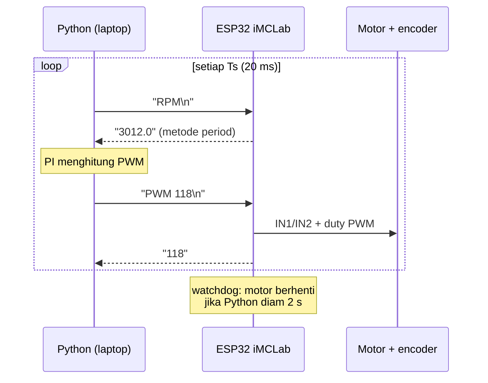
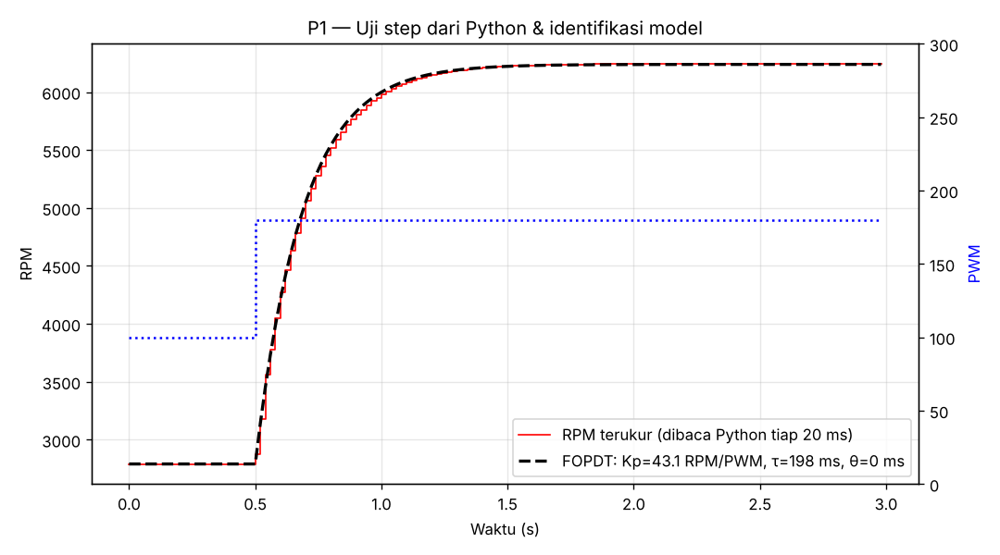
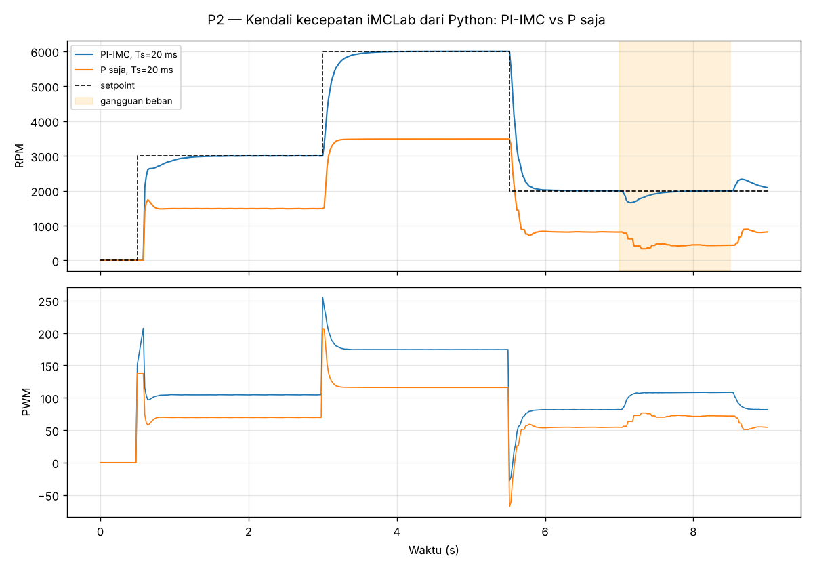
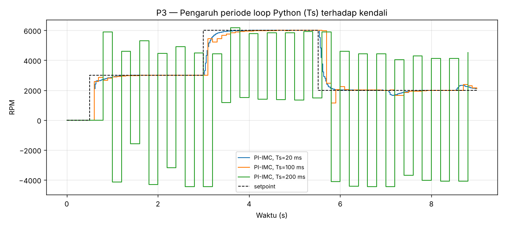
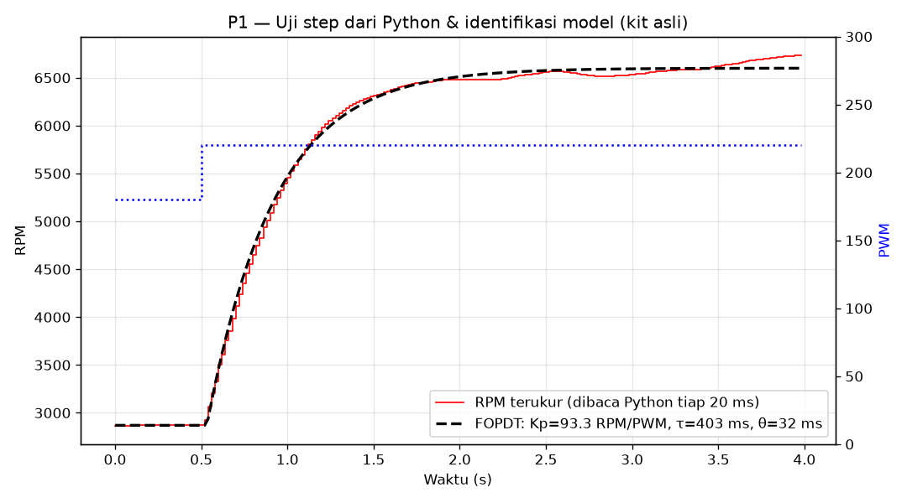
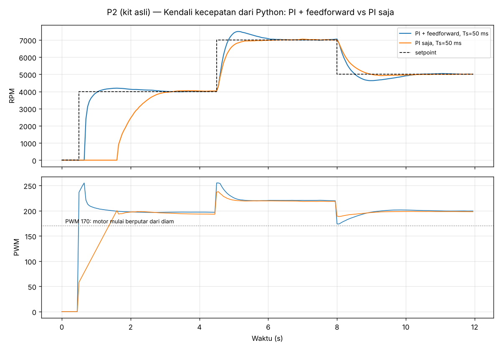
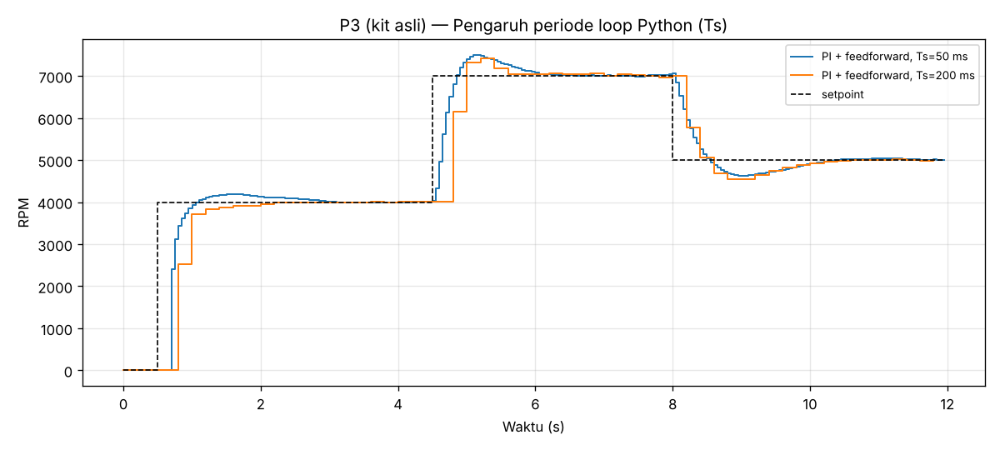

# Laporan Riset Modul 2 — Pemrograman Robotika Kit iMCLab menggunakan Python

| | |
|---|---|
| **Nama / NPM** | Kelvin Sitorus / 24081010341 |
| **Mata kuliah** | Robotika — Prof. Basuki Rahmat |
| **Status** | ✅ Program & analisis selesai · ✅ Uji di kit fisik (P1 identifikasi, P2 PI + feedforward, P3 periode loop; 27 Oktober 2026) |

## Abstrak
**Ringkasan hasil di kit asli (27 Oktober 2026):** uji step PWM 180→220 dari Python memberi model **Kp = 93,3 RPM/PWM, τ = 0,40 s, θ = 0,03 s** (RMSE 51 RPM), jauh berbeda dari asumsi simulasi (Kp 43, τ 0,2 s). Kendali PI hasil aturan SIMC dari model itu menjalankan loop 50 ms stabil (rata-rata 50 ms, maksimum 51 ms) dan mencapai 4.000, 7.000 dan 5.000 RPM dengan error akhir ≤ 22 RPM (< 0,5 %). Temuan utamanya: **PI tanpa feedforward baru membuat motor berputar 1,65 s setelah perintah** (integrator harus naik dulu sampai melewati dead-zone PWM ≈ 170), sedangkan **PI + feedforward dari kurva statis modul 1 memulai putaran pada 0,70 s**. Detail ada di bagian 5. Bagian 4 (simulasi) adalah rancangan awal sebelum kit dipakai.

Pada modul ini ESP32 hanya berperan sebagai antarmuka sensor–aktuator, sedangkan "otak" kendali dipindah ke **Python di laptop** lewat komunikasi serial. Firmware perintah teks dibuat **kompatibel dengan protokol program dosen** (`1`, `0`, `+`, `-`, `PWM:xxx`, `R`), ditambah perintah untuk eksperimen (`PWM <n>`, `RPM`, `VER`, `X`). Class Python `iMCLab` dibuat dengan antarmuka yang identik dengan simulator, sehingga program yang sama bisa dijalankan pada simulasi maupun kit. (P1) Uji step dari Python menghasilkan model orde-1 **Kp = 43,1 RPM/PWM, τ = 198 ms**, dengan waktu tunda praktis nol berkat pengukuran RPM metode period. Hasil ini konsisten dengan karakterisasi modul 1. (P2) PI yang ditala dengan aturan IMC dari model tersebut mencapai setpoint tanpa overshoot berarti (≤ 0,1 %), settling 0,32–0,56 s, error akhir 0 RPM, dan pulih dari gangguan beban. Kendali P saja menyisakan error 1.183 RPM, sesuai perhitungan teori yang menyertakan dead-zone. (P3) Memperlambat loop Python dari 20 ms ke 200 ms membuat sistem **tidak stabil** (berosilasi hingga motor berbalik arah), karena periode sampling menyamai konstanta waktu motor.

## 1. Latar Belakang
Python memudahkan eksperimen: grafik, optimasi, machine learning, dan logging data tersedia lengkap. Pertanyaannya: apakah kendali motor yang cepat (τ ≈ 0,2 s, modul 1) masih bisa dijalankan dari laptop lewat kabel USB-serial, dan apa batasannya?

## 2. Tujuan & Pertanyaan Riset
1. Membangun protokol serial ESP32 ↔ Python untuk iMCLab.
2. Mengidentifikasi model dinamis motor dari Python (P1).
3. Merancang dan menguji PI berbasis model (P2).
4. Menentukan seberapa cepat loop Python harus berjalan agar kendali stabil (P3).

## 3. Arsitektur


| File | Isi |
|---|---|
| [`imclab_firmware/imclab_firmware.ino`](imclab_firmware/imclab_firmware.ino) | Firmware serial: perintah dosen (`1`, `0`, `+`, `-`, `PWM:xxx`, `R`) + `PWM <n>`, `RPM` (metode period), `CNT`, `VER`, `X` + **watchdog 2 s** |
| [`imclab.py`](imclab.py) | Class Python untuk kit asli (pyserial, deteksi port CP210x otomatis, abaikan port Bluetooth seperti notebook dosen) |
| [`imclab_sim.py`](imclab_sim.py) | Simulator motor DC + encoder dengan antarmuka yang sama |
| [`step_test_imclab.py`](step_test_imclab.py) | P1: uji step + identifikasi FOPDT |
| [`pid_python_imclab.py`](pid_python_imclab.py) | P2 & P3: PI di Python, variasi periode loop |
| [`live_plot_imclab.py`](live_plot_imclab.py) | Grafik real-time + ubah setpoint dengan panah keyboard |

```bash
pip install pyserial numpy scipy matplotlib
python step_test_imclab.py --port COM5      # kit asli (atau --sim)
python pid_python_imclab.py --port COM5
python live_plot_imclab.py --port COM5
```

## 4. Hasil & Analisis — Simulasi (rancangan awal, parameter asumsi)

### P1 — Identifikasi model dari Python


Step dilakukan dari PWM 100 → 180 (di daerah linear) agar dead-zone tidak terbaca sebagai waktu tunda.

| Parameter | Hasil P1 | Pembanding modul 1 |
|---|---|---|
| Gain Kp | 43,09 RPM/PWM | kemiringan E2: 43,1 |
| Konstanta waktu τ | 198 ms | E3: 200 ms |
| Waktu tunda θ | ≈ 0 ms | metode period hanya tertunda ±½–1 putaran (±5–21 ms pada 2.800–6.200 RPM), jauh lebih kecil dari τ |
| RMSE | 16,8 RPM | — |

**Analisis:** tiga cara berbeda (kurva statis, respons step di ESP32, dan uji step dari Python) memberi angka yang konsisten. Waktu tunda pada model sebenarnya berasal dari **cara mengukur**, bukan dari motor. Pada versi awal laporan (jendela hitung 50 ms dengan asumsi 20 lubang) muncul θ = 24 ms. Dengan metode period, θ praktis hilang, sehingga PI bisa ditala lebih agresif.

### P2 — PI dari Python vs P saja
Aturan IMC (versi SIMC, Skogestad 2003): $K_c = \frac{\tau}{K_p(\tau_c+\theta)}$ = **0,0460 PWM/RPM**, $\tau_I = \tau$ = **0,198 s**, dengan $\tau_c$ = 0,1 s.



| Kasus | Overshoot 0→3000 | Settling ±3 % | Overshoot 3000→6000 | Settling | Error di 2000 RPM | Turun saat beban |
|---|---|---|---|---|---|---|
| **PI-IMC, Ts 20 ms** | 0,1 % | 0,56 s | 0,1 % | 0,32 s | **0 RPM** | 342 RPM, lalu pulih |
| P saja, Ts 20 ms | 0 % | tidak tercapai | 0 % | tidak tercapai | **1.183 RPM** | 1.666 RPM, tidak pulih |

**Analisis:**
- **Error P saja bisa dihitung.** Dengan model statis modul 1, RPM = 43,1·PWM − 1513, dan PWM = Kc·(SP − RPM), dengan Kc·43,1 = 1,98. Untuk SP = 2000: RPM = (1,98·2000 − 1513)/2,98 ≈ 822, sehingga error ≈ **1.178 RPM**, hampir sama dengan hasil simulasi (1.183). Error ini besar karena dead-zone ikut "memakan" sinyal kendali. Aksi integral menghapus error ini.
- Saat setpoint turun 6000 → 2000, PWM sempat **negatif** (sekitar −28): PI membalik arah motor sebentar untuk mengerem aktif. Ini wajar, tetapi pada mekanik bergigi bisa dibatasi (PWM min = 0, seperti di firmware Blynk modul 3).
- Gangguan beban (t = 7–8,5 s) menurunkan kecepatan 342 RPM. PI menaikkan PWM dari ±82 ke ±108 dan kecepatan kembali ke 2000 RPM. Kenaikan PWM ini sekaligus menjadi "sensor beban" gratis.

### P3 — Seberapa cepat loop Python harus berjalan?


| Periode loop Ts | Ts / τ | Hasil |
|---|---|---|
| 20 ms | 0,10 | stabil, settling 0,32–0,56 s |
| 100 ms | 0,51 | stabil, settling 0,6 s |
| 200 ms | 1,01 | **tidak stabil**: overshoot 96 %, berosilasi hingga motor berbalik arah |

**Analisis:** parameter PI sama di ketiga kasus, hanya periode loop yang berubah. Ketika Ts mendekati τ motor, aksi kendali yang "ditahan" selama 200 ms menjadi terlalu besar dan terlambat (efek *zero-order hold* + delay). Akibatnya sistem berayun. Aturan praktis: **Ts ≤ τ/4**. Bagi Python di Windows, ini berarti loop harus konsisten < 50 ms. Program memakai penjadwalan berbasis `time.time()` (bukan `sleep` tetap) agar jitter tidak menumpuk.

## 5. Hasil di Kit Asli (27 Oktober 2026)
Semua perintah dikirim dari Python ke ESP32 lewat COM9 (firmware `imclab_firmware.ino`, 115200 baud). Data mentah: [`step_test_data_kit.csv`](step_test_data_kit.csv) dan [`pid_kit_data.csv`](pid_kit_data.csv). Video: [`uji_step_python_kit.mp4`](video/uji_step_python_kit.mp4), [`kendali_pi_python_kit_1.mp4`](video/kendali_pi_python_kit_1.mp4), [`kendali_pi_python_kit_2.mp4`](video/kendali_pi_python_kit_2.mp4).

Penyesuaian dari simulasi ke kit, berdasarkan temuan modul 1:
- Step diberikan dari **PWM 180 → 220**, bukan dari 0, supaya dead-zone (motor baru berputar di PWM ±170) tidak terbaca sebagai waktu tunda.
- Output PI dibatasi **0–255**. Encoder 1 kanal tidak bisa membaca arah putar, jadi motor tidak pernah diperintah mundur.
- Ditambahkan **feedforward** dari kurva statis modul 1 (PWM yang dibutuhkan untuk RPM target). Dibandingkan dengan PI tanpa feedforward.

### P1 (kit) — Identifikasi model


| Parameter | Kit asli | Simulasi (asumsi) | Modul 1 (E2/E3, kit) |
|---|---|---|---|
| Gain Kp | **93,3 RPM/PWM** | 43,1 | ±140 (PWM 170–230) |
| Konstanta waktu τ | **0,40 s** | 0,198 s | 0,59–0,64 s (step dari 0) |
| Waktu tunda θ | **0,03 s** | ≈ 0 | ±0,1 s (dari diam) |
| RMSE model | 51 RPM | 16,8 RPM | 15 RPM |

**Analisis:**
1. Model orde-1 menempel baik pada data (garis hitam putus-putus mengikuti kurva merah), tetapi RMSE 51 RPM lebih besar daripada simulasi karena RPM masih **naik pelan di akhir rekaman** (6.500 → 6.725 RPM pada detik 3–4). Motor belum benar-benar tunak, kemungkinan karena panas motor atau tegangan catu bergeser.
2. τ (0,40 s) lebih kecil daripada hasil modul 1 (0,6 s) dan θ lebih kecil (0,03 s vs 0,1 s). Alasannya, di sini motor **sudah berputar** (±2.870 RPM pada PWM 180) saat step diberikan, sehingga gesekan statis tidak ikut terukur. Di modul 1 step dimulai dari diam. Parameter plant jadi bergantung pada titik kerja dan riwayat putaran.
3. **Kecepatan pada PWM yang sama berbeda antar sesi.** Pada PWM 220, modul 1 (23 Oktober) memberi ±9.660 RPM dan sesi ini ±6.600 RPM. Kemungkinan penyebabnya adalah tegangan catu motor atau suhu motor. Ini dicatat sebagai keterbatasan: model kit sebaiknya diidentifikasi ulang tiap sesi, atau kendali memakai umpan balik yang kuat seperti PI.

### P2 (kit) — PI + feedforward vs PI saja
Aturan SIMC: $K_c = \frac{\tau}{K_p(\tau_c+\theta)}$ dengan τ_c = 0,3 s (dibuat longgar karena gain plant berubah-ubah) → **Kc = 0,01298 PWM/RPM, τI = 0,403 s**. Skenario 12 s: setpoint 0 → 4.000 (0,5 s) → 7.000 (4,5 s) → 5.000 (8 s).



| Kasus | Overshoot →4000 | Settling ±5 % | Overshoot →7000 | Settling | Undershoot →5000 | Settling | Error 1 s terakhir (3 setpoint) |
|---|---|---|---|---|---|---|---|
| **PI + feedforward, Ts 50 ms** | 4,8 % | **0,45 s** | 16,4 % | 0,95 s | 18,4 % | 1,55 s | 6 / 15 / 22 RPM |
| PI saja, Ts 50 ms | 1,2 % | **2,25 s** | 1,7 % | 0,50 s | 3,6 % | 0,70 s | 34 / 19 / 5 RPM |

**Analisis:**
1. **Dead-zone terlihat jelas pada PI saja.** Setelah setpoint 4.000 diberikan pada t = 0,5 s, motor baru mulai berputar pada **t = 1,65 s**. Selama 1,1 s itu integrator menaikkan PWM pelan-pelan dari 0 sampai melewati ±170 (grafik bawah). Dengan feedforward, PWM langsung melompat ke ±237 dan motor berputar pada t = 0,70 s, yaitu **±1 s lebih cepat**. Ini membuktikan temuan modul 1 (dead-zone PWM ±170) berguna untuk merancang kendali.
2. **Harga feedforward: overshoot.** Feedforward memakai kurva statis modul 1, padahal kecepatan per PWM pada sesi ini lebih rendah (PWM 206 dari kurva ternyata menghasilkan kurang dari 7.000 RPM; PWM yang dibutuhkan sebenarnya ±220). Feedforward yang terlalu "optimis" membuat overshoot 16–18 % pada setpoint besar, lalu PI mengoreksinya. PI saja tidak punya masalah ini, tetapi lambat saat mulai dari diam.
3. **PI menutup selisih model.** Pada 7.000 RPM, PWM akhir ±220, sedangkan feedforward menyarankan 206. Selisihnya dikerjakan integrator. Error akhir semua setpoint ≤ 22 RPM (< 0,5 %), tanpa osilasi berkelanjutan.
4. **Gain plant tidak konstan.** Setpoint 4.000 dicapai di PWM ±195, dan 5.000 di PWM ±198 (selisih beberapa PWM menghasilkan ±1.000 RPM), jadi penguatan lokal di daerah ini ±250–300 RPM/PWM, jauh di atas Kp rata-rata 93. Kc yang dihitung dari Kp rata-rata menjadi terlalu agresif di sini, dan inilah penyebab overshoot ke bawah (undershoot) saat setpoint turun 7.000 → 5.000. Solusi lanjutan: *gain scheduling* atau Kc yang lebih kecil.
5. Saat setpoint turun, PI tidak pernah memerintah PWM 0 (PWM turun ke ±175–190), sehingga masalah *coasting* modul 1 tidak muncul. Penurunan 7.000 → 5.000 selesai dalam ±1 s.

### P3 (kit) — Periode loop Python


| Periode loop Ts | Ts / τ | Hasil |
|---|---|---|
| 50 ms | 0,12 | stabil, periode nyata rata-rata 50 ms (maks 51 ms) |
| 200 ms | 0,50 | **tetap stabil**, tetapi respons kasar (bertangga), settling 0,70 / 0,90 / 1,60 s, undershoot 22,6 % (vs 18,4 %) |

**Analisis:** berbeda dengan simulasi (Ts 200 ms tidak stabil karena Ts ≈ τ), di kit τ sekitar 0,4 s sehingga Ts/τ = 0,5 masih di batas aman. Aturan Ts ≤ τ/4 menjaga kualitas respons: pada Ts 200 ms undershoot lebih besar dan kurva tampak bertangga. Ts = 1,0 × τ (≈ 400 ms) belum diuji di kit. Python di Windows menjaga periode 50 ms dengan sangat konsisten (jitter ≤ 1 ms) berkat penjadwalan berbasis `time.time()`.

## 6. Kesimpulan
1. Python dapat mengendalikan iMCLab secara real-time lewat serial dengan protokol teks sederhana, dan terbukti berjalan di kit asli (loop 50 ms, jitter ≤ 1 ms). Antarmuka yang sama untuk kit dan simulator mempercepat eksperimen.
2. **Di kit asli:** model kecepatan Kp = 93,3 RPM/PWM, τ = 0,40 s, θ = 0,03 s (step PWM 180 → 220). Parameter ini bergantung pada titik kerja dan riwayat putaran, dan berbeda dari asumsi simulasi (Kp 43, τ 0,2 s).
3. **Di kit asli:** PI + feedforward dari kurva statis modul 1 memulai putaran ±1 s lebih cepat daripada PI saja (0,70 s vs 1,65 s), dengan harga overshoot 16–18 % pada setpoint besar. Semua setpoint tercapai dengan error akhir ≤ 22 RPM. Umpan balik integral wajib karena gain plant berubah menurut titik kerja dan sesi.
4. **Di kit asli:** loop Python 200 ms masih stabil (Ts/τ = 0,5), tetapi responsnya lebih kasar. Tingkat ketidakstabilan pada Ts ≈ τ yang terlihat di simulasi belum diuji di kit.
5. (Simulasi awal) PI-IMC tanpa dead-zone nyata mencapai setpoint tanpa overshoot, dan Ts 200 ms membuat sistem tidak stabil karena Ts ≈ τ simulasi. Karena itu loop kendali sebaiknya dipindah ke ESP32 saat sistem dibuat online (modul 3).

## 7. Keterbatasan
- Bagian 4 (simulasi) memakai parameter motor asumsi dan tidak sesuai kit (Kp 43 vs 93, τ 0,2 vs 0,4 s). Hasil yang berlaku untuk kit ada di bagian 5.
- Setiap percobaan di kit baru dijalankan **satu kali**. Kecepatan pada PWM yang sama berbeda antara modul 1 dan modul 2 (PWM 220: 9.660 vs ±6.600 RPM), jadi angka absolut perlu dibaca sebagai gambaran, bukan nilai tetap.
- Uji gangguan beban belum dilakukan di kit (tidak ada mekanisme beban terkontrol).
- Ts 100 ms dan Ts 400 ms belum diuji di kit.
- Latensi USB-serial nyata sudah terukur lewat periode loop (≤ 1 ms jitter pada 50 ms), tetapi tidak dipisahkan dari waktu eksekusi Python.
- Watchdog firmware 2 s mencegah motor berputar terus jika program Python crash. Fitur ini juga sempat menyebabkan percobaan pertama gagal (motor berhenti saat fase stabilisasi tanpa perintah), dan sudah diperbaiki dengan mengirim ulang PWM tiap siklus.

## Referensi
- Rahmat, B. iMCLab. https://github.com/bsrahmat/imclab
- Rahmat, B. Program kelas `imclab_naik_turun.ino` & `Tes_IMCLab_naik_turun.ipynb` (`UTS/referensi_dosen`).
- Rahmat, B. & Muljono. *Pemrograman IoT dengan Arduino dan Python*, Jilid 1 (Bab 3 & 5: pemrograman kit dengan Python, PID).
- Skogestad, S. (2003). Simple analytic rules for model reduction and PID controller tuning. *Journal of Process Control*, 13(4), 291–309. (aturan SIMC/IMC untuk FOPDT)
