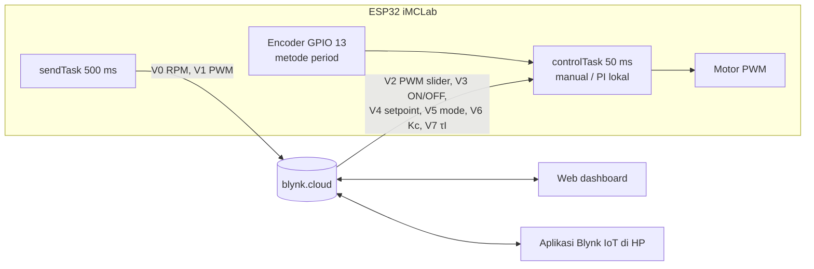
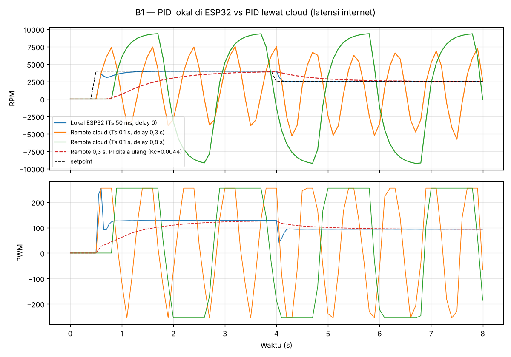
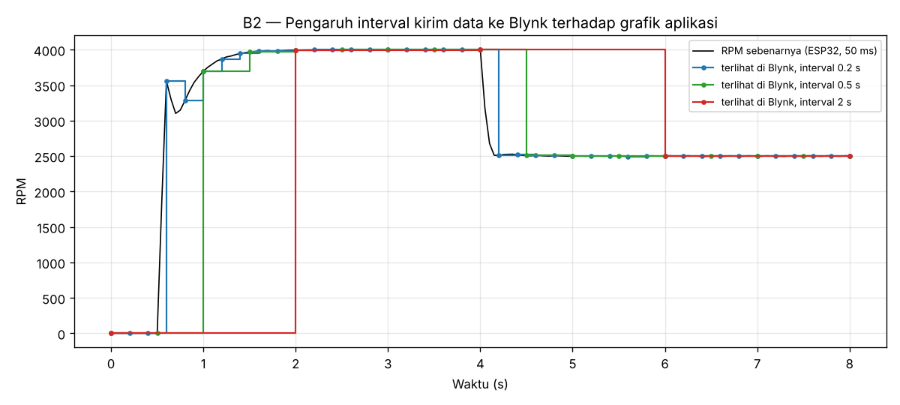

# Laporan Riset Modul 3 — Pemrograman iMCLab Berbasis Blynk

| | |
|---|---|
| **Nama / NPM** | Kelvin Sitorus / 24081010341 |
| **Mata kuliah** | Robotika — Prof. Basuki Rahmat |
| **Status** | ✅ Firmware, rancangan dashboard & analisis selesai (simulasi) · ⬜ Uji dengan akun Blynk + kit |

## Abstrak
Modul ini mengembangkan program Blynk dari kelas (`imclab_Blynk_kelas.ino`: monitoring RPM + slider PWM + tombol ON/OFF di V0–V3) dengan menambahkan **mode kendali kecepatan otomatis (PI)**. Firmware dirancang dengan prinsip **"kendali lokal, pemantauan di cloud"**: PI berjalan di ESP32 tiap 50 ms, sedangkan Blynk hanya menerima setpoint/parameter dan menampilkan data tiap 500 ms. Prinsip ini diuji dengan simulasi (B1). Jika PI yang sama dijalankan lewat cloud dengan latensi pulang-pergi 0,3 s, sistem berosilasi hingga motor berbalik arah, dan IAE naik dari 497 menjadi 27.269 RPM·s (55×). Menala ulang PI agar stabil dengan latensi tersebut membuat respons ±5× lebih lambat (2,3 s vs 0,45 s untuk mencapai 90 % setpoint). Analisis interval kirim (B2) menunjukkan interval 0,5 s (4 nilai/detik) cukup untuk tren di aplikasi tanpa membanjiri server, meskipun transien < 0,5 s tidak terlihat di grafik Blynk.

## 1. Latar Belakang
Blynk menyediakan server cloud, dashboard web, dan aplikasi HP siap pakai. Komunikasinya memakai **virtual pin** (V0, V1, …): perangkat menulis nilai dengan `Blynk.virtualWrite()`, dan perubahan dari aplikasi diterima lewat `BLYNK_WRITE(Vx)`. Karena data melewati internet, ada keterlambatan yang tidak bisa dikendalikan, dan ini menjadi pertanyaan riset utama modul ini.

## 2. Tujuan & Pertanyaan Riset
1. Mengembangkan firmware Blynk dari kelas menjadi sistem kendali kecepatan (pemantauan RPM/PWM, mode manual seperti program dosen, plus mode PI dengan setpoint dan parameter yang bisa diatur dari aplikasi).
2. **Di mana loop PID sebaiknya berjalan: di ESP32 atau lewat cloud?** (B1)
3. Seberapa sering data perlu dikirim ke Blynk? (B2)

## 3. Arsitektur & Rancangan

**Datastream** ([`blynk_datastreams.csv`](blynk_datastreams.csv)). V0–V3 **sama dengan template kelas "IMCLab Test"**, jadi dashboard kelas tetap bisa dipakai:

| Pin | Nama | Arah | Widget | Asal |
|---|---|---|---|---|
| V0 | RPM | ESP32 → app | Gauge + SuperChart | program dosen |
| V1 | PWM | ESP32 → app | Label + Chart | program dosen |
| V2 | PWM slider (0–255) | app → ESP32 | Slider | program dosen (mode manual) |
| V3 | Motor ON/OFF | app → ESP32 | Switch | program dosen |
| V4 | SetPoint (0–9000 RPM) | app → ESP32 | Slider | tambahan |
| V5 | Mode (0 manual / 1 PI) | app → ESP32 | Switch | tambahan |
| V6, V7 | Kc, τI | app → ESP32 | Numeric Input | tambahan |
| V8 | Status | ESP32 → app | Label | tambahan |

**Perbedaan dengan program kelas:**
- RPM diukur dengan **metode period** (waktu 1 putaran, diperbarui tiap 50 ms), bukan hitung pulsa per 1 s. Dengan piringan 2 lubang, cara per 1 s terlalu lambat untuk kendali (lihat modul 1, E4).
- Program kelas memanggil `Blynk.virtualWrite` di setiap perubahan PWM. Di sini pengiriman ke cloud dipusatkan di `sendTask` tiap 500 ms, supaya tidak terjadi *flood*.

**Langkah setup Blynk:**
1. Daftar di blynk.cloud → *Developer Zone* → **New Template** (Hardware: ESP32, Connection: WiFi), nama `IMCLab Test`. Bisa juga melanjutkan template kelas kalau diberi akses.
2. Tambahkan datastream V0–V8 sesuai tabel, lalu susun widget di *Web Dashboard* dan *Mobile Dashboard*.
3. **Devices → New Device → From template** untuk mendapatkan `BLYNK_TEMPLATE_ID`, `BLYNK_TEMPLATE_NAME`, `BLYNK_AUTH_TOKEN`.
4. Arduino IDE: pasang library **Blynk** (Volodymyr Shymanskyy), isi token + WiFi di [`iMCLab_Blynk.ino`](iMCLab_Blynk/iMCLab_Blynk.ino), lalu upload.

**Keputusan desain di firmware:**
- `BlynkTimer` menjalankan PI tiap 50 ms dan pengiriman data tiap 500 ms. `loop()` hanya berisi `Blynk.run()` dan `timer.run()`, karena `virtualWrite` di `loop()` akan membanjiri server.
- `BLYNK_CONNECTED()` memanggil `Blynk.syncVirtual(...)`, sehingga setelah listrik/WiFi putus, ESP32 mengambil kembali setpoint & parameter terakhir dari server.
- Jika internet putus, **motor tetap terkendali** dengan setpoint terakhir, karena PI tidak bergantung pada cloud.

## 4. Metode Analisis
[`analisis_blynk.py`](analisis_blynk.py) memakai simulator motor (modul 2, encoder 2 lubang metode period) dan parameter PI hasil modul 2 ($K_c$ = 0,0460, $\tau_I$ = 0,198 s). Setpoint: 0 → 4000 RPM (t = 0,5 s) → 2500 RPM (t = 4 s).
- **B1:** latensi internet ditiru sebagai waktu tunda pulang-pergi (setengah di jalur data sensor, setengah di jalur perintah).
- **B2:** sinyal 50 ms di-*sampling* ulang sesuai interval kirim ke Blynk.

## 5. Hasil & Analisis

### B1 — PID lokal vs PID lewat cloud

| Konfigurasi | IAE (RPM·s) | Capai 90 % | Ayunan di SP 4000 | PWM min/maks |
|---|---|---|---|---|
| **Lokal ESP32 (Ts 50 ms)** | **497** | 0,45 s | 0 RPM | 0 / 255 |
| Cloud, latensi 0,3 s | 27.269 | (berosilasi) | 11.343 RPM | −255 / 255 |
| Cloud, latensi 0,8 s | 47.376 | (berosilasi) | 18.527 RPM | −255 / 255 |
| Cloud 0,3 s, PI ditala ulang (Kc 0,0044) | 5.956 | 2,30 s | (masih naik) | 0 / 126 |

**Analisis:**
- Latensi adalah **waktu tunda** di dalam loop. Waktu tunda 0,3 s sudah lebih besar dari τ motor (0,2 s), sehingga PI yang stabil di ESP32 menjadi **tidak stabil** lewat cloud: motor berayun maju–mundur penuh (PWM ±255). Pada robot sungguhan, ini berbahaya.
- PI bisa dibuat stabil lagi dengan menurunkan $K_c$ ±10× (IMC dengan delay total 0,35 s). Harganya, respons jadi ±5× lebih lambat dan IAE tetap 12× lebih buruk dari kendali lokal. Selain itu, latensi internet tidak tetap (bisa melonjak kapan saja), jadi kestabilannya tidak terjamin.
- **Kesimpulan desain:** cloud cocok untuk *supervisory control* (setpoint, mode, parameter, monitoring), bukan untuk loop kendali cepat. Inilah alasan firmware menaruh PI di ESP32.

### B2 — Interval kirim ke Blynk

| Interval kirim | Nilai/detik (V1+V2) | Nilai/jam | Yang terlihat di aplikasi |
|---|---|---|---|
| 0,2 s | 10 | 36.000 | transien terlihat cukup jelas |
| **0,5 s (dipakai)** | 4 | 14.400 | tren jelas, transien < 0,5 s hilang |
| 2 s | 1 | 3.600 | hanya nilai tunak, lonjakan tidak terlihat |

**Analisis:** grafik di aplikasi Blynk **bukan rekaman lengkap**. Pada interval 0,5 s, kenaikan 0 → 4000 RPM yang terjadi dalam ±0,3 s hanya tampak sebagai 1–2 titik. Untuk analisis transien gunakan log Serial/Python (modul 2). Blynk dipakai untuk pemantauan tren. Interval 0,5 s dipilih sebagai kompromi antara informasi dan beban pesan, karena Blynk menyarankan agar data tidak dikirim terlalu sering.

## 6. Kesimpulan
1. Program Blynk kelas dikembangkan menjadi 9 virtual pin. V0–V3 tetap kompatibel dengan template kelas, ditambah setpoint, mode, Kc, τI, dan status, serta sinkronisasi otomatis saat reconnect.
2. Loop kendali **harus berjalan lokal** di ESP32. Simulasi menunjukkan latensi cloud 0,3 s sudah membuat PI tidak stabil (IAE 55× lebih buruk).
3. Interval kirim 0,5 s (4 nilai/detik) cukup untuk pemantauan tren. Detail transien diambil dari log lokal.

## 7. Keterbatasan & Rencana Uji Kit
- Belum diuji dengan akun Blynk dan kit fisik. Saat praktikum: screenshot dashboard web & HP disimpan di `img/`, serta ukur latensi nyata (ubah setpoint di HP, catat waktu perubahan di Serial Monitor).
- Latensi pada simulasi B1 adalah nilai uji (0,3 s & 0,8 s), bukan hasil ukur jaringan kampus.
- Firmware sudah lolos pemeriksaan sintaks (header tiruan Blynk). Kompilasi penuh perlu library Blynk di Arduino IDE.

## Referensi
- Blynk IoT Documentation — Virtual Pins, BlynkTimer, `BLYNK_CONNECTED`, `syncVirtual`. https://docs.blynk.io
- Rahmat, B. *Integrasi AI dan IoT pada Sistem Kendali Cerdas* (Blynk sebagai IoT cloud untuk iTCLab/iMCLab).
- Rahmat, B. iMCLab. https://github.com/bsrahmat/imclab
- Rahmat, B. Program kelas `imclab_Blynk_kelas.ino` (`UTS/referensi_dosen`).
