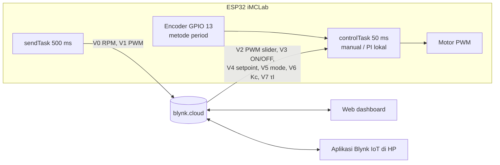
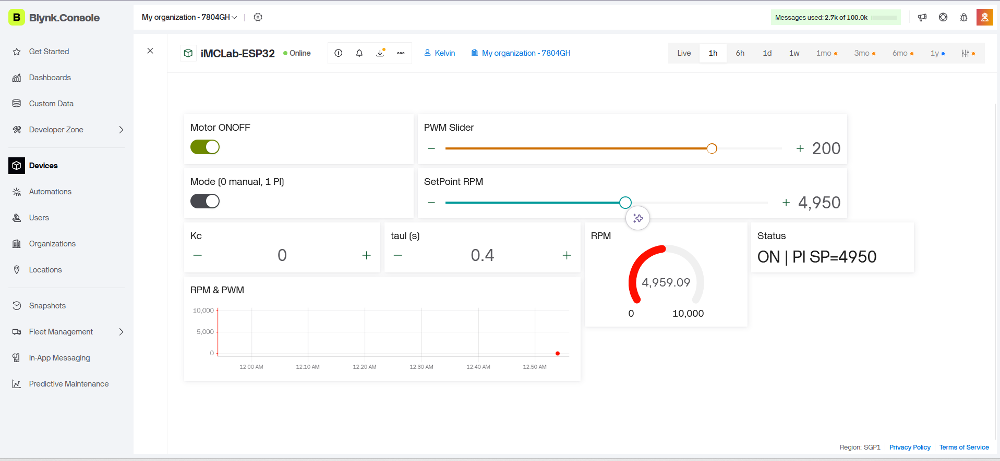
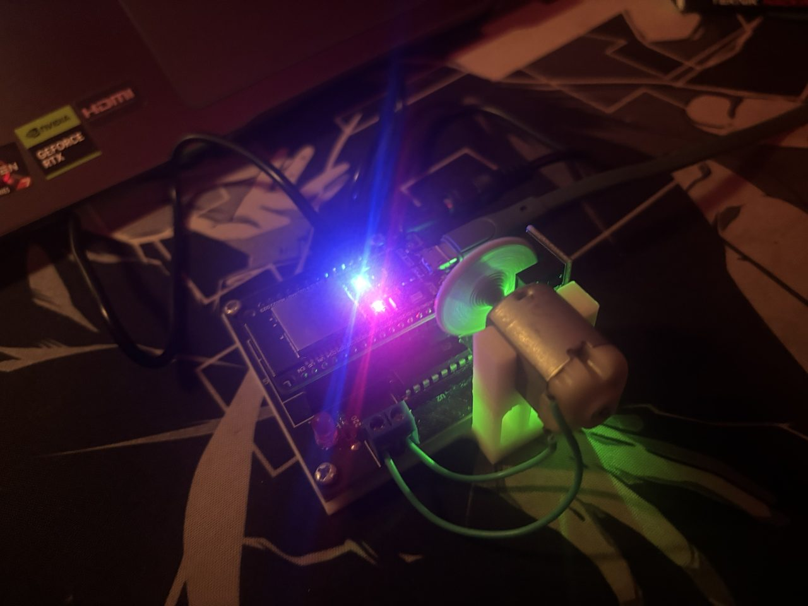
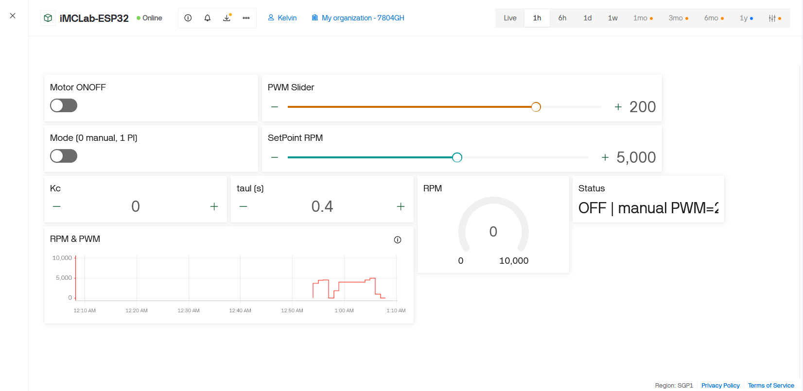

# Laporan Riset Modul 3 — Pemrograman iMCLab Berbasis Blynk

| | |
|---|---|
| **Nama / NPM** | Kelvin Sitorus / 24081010341 |
| **Mata kuliah** | Robotika — Prof. Basuki Rahmat |
| **Status** | ✅ Firmware, template Blynk, dashboard web, dan uji di kit asli (mode manual + PI via Blynk, 28 Okt 2026) · ✅ Analisis B1/B2 (simulasi) · ⬜ Uji internet putus, ukur latensi, dashboard HP |

## Abstrak
Modul ini mengembangkan program Blynk dari kelas (`imclab_Blynk_kelas.ino`: monitoring RPM + slider PWM + tombol ON/OFF di V0–V3) dengan menambahkan **mode kendali kecepatan otomatis (PI)**. Firmware dirancang dengan prinsip **"kendali lokal, pemantauan di cloud"**: PI berjalan di ESP32 tiap 50 ms, sedangkan Blynk hanya menerima setpoint/parameter dan menampilkan data tiap 500 ms. Prinsip ini dianalisis dengan simulasi (B1; parameter motor simulasi masih asumsi). Firmware kemudian diuji di **kit asli**: perangkat tersambung ke Blynk (ping 288 ms lewat hotspot HP), dashboard web 9 widget berfungsi, dan pada mode PI nilai RPM di dashboard bertahan 2–17 RPM (≤ 0,33 %) dari setpoint 4950 dan 5250 RPM (bagian 5.3). Pada simulasi B1, jika PI yang sama dijalankan lewat cloud dengan latensi pulang-pergi 0,3 s, sistem berosilasi hingga motor berbalik arah, dan IAE naik dari 497 menjadi 27.269 RPM·s (55×). Menala ulang PI agar stabil dengan latensi tersebut membuat respons ±5× lebih lambat (2,3 s vs 0,45 s untuk mencapai 90 % setpoint). Analisis interval kirim (B2) menunjukkan interval 0,5 s (4 nilai/detik) cukup untuk tren di aplikasi tanpa membanjiri server, meskipun transien < 0,5 s tidak terlihat di grafik Blynk.

## 1. Latar Belakang
Blynk menyediakan server cloud, dashboard web, dan aplikasi HP siap pakai. Komunikasinya memakai **virtual pin** (V0, V1, …): perangkat menulis nilai dengan `Blynk.virtualWrite()`, dan perubahan dari aplikasi diterima lewat `BLYNK_WRITE(Vx)`. Karena data melewati internet, ada keterlambatan yang tidak bisa dikendalikan, dan ini menjadi pertanyaan riset utama modul ini.

## 2. Tujuan & Pertanyaan Riset
1. Mengembangkan firmware Blynk dari kelas menjadi sistem kendali kecepatan (pemantauan RPM/PWM, mode manual seperti program dosen, plus mode PI dengan setpoint dan parameter yang bisa diatur dari aplikasi).
2. **Di mana loop PID sebaiknya berjalan: di ESP32 atau lewat cloud?** (B1)
3. Seberapa sering data perlu dikirim ke Blynk? (B2)

## 3. Arsitektur & Rancangan

**Datastream** ([`blynk_datastreams.csv`](blynk_datastreams.csv)). V0–V3 **sama dengan template kelas "IMCLab Test"**, jadi dashboard kelas tetap bisa dipakai:

| Pin | Nama | Arah | Widget | Asal |
|---|---|---|---|---|
| V0 | RPM | ESP32 → app | Gauge + SuperChart | program dosen |
| V1 | PWM | ESP32 → app | Label + Chart | program dosen |
| V2 | PWM slider (0–255) | app → ESP32 | Slider | program dosen (mode manual) |
| V3 | Motor ON/OFF | app → ESP32 | Switch | program dosen |
| V4 | SetPoint (0–9000 RPM) | app → ESP32 | Slider | tambahan |
| V5 | Mode (0 manual / 1 PI) | app → ESP32 | Switch | tambahan |
| V6, V7 | Kc, τI | app → ESP32 | Numeric Input | tambahan |
| V8 | Status | ESP32 → app | Label | tambahan |

**Perbedaan dengan program kelas:**
- RPM diukur dengan **metode period** (waktu 1 putaran, diperbarui tiap 50 ms), bukan hitung pulsa per 1 s. Dengan piringan 2 lubang, cara per 1 s terlalu lambat untuk kendali (lihat modul 1, E4).
- Program kelas memanggil `Blynk.virtualWrite` di setiap perubahan PWM. Di sini pengiriman ke cloud dipusatkan di `sendTask` tiap 500 ms, supaya tidak terjadi *flood*.

**Langkah setup Blynk:**
1. Daftar di blynk.cloud → *Developer Zone* → **New Template** (Hardware: ESP32, Connection: WiFi), nama `IMCLab Test`. Bisa juga melanjutkan template kelas kalau diberi akses.
2. Tambahkan datastream V0–V8 sesuai tabel, lalu susun widget di *Web Dashboard* dan *Mobile Dashboard*.
3. **Devices → New Device → From template** untuk mendapatkan `BLYNK_TEMPLATE_ID`, `BLYNK_TEMPLATE_NAME`, `BLYNK_AUTH_TOKEN`.
4. Arduino IDE: pasang library **Blynk** (di Library Manager tertulis "Blynk by Blynk", sebelumnya Volodymyr Shymanskyy; diuji versi 1.4.0), isi token + WiFi di [`iMCLab_Blynk.ino`](iMCLab_Blynk/iMCLab_Blynk.ino), lalu upload.
5. ESP32 hanya mendukung WiFi **2,4 GHz**. Hotspot HP bisa dipakai (iPhone: nyalakan *Maksimalkan Kompatibilitas* dan biarkan layar Hotspot Pribadi terbuka saat menyambung). Laptop tidak perlu satu jaringan dengan ESP32, karena dashboard diakses lewat internet.
6. Token dan password WiFi hanya diisi di salinan sketch **di luar repositori**. File di repositori ini sengaja memakai placeholder.

**Keputusan desain di firmware:**
- `BlynkTimer` menjalankan PI tiap 50 ms dan pengiriman data tiap 500 ms. `loop()` hanya berisi `Blynk.run()` dan `timer.run()`, karena `virtualWrite` di `loop()` akan membanjiri server.
- `BLYNK_CONNECTED()` memanggil `Blynk.syncVirtual(...)`, sehingga setelah listrik/WiFi putus, ESP32 mengambil kembali setpoint & parameter terakhir dari server.
- **Maksud desain:** jika internet putus, PI tetap berjalan dengan setpoint terakhir karena kalkulasinya tidak memanggil cloud. **Hal ini belum diuji di kit.** Ada risiko: saat koneksi putus, `Blynk.run()` mencoba menyambung ulang dan dapat memblokir `loop()` beberapa detik, sehingga `timer.run()` (PI 50 ms) tertunda dan PWM bertahan di nilai terakhir tanpa umpan balik. Perlu diuji (bagian 7) dan, bila terbukti, diperbaiki dengan penyambungan ulang yang tidak memblokir.
- Nilai awal PI memakai hasil identifikasi kit asli di modul 2 (Kc = 0,013 PWM/RPM, τI = 0,40 s). Integrator diisi awal ±170 (batas dead-zone motor dari modul 1) saat motor/mode PI dinyalakan, supaya motor tidak menunggu lama melewati dead-zone.

## 4. Metode Analisis
> **Catatan:** analisis B1/B2 di bagian 5.1–5.2 berasal dari **simulasi** dengan parameter motor asumsi (τ ≈ 0,2 s). Motor kit asli ternyata lebih lambat (τ ≈ 0,40 s, modul 2) dengan Kc PI 0,013, sehingga angka IAE di bawah belum mencerminkan kit. Kesimpulan kualitatifnya (latensi cloud mengganggu loop cepat) tetap berlaku, tetapi angkanya perlu dihitung ulang setelah simulator dikalibrasi ke kit.

[`analisis_blynk.py`](analisis_blynk.py) memakai simulator motor (modul 2, encoder 2 lubang metode period) dan parameter PI dari simulasi ($K_c$ = 0,0460, $\tau_I$ = 0,198 s). Setpoint: 0 → 4000 RPM (t = 0,5 s) → 2500 RPM (t = 4 s).
- **B1:** latensi internet ditiru sebagai waktu tunda pulang-pergi (setengah di jalur data sensor, setengah di jalur perintah).
- **B2:** sinyal 50 ms di-*sampling* ulang sesuai interval kirim ke Blynk.

## 5. Hasil & Analisis

### 5.1 B1 (simulasi) — PID lokal vs PID lewat cloud

| Konfigurasi | IAE (RPM·s) | Capai 90 % | Ayunan di SP 4000 | PWM min/maks |
|---|---|---|---|---|
| **Lokal ESP32 (Ts 50 ms)** | **497** | 0,45 s | 0 RPM | 0 / 255 |
| Cloud, latensi 0,3 s | 27.269 | (berosilasi) | 11.343 RPM | −255 / 255 |
| Cloud, latensi 0,8 s | 47.376 | (berosilasi) | 18.527 RPM | −255 / 255 |
| Cloud 0,3 s, PI ditala ulang (Kc 0,0044) | 5.956 | 2,30 s | (masih naik) | 0 / 126 |

**Analisis:**
- Latensi adalah **waktu tunda** di dalam loop. Waktu tunda 0,3 s sudah lebih besar dari τ motor (0,2 s), sehingga PI yang stabil di ESP32 menjadi **tidak stabil** lewat cloud: motor berayun maju–mundur penuh (PWM ±255). Pada robot sungguhan, ini berbahaya.
- PI bisa dibuat stabil lagi dengan menurunkan $K_c$ ±10× (IMC dengan delay total 0,35 s). Harganya, respons jadi ±5× lebih lambat dan IAE tetap 12× lebih buruk dari kendali lokal. Selain itu, latensi internet tidak tetap (bisa melonjak kapan saja), jadi kestabilannya tidak terjamin.
- **Kesimpulan desain:** cloud cocok untuk *supervisory control* (setpoint, mode, parameter, monitoring), bukan untuk loop kendali cepat. Inilah alasan firmware menaruh PI di ESP32.

### 5.2 B2 (simulasi) — Interval kirim ke Blynk

| Interval kirim | Nilai/detik (V1+V2) | Nilai/jam | Yang terlihat di aplikasi |
|---|---|---|---|
| 0,2 s | 10 | 36.000 | transien terlihat cukup jelas |
| **0,5 s (dipakai)** | 4 | 14.400 | tren jelas, transien < 0,5 s hilang |
| 2 s | 1 | 3.600 | hanya nilai tunak, lonjakan tidak terlihat |

**Analisis:** grafik di aplikasi Blynk **bukan rekaman lengkap**. Pada interval 0,5 s, kenaikan 0 → 4000 RPM yang terjadi dalam ±0,3 s hanya tampak sebagai 1–2 titik. Untuk analisis transien gunakan log Serial/Python (modul 2). Blynk dipakai untuk pemantauan tren. Interval 0,5 s dipilih sebagai kompromi antara informasi dan beban pesan, karena Blynk menyarankan agar data tidak dikirim terlalu sering.

### 5.3 Hasil di kit asli (28 Oktober 2026)

**Konfigurasi uji:** template `IMCLab Test` (ESP32, WiFi) dengan 9 datastream V0–V8 ([`blynk_datastreams.csv`](blynk_datastreams.csv)), web dashboard 9 widget, device dibuat dari template. Board DOIT ESP32 DEVKIT V1 (COM9), Arduino IDE 2.3.10, library Blynk 1.4.0, WiFi 2,4 GHz dari hotspot HP. Kc/τI awal 0,013 / 0,40 s.

**a. Build dan koneksi**
- Sketch memakai 934.038 byte (71 % dari 1.310.720 byte), RAM global 47.904 byte (14 %).
- Serial Monitor: `Connecting to blynk.cloud:80` lalu `Ready (ping: 288ms)`. Status device di Blynk.Console berubah dari Offline menjadi **Online**. Ping cukup tinggi karena lewat hotspot seluler, bukan jaringan kampus.

**b. Mode PI via Blynk.** Mode manual (slider V2 + switch V3) dan mode PI (switch V5, slider V4) dipakai dari dashboard, dan label Status (V8) berubah sesuai (`ON | PI SP=5250`, `OFF | manual PWM=…`). Pada mode PI, pembacaan RPM di dashboard:

| Setpoint (RPM) | RPM di dashboard | Selisih | Sumber |
|---|---|---|---|
| 5250 | 5258,08 | +8,1 | frame video |
| 5250 | 5253,48 | +3,5 | frame video |
| 5250 | 5253,94 | +3,9 | frame video |
| 5250 | 5266,85 | +16,9 | foto layar |
| 5250 | 5252,10 | +2,1 | foto layar |
| 4950 | 4959,09 | +9,1 | screenshot |

Bukti: [`video/blynk_pi_kit.mp4`](video/blynk_pi_kit.mp4) (10 s: dashboard saat PI 5250 RPM, lalu motor berputar; bagian AuthToken ditutup) dan foto kit di bawah.

**Catatan:** angka di atas adalah **cuplikan pembacaan** di dashboard pada enam saat berbeda, bukan rekaman deret waktu, jadi belum cukup untuk menghitung overshoot, settling time, atau galat tunak secara formal. Selisihnya selalu positif (2–17 RPM, ≤ 0,33 % dari setpoint); penyebabnya belum diselidiki (kandidat: kuantisasi pembacaan metode period, derau, atau integrator yang masih bergerak) dan perlu log beresolusi tinggi. Respons step akurat tetap diambil dari data serial/Python di modul 2.

**c. Grafik riwayat.** Awalnya widget Chart menampilkan "No data" karena *History* datastream bawaan hanya *Last Value* (tidak menyimpan riwayat). Setelah RPM (V0) diubah ke **1 Minute AVG** (mode *High-Resolution RAW* berbayar), garis RPM muncul (12:55–01:07):

Garis PWM (V1) belum tampil karena History V1 belum diubah. Dengan rata-rata 1 menit, grafik hanya cocok untuk tren, bukan untuk melihat transien (sesuai analisis B2).

**d. Kuota pesan.** Penghitung *Messages used* naik dari 292 ke ±2,7 ribu dalam ±10 menit, sekitar **4 pesan/detik**. Ini cocok dengan perhitungan B2 (interval 0,5 s × 2 datastream = 4 nilai/detik = 14.400/jam). Dengan kuota 100.000 pesan, perangkat yang menyala terus habis dalam ±6,9 jam, jadi pengujian sebaiknya singkat dan ESP32 dimatikan setelah selesai (atau interval kirim dinaikkan ke 1 s).

**e. Temuan selama pengerjaan**
- `BlynkSimpleEsp32.h: No such file`: library Blynk belum terpasang. Dipasang lewat Library Manager (pilih "Blynk by Blynk", bukan library dengan nama mirip).
- Upload gagal `Wrong boot mode detected (0x13)`: tahan tombol BOOT saat `Connecting....`.
- Ekspor datastream dari Blynk (CSV) memperlihatkan Max V2 tertulis 225 (salah ketik), padahal seharusnya 255. Diperbaiki sebelum pengujian; berkas di repositori memakai 255.
- *HTML Widget* bertanda UPGRADE (berbayar) tidak dipakai.
- Widget Kc menampilkan 0 (nilai bawaan datastream), tetapi firmware mengabaikan nilai ≤ 0 pada `BLYNK_WRITE(V6)` sehingga Kc tetap 0,013 dan PI bekerja.

## 6. Kesimpulan
1. Program Blynk kelas dikembangkan menjadi 9 virtual pin. V0–V3 tetap kompatibel dengan template kelas, ditambah setpoint, mode, Kc, τI, dan status, serta sinkronisasi otomatis saat reconnect.
2. Firmware dan dashboard berfungsi di **kit asli**: perangkat Online di Blynk, mode manual dan PI dapat dikendalikan dari dashboard web, dan pada mode PI RPM bertahan dalam ±17 RPM (≤ 0,33 %) dari setpoint 4950 dan 5250 RPM (cuplikan pembacaan, bukan deret waktu).
3. Simulasi B1 menunjukkan loop kendali **harus berjalan lokal** di ESP32: latensi cloud 0,3 s sudah membuat PI tidak stabil (IAE 55× lebih buruk). Angka ini masih berasal dari simulator dengan parameter asumsi dan belum dikalibrasi ke kit; klaim bahwa PI tetap berjalan saat internet putus **belum diuji**.
4. Interval kirim 0,5 s (4 nilai/detik) cukup untuk pemantauan tren, dan laju 4 pesan/detik terbukti di kit (penghitung pesan Blynk). Konsekuensinya, kuota 100.000 pesan habis dalam ±7 jam bila perangkat dibiarkan menyala. Detail transien diambil dari log lokal.

## 7. Keterbatasan & Rencana Berikutnya
- **Belum diuji:** perilaku saat internet/WiFi putus (apakah PI tetap berjalan atau tertunda oleh penyambungan ulang `Blynk.run()`), pengukuran latensi nyata (ubah setpoint dari dashboard lalu catat waktu respons di Serial Monitor), dashboard HP, dan perubahan Kc/τI dari dashboard.
- **Data kuantitatif terbatas:** respons PI via Blynk belum direkam sebagai deret waktu. Perlu log Serial berstempel waktu untuk menghitung overshoot, settling time, dan galat tunak.
- **Chart:** History V1 (PWM) belum diaktifkan, dan resolusi grafik hanya 1 menit pada paket gratis.
- **Simulasi B1/B2:** parameter motor di `imclab_sim.py` masih asumsi (τ ≈ 0,2 s, kit ≈ 0,40 s). Perlu kalibrasi ke kit lalu hitung ulang IAE.
- Latensi pada simulasi B1 adalah nilai uji (0,3 s & 0,8 s), bukan hasil ukur jaringan.
- Pengujian memakai hotspot HP dengan ping 288 ms; hasil di jaringan kampus bisa berbeda.

## Referensi
- Blynk IoT Documentation — Virtual Pins, BlynkTimer, `BLYNK_CONNECTED`, `syncVirtual`. https://docs.blynk.io
- Rahmat, B. *Integrasi AI dan IoT pada Sistem Kendali Cerdas* (Blynk sebagai IoT cloud untuk iTCLab/iMCLab).
- Rahmat, B. iMCLab. https://github.com/bsrahmat/imclab
- Rahmat, B. Program kelas `imclab_Blynk_kelas.ino` (`UTS/referensi_dosen`).
