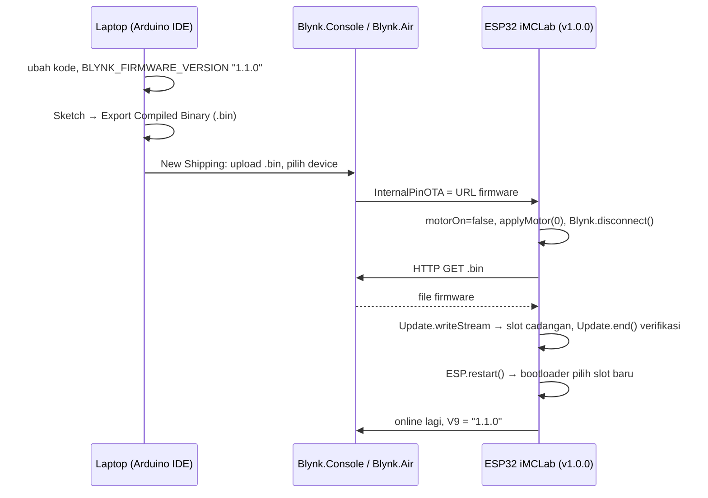
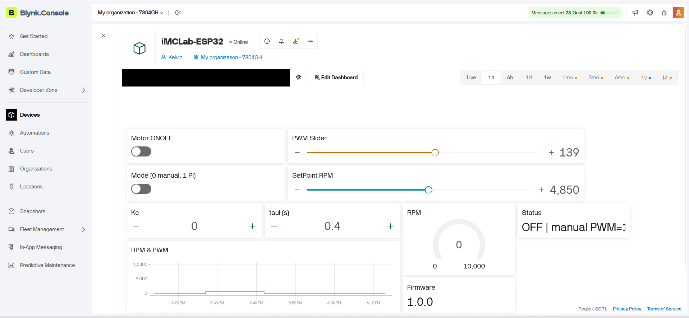
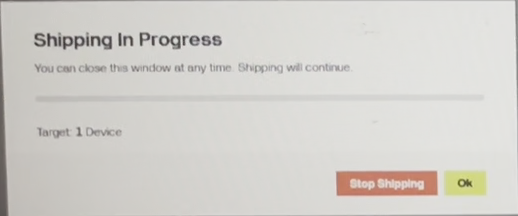
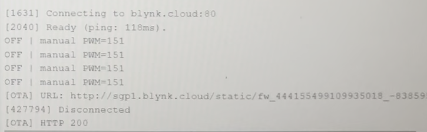
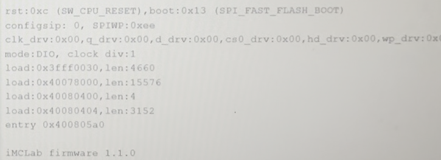
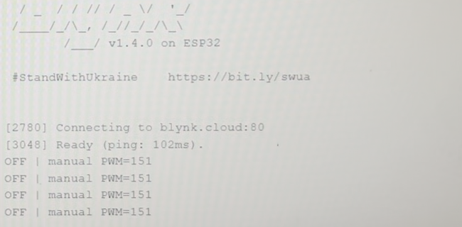
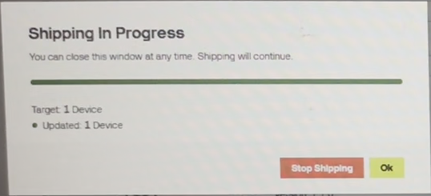
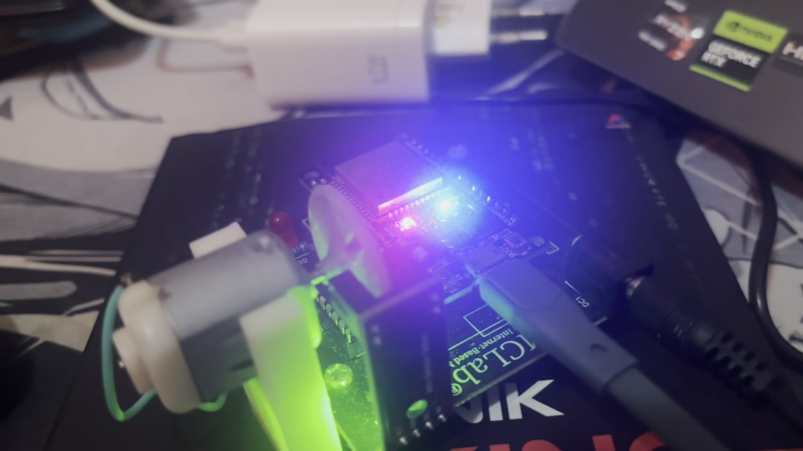
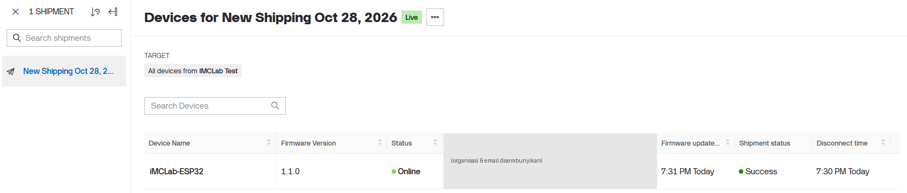

# Laporan Riset Modul 4 — Pemrograman OTA (Over-The-Air) Berbasis Blynk

| | |
|---|---|
| **Nama / NPM** | Kelvin Sitorus / 24081010341 |
| **Mata kuliah** | Robotika — Prof. Basuki Rahmat |
| **Status** | ✅ Firmware v1.0.0 & v1.1.0, prosedur & analisis selesai · ✅ Uji Blynk.Air di kit asli (28 Oktober 2026): v1.0.0 → v1.1.0 lewat OTA berhasil |

## Abstrak
Robot yang sudah terpasang (di dalam casing atau sedang bergerak) sulit dihubungkan ke kabel USB setiap kali firmware diperbarui. **OTA (Over-The-Air)** memungkinkan firmware baru dikirim lewat internet. Modul ini mengimplementasikan OTA memakai **Blynk.Air** pada firmware iMCLab-Blynk dari modul 3. Firmware v1.0.0 di-upload sekali lewat USB, lalu versi 1.1.0 (penambahan soft-start, LED heartbeat, dan laporan alasan reset) dikirim lewat Blynk.Air. Handler OTA menerima URL firmware dari server, **menghentikan motor terlebih dahulu**, mengunduh file `.bin` dengan `HTTPClient`, menulisnya ke slot flash cadangan dengan library `Update`, memverifikasi, lalu restart. Analisis tata letak flash menunjukkan batas ukuran firmware 1,25 MB per slot pada partisi default, serta mekanisme *dual-bank* yang membuat perangkat tetap memakai firmware lama bila unduhan gagal. Pada uji di kit asli, v1.1.0 (1.062.832 byte) terkirim dari server Blynk dan terpasang tanpa kabel; perangkat restart sendiri dan melaporkan versi 1.1.0. Sebagai pembanding, disertakan OTA lokal (ArduinoOTA) yang belum diuji di kit.

## 1. Latar Belakang
Pada modul 3, firmware iMCLab sudah online lewat Blynk. Tanpa OTA, setiap perbaikan bug atau perubahan parameter bawaan tetap mengharuskan robot dicolok ke laptop. Blynk menyediakan layanan **Blynk.Air** untuk mengirim firmware ke perangkat yang terdaftar di sebuah template.

## 2. Tujuan & Pertanyaan Riset
1. Mengimplementasikan OTA Blynk.Air pada firmware iMCLab.
2. Bagaimana ESP32 memastikan update aman (tidak "brick") jika unduhan gagal?
3. Apa saja syarat & risiko OTA pada sistem robot yang sedang bergerak?

## 3. Cara Kerja

**Langkah praktik:**
1. Upload [`iMCLab_OTA_v1_0_0.ino`](iMCLab_OTA_v1_0_0/iMCLab_OTA_v1_0_0.ino) lewat USB (sekali saja). Partition scheme: *Default 4MB with spiffs*. Firmware ini memakai datastream modul 3 (V0–V8). Tambahkan **V9 (String, "Firmware")** di template.
2. Buka [`iMCLab_OTA_v1_1_0.ino`](iMCLab_OTA_v1_1_0/iMCLab_OTA_v1_1_0.ino) → **Sketch → Export Compiled Binary**. Ambil file `*.ino.bin` (bukan `*.merged.bin` atau bootloader).
3. Blynk.Console → **Blynk.Air → New Shipping** → pilih template iMCLab & device → upload `.bin` → Start.
4. Pantau Serial Monitor (log `[OTA]`) dan label V8/V9 di dashboard. Setelah restart, V9 berubah menjadi `1.1.0`, dan LED berkedip 1 Hz saat motor OFF.

**Perubahan v1.0.0 → v1.1.0** ([`perubahan_v1.0.0_ke_v1.1.0.diff`](perubahan_v1.0.0_ke_v1.1.0.diff)):
- `BLYNK_FIRMWARE_VERSION` "1.0.0" → "1.1.0"
- **Soft-start:** perubahan PWM dibatasi ±10 per 50 ms (melindungi motor & catu dari lonjakan arus)
- **LED heartbeat** 1 Hz saat motor OFF, sebagai tanda visual firmware baru berjalan
- **Alasan reset** (`esp_reset_reason()`) dikirim ke V8, sebagai bukti perangkat benar-benar reboot setelah OTA

## 4. Hasil & Analisis

### O1 — Tata letak flash & batas ukuran firmware

Pada partisi *Default 4MB with spiffs*, flash dibagi menjadi **dua slot aplikasi** (app0 & app1, masing-masing 1,25 MB) + otadata (penunjuk slot aktif) + SPIFFS. Firmware OTA harus muat di **satu slot**. Firmware yang memakai WiFi + Blynk + HTTPClient perlu dicek di output kompilasi Arduino ("Sketch uses … bytes"). Jika melebihi 1,25 MB, pilih skema *Minimal SPIFFS (1.9MB APP with OTA)*. Skema *Huge APP (3MB No OTA)* **tidak bisa** dipakai karena hanya ada satu slot aplikasi.

### O2 — Mekanisme dual-bank (A/B)

**Analisis keamanan update:**
- Firmware baru **tidak menimpa** firmware yang sedang berjalan, tetapi ditulis ke slot cadangan. Penunjuk di otadata baru dipindah setelah `Update.end()` memverifikasi data.
- Jika unduhan terputus, WiFi hilang, atau ukuran tidak cocok, handler memanggil `otaFail()`: Blynk tersambung kembali dan **firmware lama tetap berjalan**. Perangkat tidak rusak.
- Jika listrik padam saat penulisan, slot aktif belum berganti, jadi setelah menyala ESP32 tetap menjalankan v1.0.0.

### O3 — Risiko khusus robot
| Risiko | Penanganan di firmware |
|---|---|
| Motor tetap berputar tanpa kendali saat CPU sibuk mengunduh | `motorOn = false; applyMotor(0);` di awal handler OTA |
| Loop Blynk mengganggu unduhan | `Blynk.disconnect()` sebelum HTTP GET |
| Versi tidak terlacak | `BLYNK_FIRMWARE_VERSION` + ditampilkan di V9 |
| File `.bin` untuk board lain | Export dari board yang sama (DOIT ESP32 DEVKIT V1) |
| Firmware baru ada bug | Uji di 1 perangkat dulu sebelum shipping ke banyak perangkat |

### O4 — Pembanding: OTA lokal (ArduinoOTA)
[`ArduinoOTA_Lokal.ino`](ArduinoOTA_Lokal/ArduinoOTA_Lokal.ino): board muncul sebagai *network port* di Arduino IDE.

| Aspek | Blynk.Air | ArduinoOTA |
|---|---|---|
| Jaringan | lewat internet, dari mana saja | laptop & ESP32 harus satu WiFi |
| Banyak perangkat sekaligus | ya (shipping per template) | satu per satu |
| Butuh akun/cloud | ya | tidak |
| Keamanan | token Blynk + HTTPS dari server | wajib `setPassword()` |
| Cocok untuk | perangkat yang sudah dipasang di lapangan | pengembangan di lab |

### O5 — Hasil uji Blynk.Air di kit asli (28 Oktober 2026)

**Kondisi awal.** v1.0.0 di-upload lewat USB (1.062.368 byte tertulis ke flash, `Hash of data verified`). Serial Monitor: `iMCLab firmware 1.0.0`, `Ready (ping: 102 ms)`. Blynk Console menampilkan device Online dengan widget **Firmware = 1.0.0** (V9).

**Ukuran firmware** (lihat O1): hasil kompilasi v1.1.0 = **1.062.682 byte (81 %)** dari batas slot 1.310.720 byte. File `.ino.bin` yang diunggah ke Blynk.Air = **1.062.832 byte (1,01 MB)**, MD5 `1905CC44F3665921AFC852BF81222DF9`. Selisih 314 byte antara v1.0.0 dan v1.1.0 (1.062.368 → 1.062.682) berasal dari soft-start, heartbeat, dan laporan reset.

**Pengaturan shipment:** template IMCLab Test, All devices, *Apply update if device has: Lower firmware version*, *Use HTTPS URL: OFF* (unduhan lewat HTTP), attempts limit 3 per 24 jam.

**Kronologi yang terekam** (video layar, dipotong menjadi gambar; videonya tidak diunggah karena memuat kredensial):

| Tahap | Bukti |
|---|---|
| 1. Shipment dimulai, Blynk: *Shipping In Progress, Target: 1 Device* |  |
| 2. Server mengirim URL lewat `InternalPinOTA`, ESP32 memutus Blynk (`Disconnected`), lalu unduhan **HTTP 200** (bagian `?token=` pada URL sengaja dipotong) |  |
| 3. ESP32 restart sendiri (`rst:0xc (SW_CPU_RESET)`), boot dengan **`iMCLab firmware 1.1.0`** |  |
| 4. Tersambung lagi ke Blynk dengan firmware baru (`Ready, ping 102 ms`) |  |
| 5. Blynk: *Updated: 1 Device*; detail shipment: *Success* (lihat di bawah) |  |
| 6. LED biru (GPIO2) menyala pada papan setelah update (foto diam; kedipan 1 Hz hanya terlihat di video, bukan di foto ini) |  |

Urutan log yang teramati sama dengan rancangan handler: `[OTA] URL` → `Disconnected` → `[OTA] HTTP 200` → (tulis ke slot cadangan, verifikasi) → restart → firmware 1.1.0. `[OTA] Sukses ... Restart` dan `GAGAL` tidak terlihat di potongan yang direkam, jadi keberhasilan dibuktikan dari reset `SW_CPU_RESET` yang disusul banner `1.1.0`, status *Updated: 1 Device*, dan *Shipment status: Success* di Blynk.

**Waktu.** Halaman detail shipment di Blynk mencatat untuk `iMCLab-ESP32`: *Disconnect time* **7:30 PM**, *Firmware updated* **7:31 PM**, *Shipment status* **Success**, versi **1.1.0**. Jadi dari perangkat memutus Blynk untuk mengunduh sampai kembali online dengan v1.1.0 sekitar **1 menit** (resolusi catatan Blynk hanya menit, jadi bisa kurang dari itu). Dari video, lebih dari 12 detik berlalu antara `[OTA] HTTP 200` dan restart.

**Temuan selama uji (kejadian nyata, tercatat apa adanya):**
1. **Target ditentukan saat shipment dibuat.** Shipment pertama (ID 51389) dibuat ketika perangkat sudah berjalan v1.1.0, jadi *Target Size* kosong dan tidak ada yang dikirim. Perangkat lalu diturunkan ke v1.0.0 lewat USB, tetapi shipment itu tetap tidak mengirim (±8 menit). Shipment itu dibatalkan, lalu shipment baru dibuat saat perangkat berada di v1.0.0, dan itu yang berhasil. Ini sesuai dokumentasi Blynk bahwa Blynk.Air menentukan perangkat yang perlu di-upgrade saat shipment dibuat.
2. **Firmware 1.1.0 sempat terpasang tanpa OTA.** Sebelum uji resmi, v1.1.0 sudah berjalan di perangkat (kemungkinan besar terunggah lewat kabel karena sketch v1.1.0 sedang terbuka di Arduino IDE). Hasil itu **tidak dihitung** sebagai OTA. Perangkat dikembalikan ke v1.0.0 lewat USB, baru uji OTA di atas dilakukan.
3. **Paket gratis Blynk dibatasi 2 shipment** ([halaman harga Blynk](https://www.blynk.io/pricing)). Dalam praktik jatah itu terpakai habis oleh shipment 51389 dan shipment yang berhasil. Menu Fleet Management tidak tersedia (fitur Enterprise).
4. Kolom *Firmware Version* di halaman New Shipping sempat menampilkan nilai lama sesaat setelah perangkat berganti versi. Untuk memastikan versi sebenarnya, pakai banner Serial Monitor dan widget V9.

## 5. Kesimpulan
1. OTA Blynk.Air diimplementasikan lewat handler `BLYNK_WRITE(InternalPinOTA)` + `HTTPClient` + `Update`, dengan versi firmware yang terlacak (`BLYNK_FIRMWARE_VERSION`).
2. ESP32 aman dari kegagalan update berkat **dual-bank**: firmware baru ditulis ke slot cadangan dan baru diaktifkan setelah diverifikasi.
3. Untuk robot, **aktuator wajib dihentikan sebelum OTA**, dan ukuran firmware harus ≤ 1,25 MB pada partisi default (v1.1.0 terpakai 81 %).
4. **Terbukti di kit asli:** v1.1.0 terkirim lewat Blynk.Air dan terpasang tanpa kabel; perangkat restart sendiri dan menjalankan v1.1.0 (O5).
5. Pelajaran praktik: daftar target shipment ditentukan saat shipment dibuat, dan paket gratis hanya mengizinkan 2 shipment, jadi uji perlu disiapkan matang sebelum Start.

## 6. Keterbatasan
- **Unduhan lewat HTTP biasa** (toggle HTTPS OFF di Blynk.Air). Isi firmware tidak terenkripsi di jaringan, dan firmware tidak diverifikasi tanda tangannya di sisi ESP32. Pada sketch, jalur HTTPS memakai `setInsecure()` (sertifikat server tidak divalidasi) dan **belum diuji**, karena uji kit memakai HTTP. Untuk produksi, gunakan HTTPS dengan validasi sertifikat, dan verifikasi MD5 atau tanda tangan firmware.
- **Hanya satu keberhasilan yang terekam.** Tidak diuji: unduhan terputus di tengah, WiFi mati saat update, atau firmware rusak. Klaim "firmware lama tetap jalan bila gagal" (O2) berasal dari rancangan dual-bank dan kode `otaFail()`, **belum dibuktikan** di kit.
- Pengukuran waktu update tidak presisi (lihat O5). Kedipan LED 1 Hz hanya terlihat di video, yang tidak diunggah karena memuat kredensial.
- Jatah shipment gratis (2) sudah terpakai, jadi uji ulang di Blynk.Air memerlukan paket berbayar atau shipment baru yang belum habis.
- OTA lokal (`ArduinoOTA_Lokal.ino`) hanya disertakan sebagai pembanding dan belum diuji di kit.
- Kode handler OTA diadaptasi dari contoh komunitas Blynk "Blynk.Air OTA minimal code". Perilakunya bisa berbeda antar versi library; uji ini memakai library Blynk 1.4.0 dan core ESP32 bawaan Arduino IDE 2.3.10.
- Sketch di repo memakai placeholder token/WiFi; salinan yang diuji ada di luar repo.

## Referensi
- Blynk Documentation — Blynk.Air (OTA firmware updates). https://docs.blynk.io
- Blynk Community, "Blynk.Air OTA minimal code". https://community.blynk.cc/t/blynk-air-ota-minimal-code/58929
- Espressif, ESP-IDF Programming Guide — Over The Air Updates (OTA) & Partition Tables.
