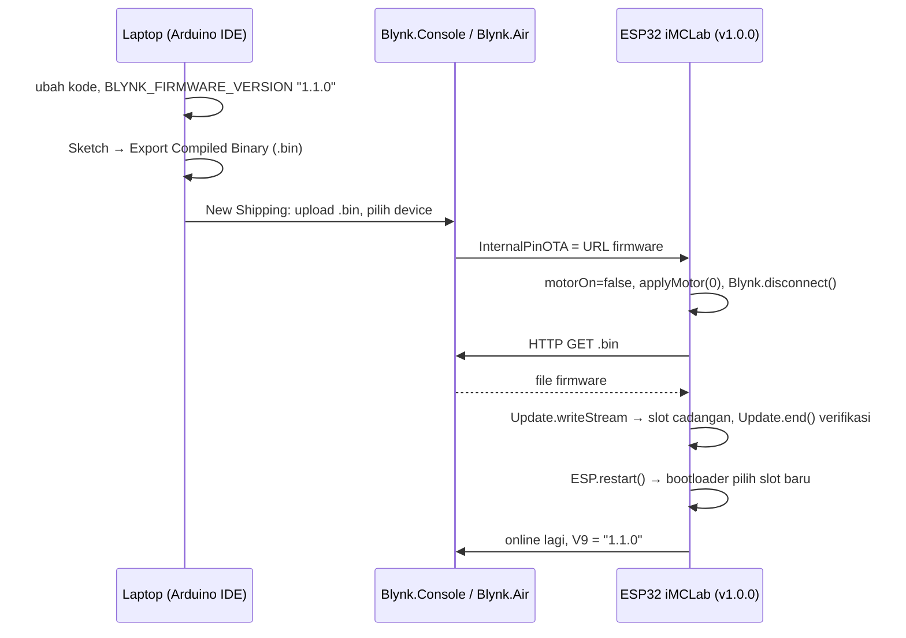
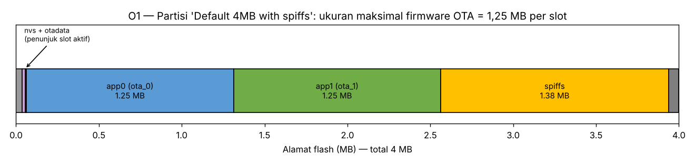
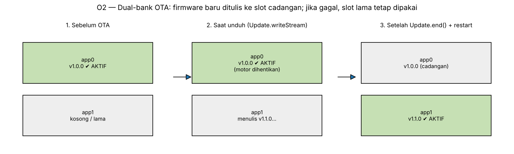

# Laporan Riset Modul 4 — Pemrograman OTA (Over-The-Air) Berbasis Blynk

| | |
|---|---|
| **Nama / NPM** | Kelvin Sitorus / 24081010341 |
| **Mata kuliah** | Robotika — Prof. Basuki Rahmat |
| **Status** | ✅ Firmware v1.0.0 & v1.1.0, prosedur & analisis selesai · ⬜ Uji Blynk.Air di kit |

## Abstrak
Robot yang sudah terpasang (di dalam casing atau sedang bergerak) sulit dihubungkan ke kabel USB setiap kali firmware diperbarui. **OTA (Over-The-Air)** memungkinkan firmware baru dikirim lewat internet. Modul ini mengimplementasikan OTA memakai **Blynk.Air** pada firmware iMCLab-Blynk dari modul 3. Firmware v1.0.0 di-upload sekali lewat USB, lalu versi 1.1.0 (penambahan soft-start, LED heartbeat, dan laporan alasan reset) dikirim lewat Blynk.Air. Handler OTA menerima URL firmware dari server, **menghentikan motor terlebih dahulu**, mengunduh file `.bin` dengan `HTTPClient`, menulisnya ke slot flash cadangan dengan library `Update`, memverifikasi, lalu restart. Analisis tata letak flash menunjukkan batas ukuran firmware 1,25 MB per slot pada partisi default, serta mekanisme *dual-bank* yang membuat perangkat tetap memakai firmware lama bila unduhan gagal. Sebagai pembanding, disertakan OTA lokal (ArduinoOTA).

## 1. Latar Belakang
Pada modul 3, firmware iMCLab sudah online lewat Blynk. Tanpa OTA, setiap perbaikan bug atau perubahan parameter bawaan tetap mengharuskan robot dicolok ke laptop. Blynk menyediakan layanan **Blynk.Air** untuk mengirim firmware ke perangkat yang terdaftar di sebuah template.

## 2. Tujuan & Pertanyaan Riset
1. Mengimplementasikan OTA Blynk.Air pada firmware iMCLab.
2. Bagaimana ESP32 memastikan update aman (tidak "brick") jika unduhan gagal?
3. Apa saja syarat & risiko OTA pada sistem robot yang sedang bergerak?

## 3. Cara Kerja

**Langkah praktik:**
1. Upload [`iMCLab_OTA_v1_0_0.ino`](iMCLab_OTA_v1_0_0/iMCLab_OTA_v1_0_0.ino) lewat USB (sekali saja). Partition scheme: *Default 4MB with spiffs*. Firmware ini memakai datastream modul 3 (V0–V8). Tambahkan **V9 (String, "Firmware")** di template.
2. Buka [`iMCLab_OTA_v1_1_0.ino`](iMCLab_OTA_v1_1_0/iMCLab_OTA_v1_1_0.ino) → **Sketch → Export Compiled Binary**. Ambil file `*.ino.bin` (bukan `*.merged.bin` atau bootloader).
3. Blynk.Console → **Blynk.Air → New Shipping** → pilih template iMCLab & device → upload `.bin` → Start.
4. Pantau Serial Monitor (log `[OTA]`) dan label V8/V9 di dashboard. Setelah restart, V9 berubah menjadi `1.1.0`, dan LED berkedip 1 Hz saat motor OFF.

**Perubahan v1.0.0 → v1.1.0** ([`perubahan_v1.0.0_ke_v1.1.0.diff`](perubahan_v1.0.0_ke_v1.1.0.diff)):
- `BLYNK_FIRMWARE_VERSION` "1.0.0" → "1.1.0"
- **Soft-start:** perubahan PWM dibatasi ±10 per 50 ms (melindungi motor & catu dari lonjakan arus)
- **LED heartbeat** 1 Hz saat motor OFF, sebagai tanda visual firmware baru berjalan
- **Alasan reset** (`esp_reset_reason()`) dikirim ke V8, sebagai bukti perangkat benar-benar reboot setelah OTA

## 4. Hasil & Analisis

### O1 — Tata letak flash & batas ukuran firmware

Pada partisi *Default 4MB with spiffs*, flash dibagi menjadi **dua slot aplikasi** (app0 & app1, masing-masing 1,25 MB) + otadata (penunjuk slot aktif) + SPIFFS. Firmware OTA harus muat di **satu slot**. Firmware yang memakai WiFi + Blynk + HTTPClient perlu dicek di output kompilasi Arduino ("Sketch uses … bytes"). Jika melebihi 1,25 MB, pilih skema *Minimal SPIFFS (1.9MB APP with OTA)*. Skema *Huge APP (3MB No OTA)* **tidak bisa** dipakai karena hanya ada satu slot aplikasi.

### O2 — Mekanisme dual-bank (A/B)

**Analisis keamanan update:**
- Firmware baru **tidak menimpa** firmware yang sedang berjalan, tetapi ditulis ke slot cadangan. Penunjuk di otadata baru dipindah setelah `Update.end()` memverifikasi data.
- Jika unduhan terputus, WiFi hilang, atau ukuran tidak cocok, handler memanggil `otaFail()`: Blynk tersambung kembali dan **firmware lama tetap berjalan**. Perangkat tidak rusak.
- Jika listrik padam saat penulisan, slot aktif belum berganti, jadi setelah menyala ESP32 tetap menjalankan v1.0.0.

### O3 — Risiko khusus robot
| Risiko | Penanganan di firmware |
|---|---|
| Motor tetap berputar tanpa kendali saat CPU sibuk mengunduh | `motorOn = false; applyMotor(0);` di awal handler OTA |
| Loop Blynk mengganggu unduhan | `Blynk.disconnect()` sebelum HTTP GET |
| Versi tidak terlacak | `BLYNK_FIRMWARE_VERSION` + ditampilkan di V9 |
| File `.bin` untuk board lain | Export dari board yang sama (DOIT ESP32 DEVKIT V1) |
| Firmware baru ada bug | Uji di 1 perangkat dulu sebelum shipping ke banyak perangkat |

### O4 — Pembanding: OTA lokal (ArduinoOTA)
[`ArduinoOTA_Lokal.ino`](ArduinoOTA_Lokal/ArduinoOTA_Lokal.ino): board muncul sebagai *network port* di Arduino IDE.

| Aspek | Blynk.Air | ArduinoOTA |
|---|---|---|
| Jaringan | lewat internet, dari mana saja | laptop & ESP32 harus satu WiFi |
| Banyak perangkat sekaligus | ya (shipping per template) | satu per satu |
| Butuh akun/cloud | ya | tidak |
| Keamanan | token Blynk + HTTPS dari server | wajib `setPassword()` |
| Cocok untuk | perangkat yang sudah dipasang di lapangan | pengembangan di lab |

## 5. Kesimpulan
1. OTA Blynk.Air diimplementasikan lewat handler `BLYNK_WRITE(InternalPinOTA)` + `HTTPClient` + `Update`, dengan versi firmware yang terlacak (`BLYNK_FIRMWARE_VERSION`).
2. ESP32 aman dari kegagalan update berkat **dual-bank**: firmware baru ditulis ke slot cadangan dan baru diaktifkan setelah diverifikasi.
3. Untuk robot, **aktuator wajib dihentikan sebelum OTA**, dan ukuran firmware harus ≤ 1,25 MB pada partisi default.

## 6. Keterbatasan & Rencana Uji Kit
- Belum diuji dengan Blynk.Air sungguhan. Saat praktikum, simpan screenshot halaman Blynk.Air (status shipping), log Serial `[OTA]`, dan nilai V9 sebelum/sesudah di `img/`. Catat juga ukuran `.bin` dan lama proses update.
- Firmware lolos pemeriksaan sintaks (header tiruan). Kompilasi penuh perlu library Blynk.
- Kode handler OTA diadaptasi dari contoh komunitas Blynk "Blynk.Air OTA minimal code". Ada laporan bahwa perilakunya bisa berbeda antar versi library, jadi uji di board sendiri.

## Referensi
- Blynk Documentation — Blynk.Air (OTA firmware updates). https://docs.blynk.io
- Blynk Community, "Blynk.Air OTA minimal code". https://community.blynk.cc/t/blynk-air-ota-minimal-code/58929
- Espressif, ESP-IDF Programming Guide — Over The Air Updates (OTA) & Partition Tables.
