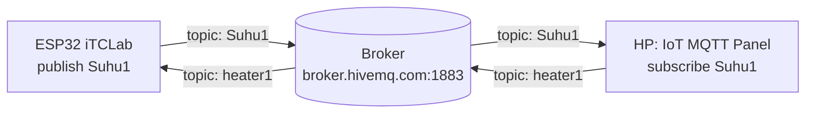

# 01 — Konsep IoT & MQTT

**Bagian:** UTS · **Status:** ✅ Selesai (diuji dengan broker MQTT lokal)

## Tujuan
Memahami konsep dasar Internet of Things dan protokol MQTT sebagai jalur komunikasi untuk memantau dan mengendalikan perangkat (iTCLab, robot BNU) dari jarak jauh.

## Ringkasan Materi
**Sistem dasar IoT** terdiri dari tiga komponen:
1. **Things/hardware**, misalnya ESP32 + sensor suhu + heater pada iTCLab.
2. **Koneksi internet**, yaitu WiFi.
3. **Cloud/data center**, yaitu broker MQTT (HiveMQ, EMQX) atau platform seperti Blynk.

**MQTT** (Message Queuing Telemetry Transport) memakai pola *publish/subscribe*:



| Istilah | Arti |
|---|---|
| Broker | Server perantara yang menerima lalu meneruskan pesan |
| Client | Perangkat/aplikasi yang terhubung ke broker (ESP32, HP, laptop) |
| Topic | "Alamat" pesan, mis. `Suhu1`, `heater1`, `kelvin341/itclab/SetPoint` |
| Publish | Mengirim pesan ke sebuah topic |
| Subscribe | Mendaftar untuk menerima semua pesan pada topic tertentu |
| QoS | 0 = paling banyak sekali, 1 = minimal sekali, 2 = tepat sekali |

Pengirim dan penerima tidak perlu saling kenal alamat IP. Keduanya cukup sepakat soal nama topic, sehingga MQTT ringan dan cocok untuk mikrokontroler.

## Praktik / Kode
| File | Keterangan |
|---|---|
| [`mqtt_publisher.py`](mqtt_publisher.py) | Mensimulasikan sensor suhu yang mem-*publish* ke topic `Suhu1` tiap 1 detik |
| [`mqtt_subscriber.py`](mqtt_subscriber.py) | Subscribe `Suhu1` & `heater1`, mencetak pesan yang masuk |
| [`hasil_uji_lokal.txt`](hasil_uji_lokal.txt) | Log uji: 5 pesan terkirim dan 5 pesan diterima utuh |

Cara menjalankan:
```bash
pip install paho-mqtt
python mqtt_subscriber.py                 # terminal 1 (broker.hivemq.com)
python mqtt_publisher.py                  # terminal 2
```

### Konfigurasi IoT MQTT Panel (HP)
1. Tambah *Connection*: broker `broker.hivemq.com`, port `1883`, protokol TCP.
2. Tambah *Dashboard*, lalu panel:
   - **Text Log / Line Graph** → subscribe `Suhu1`
   - **Switch** → publish `heater1` (payload on = `1`, off = `0`)
3. Jalankan `mqtt_publisher.py`. Angka suhu akan muncul di HP.

## Hasil
Pengujian di broker lokal (amqtt) menunjukkan 5 dari 5 pesan diterima subscriber dengan urutan dan isi yang sama:
```
[PUBLISH] Suhu1 -> 25.47        [TERIMA] Suhu1: 25.47
[PUBLISH] Suhu1 -> 25.35        [TERIMA] Suhu1: 25.35
...
```

## Yang Sudah Saya Kuasai
- [x] Menjelaskan tiga komponen sistem dasar IoT
- [x] Menjelaskan alur publish/subscribe, peran broker, topic, dan QoS
- [x] Membuat publisher & subscriber MQTT dengan Python (paho-mqtt)
- [ ] Uji dengan IoT MQTT Panel di HP (dilakukan saat praktikum)

## Catatan
- Broker publik bisa dipakai siapa saja, jadi nama topic sebaiknya diberi awalan unik (di repo ini `kelvin341/...`) supaya tidak bentrok dengan mahasiswa lain.
- Broker publik tanpa autentikasi **tidak aman** untuk sistem sungguhan. Untuk produksi perlu username/password + TLS (port 8883).

## Referensi
- Rahmat & Muljono, *Pemrograman IoT dengan Arduino dan Python* Jilid 1, Bab 1
