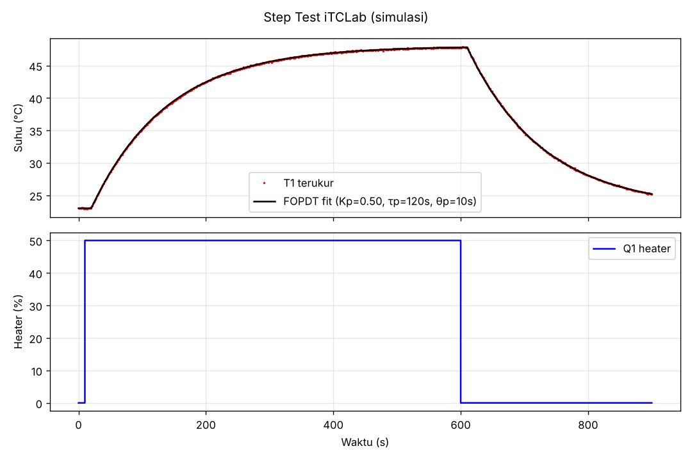

# 03 — Kit iTCLab (Internet-Based Temperature Control Lab)

**Bagian:** UTS · **Status:** ✅ Selesai (simulasi) · ⬜ Uji di kit

## Tujuan
Memahami iTCLab sebagai *plant* kendali suhu, memprogramnya dari Arduino dan Python, serta membuat model dinamisnya.

## Ringkasan Materi
iTCLab = ESP32 + 2 heater (transistor, Q1/Q2) + 2 sensor suhu (T1/T2) + LED. Heater memanaskan heat sink, lalu sensor membaca suhunya. Respons suhu terhadap heater bisa didekati dengan model **FOPDT (First Order Plus Dead Time)**:

$$\tau_p \frac{dT}{dt} = -(T - T_{ss}) + K_p\,Q(t-\theta_p)$$

| Parameter | Arti | Nilai di ebook |
|---|---|---|
| $K_p$ | gain proses: kenaikan suhu per 1 % heater | 0,5 °C/% |
| $\tau_p$ | konstanta waktu: waktu mencapai 63 % perubahan | 120 s |
| $\theta_p$ | waktu tunda (dead time) | 10 s |
| $T_{ss}$ | suhu ruang | 23 °C |

## Praktik / Kode
| File | Keterangan |
|---|---|
| [`itclab_firmware/itclab_firmware.ino`](itclab_firmware/itclab_firmware.ino) | Firmware serial: perintah `Q1 50`, `T1`, `LED 100`, `VER`, `X`, plus pengaman suhu > 59 °C |
| [`itclab.py`](itclab.py) | Class Python untuk kit asli (pyserial, deteksi port otomatis) |
| [`itclab_sim.py`](itclab_sim.py) | Simulator FOPDT dengan antarmuka **sama** (`T1`, `Q1()`, `step()`) supaya program bisa diuji tanpa kit |
| [`step_test.py`](step_test.py) | Uji step Q1 = 50 % lalu identifikasi $K_p, \tau_p, \theta_p$ dengan curve fitting |
| [`step_test_data.csv`](step_test_data.csv) | Data hasil uji step (simulasi) |

```bash
python step_test.py --sim          # simulasi
python step_test.py --port COM5    # kit iTCLab asli
```

## Hasil


Identifikasi model dari data uji step (simulasi dengan noise sensor 0,05 °C):

| Parameter | Hasil identifikasi | Nilai sebenarnya |
|---|---|---|
| $K_p$ | 0,500 °C/% | 0,5 |
| $\tau_p$ | 120,0 s | 120 |
| $\theta_p$ | 10 s | 10 |
| RMSE | 0,049 °C | ≈ noise sensor |

Catatan proses: percobaan pertama memakai optimasi gradien untuk ketiga parameter sekaligus. Hasilnya $\theta_p$ "terjebak" di 5 s karena delay bersifat diskrit (bilangan bulat), sehingga gradiennya nol. Solusinya: $\theta_p$ dicari dengan *grid search* 0–30 s, lalu $K_p, \tau_p$ dioptimasi untuk tiap nilai $\theta_p$.

Dari $K_p$ = 0,5 °C/%: heater 50 % menaikkan suhu ±25 °C di atas suhu ruang, jadi suhu maksimum ±48 °C. Hasil ini cocok dengan grafik.

## Yang Sudah Saya Kuasai
- [x] Menjelaskan komponen dan cara kerja iTCLab
- [x] Menulis firmware antarmuka serial dan client Python-nya
- [x] Memodelkan iTCLab sebagai FOPDT dan mengidentifikasi parameternya dari data step test
- [ ] Menjalankan step test pada kit asli lalu membandingkan parameternya dengan ebook

## Referensi
- Rahmat & Muljono, *Pemrograman IoT dengan Arduino dan Python* Jilid 1, Bab 3
- https://github.com/bsrahmat/itclab-01
