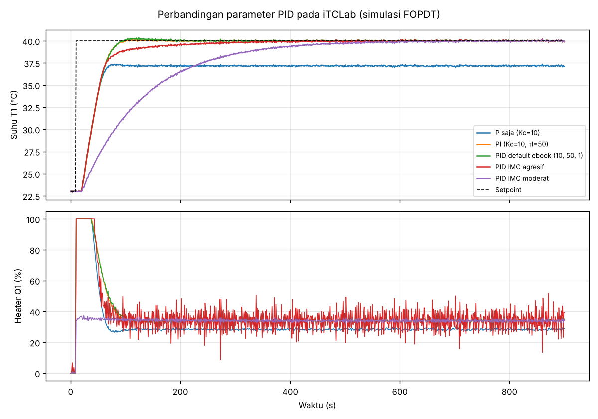
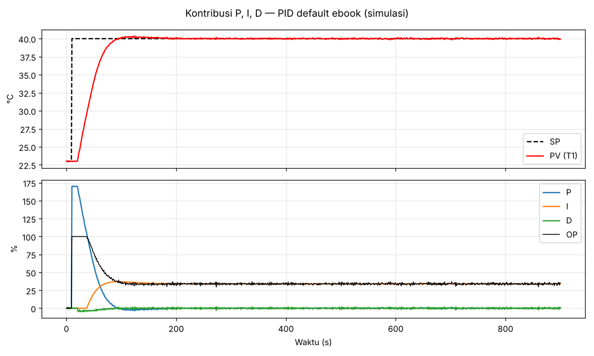

# 04 — Sistem Kendali PID

**Bagian:** UTS · **Status:** ✅ Selesai (simulasi) · ⬜ Uji di kit

## Tujuan
Memahami prinsip kendali PID, menerapkannya pada iTCLab, dan membandingkan pengaruh tiap parameter.

## Ringkasan Materi
Bentuk PID di ebook (parameter $K_c, \tau_I, \tau_D$):

$$OP(t) = K_c\,e(t) + \frac{K_c}{\tau_I}\int_0^t e\,d\tau - K_c\,\tau_D\,\frac{dPV}{dt}, \qquad e = SP - PV$$

| Aksi | Efek | Risiko |
|---|---|---|
| **P** ($K_c$) | respons lebih cepat | jika sendirian: ada *offset* (error tetap) |
| **I** ($\tau_I$) | menghapus offset | $\tau_I$ terlalu kecil → overshoot/osilasi |
| **D** ($\tau_D$) | meredam, mengantisipasi perubahan | memperkuat noise sensor |

Dua detail implementasi penting (sesuai kode ebook):
- **Derivative on measurement**: memakai $dPV/dt$, bukan $de/dt$, supaya tidak ada lonjakan (*derivative kick*) saat setpoint diubah.
- **Anti-reset windup**: saat output heater mentok 0 atau 100 %, integral berhenti ditambah.

**Penalaan (tuning)** memakai aturan IMC untuk model FOPDT:
$K_c = \frac{1}{K_p}\frac{\tau_p + 0.5\theta_p}{\tau_c + 0.5\theta_p}$, $\tau_I = \tau_p + 0.5\theta_p$, $\tau_D = \frac{\tau_p\theta_p}{2\tau_p+\theta_p}$.
Agresif: $\tau_c = \max(0.1\tau_p, 0.8\theta_p)$; moderat: $\tau_c = \max(\tau_p, 8\theta_p)$.

## Praktik / Kode
| File | Keterangan |
|---|---|
| [`PID_Arduino/PID_Arduino.ino`](PID_Arduino/PID_Arduino.ino) | PID T1 di ESP32 (1 s), setpoint bisa diubah lewat Serial `SP 45`, pengaman 58 °C |
| [`pid_controller.py`](pid_controller.py) | Class PID Python (sama dengan versi Arduino) |
| [`pid_experiment.py`](pid_experiment.py) | Membandingkan 5 set parameter pada simulator iTCLab |
| [`pid_results.csv`](pid_results.csv) | Tabel metrik hasil |

## Hasil
Skenario: setpoint 23 → 40 °C pada t = 10 s, simulasi FOPDT ($K_p$=0,5; $\tau_p$=120 s; $\theta_p$=10 s) dengan noise sensor.

| Kasus | Kc | τI | τD | Overshoot (%) | Rise 10–90 % (s) | Settling ±0,5 °C (s) | IAE | Error akhir (°C) |
|---|---|---|---|---|---|---|---|---|
| P saja | 10 | – | 0 | 0,0 | tidak tercapai | tidak tercapai | 2944 | **2,83** |
| PI | 10 | 50 | 0 | 1,2 | 44 | 74 | **633** | 0,00 |
| PID default ebook | 10 | 50 | 1 | 2,1 | 45 | 74 | 643 | 0,00 |
| PID IMC agresif | 14,71 | 125 | 4,8 | 1,3 | 53 | 193 | 765 | 0,00 |
| PID IMC moderat | 2,0 | 125 | 4,8 | 1,1 | 250 | 430 | 2129 | 0,00 |

**Analisis:**
1. **P saja meninggalkan offset 2,83 °C**, sesuai teori: offset = ΔSP / (1 + Kc·Kp) = 17 / (1 + 10·0,5) = 2,83 °C. Komponen I diperlukan untuk menghapusnya.
2. **PI dan PID default ebook hampir identik.** Pada plant ini delay-nya kecil dibanding konstanta waktu ($\theta_p/\tau_p$ ≈ 0,08), jadi aksi D tidak banyak membantu.
3. **IMC agresif** memakai $\tau_D$ = 4,8 s, sehingga noise sensor diperkuat dan heater bergetar keras (grafik bawah, garis merah). Settling-nya malah lebih lama karena $\tau_I$ besar. Ini contoh nyata kelemahan aksi D pada sinyal yang berisik.
4. **IMC moderat** paling halus dan tanpa getaran, tetapi lambat (settling 430 s). Pilihan parameter selalu tawar-menawar antara kecepatan dan kehalusan.
5. Selama ±40 detik pertama heater **saturasi 100 %**. Tanpa anti-windup, integral akan menumpuk dan overshoot jauh lebih besar.

## Yang Sudah Saya Kuasai
- [x] Menjelaskan peran P, I, D dan menghitung offset kendali P secara teori
- [x] Mengimplementasikan PID diskrit dengan derivative-on-measurement dan anti-windup (Arduino & Python)
- [x] Menala PID dengan aturan IMC dari model FOPDT
- [x] Membandingkan beberapa set parameter dengan metrik overshoot, rise time, settling time, IAE
- [ ] Menjalankan PID_Arduino.ino di kit dan membandingkannya dengan simulasi

## Referensi
- Rahmat & Muljono, *Pemrograman IoT dengan Arduino dan Python* Jilid 1, Bab 4–5
