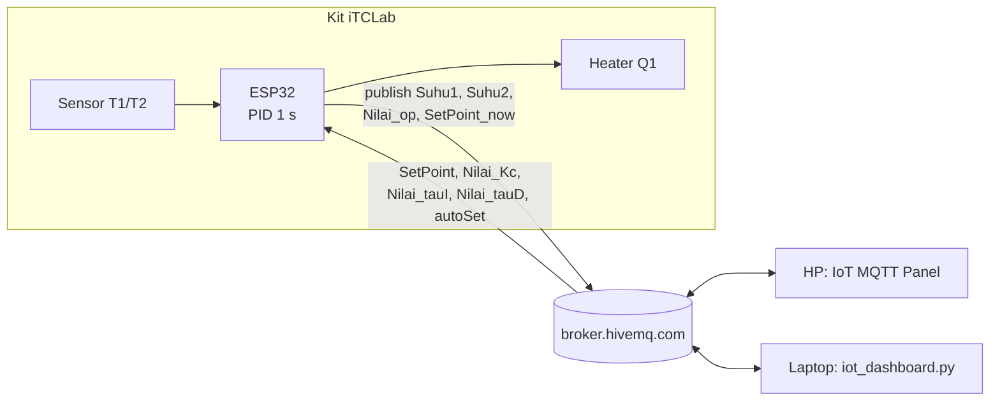
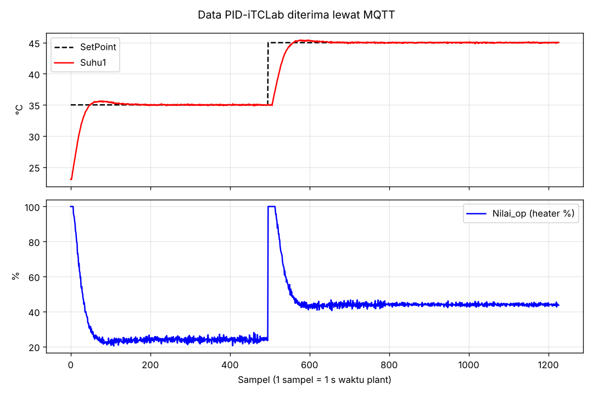

# 05 — Pemrograman IoT + PID-iTCLab

**Bagian:** UTS · **Status:** ✅ Selesai (uji end-to-end MQTT lokal) · ⬜ Uji di kit + HP

## Tujuan
Menggabungkan kendali PID dengan IoT agar suhu iTCLab bisa **dipantau** dan **dikendalikan** (setpoint & parameter PID) dari HP atau laptop lewat MQTT.

## Arsitektur


Semua topic memakai awalan `kelvin341/itclab/`.

| Topic | Arah | Isi |
|---|---|---|
| `Suhu1`, `Suhu2` | ESP32 → | suhu (°C) tiap 1 s |
| `Nilai_op` | ESP32 → | output PID / heater (%) |
| `SetPoint_now` | ESP32 → | setpoint yang sedang dipakai |
| `SetPoint` | → ESP32 | setpoint baru |
| `Nilai_Kc`, `Nilai_tauI`, `Nilai_tauD` | → ESP32 | ubah parameter PID dari jauh |
| `autoSet` | → ESP32 | `1` = kembali ke default (10, 50, 1) |
| `heater1`, `mode` | → ESP32 | mode on/off manual; `mode=pid` kembali ke PID |

## Praktik / Kode
| File | Keterangan |
|---|---|
| [`IoT_PID_iTCLab/IoT_PID_iTCLab.ino`](IoT_PID_iTCLab/IoT_PID_iTCLab.ino) | Firmware ESP32: WiFi + PubSubClient + PID + pengaman suhu |
| [`virtual_itclab_mqtt.py`](virtual_itclab_mqtt.py) | *Digital twin*: simulator iTCLab + PID yang memakai topic yang sama dengan firmware |
| [`iot_dashboard.py`](iot_dashboard.py) | Dashboard laptop: merekam data MQTT ke CSV + grafik, mengirim perintah terjadwal |
| [`iot_log_uji_lokal.csv`](iot_log_uji_lokal.csv) | Data hasil uji |

```bash
# tanpa hardware (digital twin), 1 detik nyata = 20 detik plant
python virtual_itclab_mqtt.py --speed 20
python iot_dashboard.py --duration 60 --set SetPoint=45@25 --set Nilai_Kc=6@40
```

## Hasil
Uji end-to-end dengan broker lokal: digital twin ↔ broker ↔ dashboard. Dari dashboard dikirim `SetPoint=45` lalu `Nilai_Kc=6`. Perintah diterima twin, dan 1227 sampel data suhu kembali ke dashboard lewat MQTT.



- Suhu naik ke setpoint awal 35 °C dengan overshoot kecil, lalu stabil.
- Setelah setpoint diubah **dari jarak jauh** menjadi 45 °C, heater kembali saturasi 100 % dan suhu mengikuti.
- Setelah $K_c$ diturunkan ke 6 (sekitar sampel 800), getaran sinyal heater berkurang. Ini menunjukkan parameter PID bisa dituning *online* tanpa upload ulang firmware.

## Yang Sudah Saya Kuasai
- [x] Merancang struktur topic MQTT untuk pemantauan & pengendalian
- [x] Menulis firmware ESP32 yang menggabungkan WiFi, MQTT (PubSubClient), dan PID
- [x] Membuat digital twin untuk menguji sistem IoT tanpa hardware
- [x] Mengubah setpoint & parameter PID dari jarak jauh dan merekam datanya
- [ ] Uji dengan kit iTCLab asli + IoT MQTT Panel di HP

## Catatan Keamanan
- Firmware tetap mematikan heater jika suhu ≥ 58 °C, **apa pun perintah dari MQTT**. Pengaman harus ada di perangkat, bukan di aplikasi.
- Broker publik tidak memakai autentikasi. Siapa pun yang tahu nama topic bisa mengubah setpoint. Untuk pemakaian nyata perlu broker privat + username/password + TLS.

## Referensi
- Rahmat & Muljono, *Pemrograman IoT dengan Arduino dan Python* Jilid 1, Bab 6
