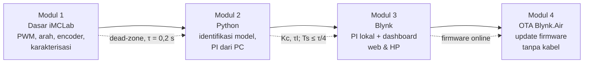
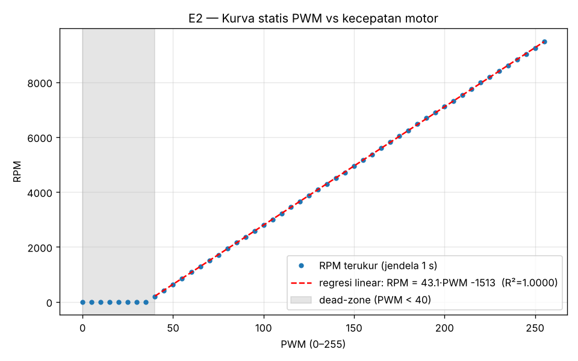
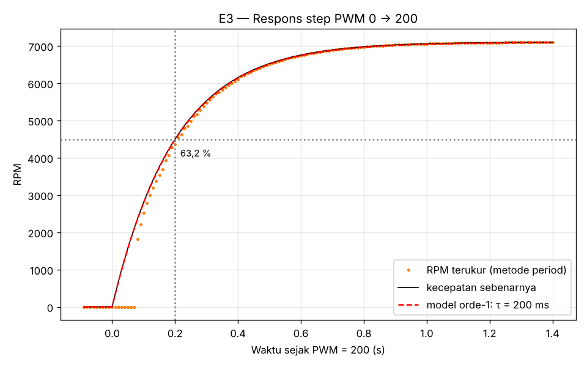

# Project Report UTS — Robotika
## Ringkasan Riset Pemrograman Robotika dengan Kit iMCLab

| | |
|---|---|
| **Nama** | Kelvin Sitorus |
| **NPM** | 24081010341 |
| **Program Studi** | Informatika, UPN "Veteran" Jawa Timur |
| **Mata Kuliah** | Robotika |
| **Dosen** | Prof. Basuki Rahmat |

## Pemenuhan Syarat Minimal UTS

| Syarat | Dipenuhi di | Status |
|---|---|---|
| Ringkasan riset tiap eksperimen dalam bentuk Laporan Riset per modul | Dokumen ini + `README.md` di tiap folder modul (format: abstrak, latar belakang, tujuan, alat, metode, hasil, analisis, kesimpulan, keterbatasan, referensi) | ✅ |
| Dilengkapi gambar-gambar dan analisisnya | 11 grafik hasil eksperimen + diagram arsitektur/alur di tiap modul, masing-masing dengan analisis | ✅ |
| Pemrograman basic robotika dengan Kit iMCLab | [Modul 1](01-iMCLab-Pemrograman-Dasar/) | ✅ program + analisis · ⬜ data kit |
| Pemrograman robotika dengan Kit iMCLab menggunakan Python | [Modul 2](02-iMCLab-Python/) | ✅ program + analisis · ⬜ data kit |
| Pemrograman iMCLab berbasis Blynk | [Modul 3](03-iMCLab-Blynk/) | ✅ firmware + analisis · ⬜ uji akun Blynk |
| Pemrograman OTA berbasis Blynk | [Modul 4](04-OTA-Blynk/) | ✅ firmware v1.0.0/v1.1.0 + analisis · ⬜ uji Blynk.Air |

> **Catatan metode (penting):** data pada laporan ini berasal dari **simulator motor DC** yang dibuat sendiri (`UTS/02-iMCLab-Python/imclab_sim.py`) dengan **parameter motor asumsi** (motor tipe 130, catu 12 V), karena pengambilan data dengan kit fisik belum dilakukan. Semua program ditulis agar bisa langsung dijalankan ulang di kit (`--port COM5` atau `--csv data_kit.csv`). Hasil kit fisik akan ditambahkan dan dibandingkan dengan simulasi setelah praktikum. Konfigurasi hardware dipastikan dari program yang dibagikan dosen ([`referensi_dosen`](referensi_dosen/)): motor IN1 = 27, IN2 = 26, EN = 12; encoder GPIO 13 dengan **piringan 2 lubang**; LED GPIO 2; USB-serial CP210x. Yang masih asumsi hanya parameter fisik motor di simulator.

## Abstrak
Laporan ini merangkum empat modul riset pemrograman robotika dengan Kit iMCLab (ESP32 + driver H-bridge + motor DC + encoder optik). **Modul 1** mengkarakterisasi motor: dead-zone PWM < ±40, gain statis ±43 RPM/PWM, konstanta waktu ±0,2 s. Karena piringan encoder hanya 2 lubang, dibuktikan bahwa RPM untuk kendali harus diukur dengan metode period (waktu satu putaran), bukan hitung pulsa per detik. **Modul 2** memindahkan kendali ke Python dengan firmware yang kompatibel dengan protokol program dosen: model hasil identifikasi (Kp 43,1 RPM/PWM, τ 198 ms) dipakai merancang PI yang mencapai setpoint tanpa overshoot berarti dan error akhir 0 RPM. Di sisi lain, memperlambat loop Python ke 200 ms membuat sistem tidak stabil. **Modul 3** mengembangkan program Blynk kelas (V0–V3) dengan mode PI berprinsip "kendali lokal, pemantauan di cloud". Simulasi membuktikan PI lewat cloud dengan latensi 0,3 s berosilasi (IAE 55× lebih buruk). **Modul 4** mengimplementasikan update firmware OTA dengan Blynk.Air (v1.0.0 → v1.1.0), dengan mekanisme dual-bank dan penghentian motor sebelum update demi keselamatan. Benang merah keempat modul: **waktu (τ motor, periode sampling, latensi jaringan) menentukan di mana dan bagaimana kendali robot harus dijalankan.**

## Peta Modul



---

## Modul 1 — Pemrograman Dasar Robotika dengan iMCLab
📁 [Laporan lengkap](01-iMCLab-Pemrograman-Dasar/README.md)

**Pertanyaan:** bagaimana mengatur arah & kecepatan motor, mengukur kecepatannya, dan seperti apa karakteristiknya?

**Program:** `01_Test_iMCLab` (program dosen, diadaptasi core 2.x/3.x), `02_Kecepatan_PWM`, `03_Encoder_RPM` (interrupt GPIO 13 + debounce, dua metode RPM), `04_Karakterisasi_Otomatis`.

| Eksperimen | Gambar | Temuan |
|---|---|---|
| E1 Uji fungsi |  | Arah diatur IN1/IN2. Motor ±9.480 RPM pada PWM 255. Berhenti ±0,39 s (dynamic braking). |
| E2 Kurva statis |  | **Dead-zone PWM < 40.** Di atasnya linear 43,1 RPM/PWM. |
| E3 Respons step |  | Orde-1, **τ = 0,20 s**, settling ±0,8 s |
| E4 Metode ukur RPM (2 lubang) |  | Galat RMS: jendela 1 s (dosen) 2.676 RPM, jendela 100 ms 469 RPM, **period 188 RPM** |

**Analisis kunci:** dead-zone membuat perintah PWM kecil tidak berefek, sehingga integrator diperlukan. τ = 0,2 s berarti loop kendali perlu periode ≤ 50 ms. Piringan 2 lubang membuat hitung pulsa per detik terlalu lambat untuk kendali, jadi modul berikutnya memakai metode period.

---

## Modul 2 — Pemrograman iMCLab menggunakan Python
📁 [Laporan lengkap](02-iMCLab-Python/README.md)

**Pertanyaan:** bisakah motor dikendalikan dari Python lewat serial, dan apa batasnya?

**Program:** firmware serial kompatibel protokol dosen (`1`, `0`, `+`, `-`, `PWM:xxx`, `R`) + perintah eksperimen (`PWM <n>`, `RPM`, `VER`, `X`, watchdog 2 s), class `iMCLab` (kit) & `iMCLabSim` (simulator) dengan antarmuka identik, `step_test_imclab.py`, `pid_python_imclab.py`, `live_plot_imclab.py`.

| Eksperimen | Gambar | Temuan |
|---|---|---|
| P1 Identifikasi |  | Kp 43,1 RPM/PWM, τ 198 ms, θ ≈ 0 (metode period). Konsisten dengan modul 1. |
| P2 PI vs P |  | PI-IMC: overshoot ≤ 0,1 %, error 0 RPM, pulih dari beban. P saja: error 1.183 RPM (cocok dengan hitungan teori + dead-zone). |
| P3 Periode loop |  | Ts 20/100 ms stabil. **Ts 200 ms tidak stabil** (overshoot 96 %, berosilasi). |

**Analisis kunci:** model sederhana hasil identifikasi cukup untuk tuning yang baik. Batas utama kendali dari PC adalah periode loop: **Ts ≤ τ/4**.

---

## Modul 3 — Pemrograman iMCLab Berbasis Blynk
📁 [Laporan lengkap](03-iMCLab-Blynk/README.md)

**Pertanyaan:** di mana loop PID harus berjalan saat sistem online, dan seberapa sering data dikirim?

**Program:** `iMCLab_Blynk.ino`: V0–V3 sama dengan program kelas (RPM, PWM, slider PWM, ON/OFF) + V4 setpoint, V5 mode PI, V6 Kc, V7 τI, V8 status; PI lokal 50 ms via `BlynkTimer`, kirim 500 ms, `syncVirtual` saat reconnect.

| Eksperimen | Gambar | Temuan |
|---|---|---|
| B1 Lokal vs cloud |  | Lokal: IAE 497. Cloud 0,3 s: IAE 27.269 (berosilasi). Cloud + PI ditala ulang: stabil tapi 5× lebih lambat. |
| B2 Interval kirim |  | 0,5 s = 4 nilai/detik: tren jelas, transien < 0,5 s tidak tampak di aplikasi |

**Analisis kunci:** latensi internet adalah waktu tunda di dalam loop. Karena itu cloud dipakai untuk *supervisory control* (setpoint, parameter, monitoring), bukan untuk loop cepat.

---

## Modul 4 — Pemrograman OTA Berbasis Blynk
📁 [Laporan lengkap](04-OTA-Blynk/README.md)

**Pertanyaan:** bagaimana memperbarui firmware robot tanpa kabel dengan aman?

**Program:** `iMCLab_OTA_v1_0_0.ino` (upload USB sekali) → `iMCLab_OTA_v1_1_0.ino` (dikirim lewat Blynk.Air: soft-start, LED heartbeat, alasan reset), handler `BLYNK_WRITE(InternalPinOTA)` + `HTTPClient` + `Update`, pembanding `ArduinoOTA_Lokal.ino`.

| Analisis | Gambar | Temuan |
|---|---|---|
| O1 Partisi flash |  | 2 slot app × 1,25 MB. Firmware OTA harus muat di 1 slot. |
| O2 Dual-bank |  | Firmware baru ditulis ke slot cadangan. Jika gagal, firmware lama tetap jalan. |

**Analisis kunci:** OTA pada robot harus **menghentikan aktuator dulu**, melacak versi (`BLYNK_FIRMWARE_VERSION` → V9), dan menangani kegagalan unduhan tanpa merusak perangkat.

---

## Pembahasan Lintas Modul
1. **Skala waktu menentukan arsitektur.** τ motor 0,2 s (M1) → loop ≤ 50 ms (M2) → loop tidak boleh lewat internet yang latensinya 0,3 s atau lebih (M3) → saat OTA, loop dihentikan sepenuhnya (M4).
2. **Ketidaklinearan & keterbatasan sensor nyata** (dead-zone, encoder 2 lubang) menjelaskan perilaku yang tidak terlihat di teori linear, misalnya error P saja yang jauh lebih besar dari perkiraan linear, dan keharusan memakai metode period.
3. **Keselamatan berlapis:** watchdog serial (M2), kendali lokal saat internet putus (M3), dan motor berhenti sebelum OTA (M4).
4. **Satu antarmuka untuk simulasi & kit** (`pwm()`, `rpm`, `step()`) membuat seluruh eksperimen bisa diulang di hardware tanpa menulis ulang program.

## Apa yang Telah Saya Kuasai
- Mengendalikan motor DC dengan H-bridge & PWM ESP32, membaca encoder dengan interrupt, dan mengkarakterisasi motor secara kuantitatif.
- Membangun protokol serial ESP32 ↔ Python, mengidentifikasi model FOPDT, dan merancang PI dengan aturan IMC/SIMC.
- Menganalisis pengaruh periode sampling dan waktu tunda terhadap kestabilan.
- Memprogram iMCLab untuk Blynk IoT (virtual pin, BlynkTimer, sinkronisasi) dengan arsitektur kendali lokal.
- Mengimplementasikan OTA Blynk.Air dan memahami partisi flash serta mekanisme dual-bank ESP32.

## Kendala & Solusi
| Kendala | Solusi |
|---|---|
| Kit fisik belum bisa dipakai setiap saat | Simulator motor DC + encoder dengan antarmuka identik dengan kit |
| Pin encoder/LED & jumlah lubang piringan awalnya tidak diketahui (repo dosen hanya berisi uji motor) | Dipastikan dari program kelas dosen: GPIO 13, 2 lubang, LED GPIO 2. Semua program & analisis diperbarui |
| Piringan hanya 2 lubang → RPM per detik terlalu lambat | Metode period (waktu 1 putaran dengan `micros()`) |
| API PWM berubah di ESP32 core 3.x | `#if ESP_ARDUINO_VERSION_MAJOR >= 3` di semua sketch |
| Toolchain ESP32 tidak bisa diunduh di lingkungan kerja | 19 sketch dicek sintaksnya dengan `g++` + header tiruan (core 2.x & 3.x) |

## Rencana Setelah Praktikum
1. Jalankan `01_Test_iMCLab` (rekam video), `03_Encoder_RPM`, lalu `04_Karakterisasi_Otomatis` dan `analisis_karakterisasi.py --csv`.
2. Jalankan `step_test_imclab.py --port` dan `pid_python_imclab.py --port`, lalu bandingkan dengan tabel simulasi.
3. Buat template Blynk, simpan screenshot dashboard web & HP, dan ukur latensi nyata.
4. Lakukan shipping Blynk.Air v1.0.0 → v1.1.0, lalu simpan screenshot status & log Serial.

## Cara Menjalankan Ulang Semua Analisis
```bash
pip install -r requirements.txt
python UTS/01-iMCLab-Pemrograman-Dasar/analisis_karakterisasi.py
python UTS/02-iMCLab-Python/step_test_imclab.py --sim
python UTS/02-iMCLab-Python/pid_python_imclab.py --sim
python UTS/03-iMCLab-Blynk/analisis_blynk.py
python UTS/04-OTA-Blynk/analisis_ota.py
```

## Materi Pendukung
Latihan iTCLab (Ebook IoT Jilid 1) tetap disimpan di [05-Pendukung-iTCLab](05-Pendukung-iTCLab/): MQTT, ESP32 dasar, identifikasi model FOPDT iTCLab, eksperimen PID, dan IoT + digital twin.

## Referensi
1. Rahmat, B. iMCLab — Internet-Based Motor Control Lab. https://github.com/bsrahmat/imclab
2. Rahmat, B., & Muljono. *Pemrograman Internet of Things (IoT) dengan Arduino dan Python*, Jilid 1. CV. Eureka Media Aksara.
3. Rahmat, B. *Integrasi AI dan IoT pada Sistem Kendali Cerdas* (materi kuliah).
4. Rahmat, B. Program kelas iMCLab: `imclab_naik_turun.ino`, `Tes_IMCLab_naik_turun.ipynb`, `imclab_Blynk_kelas.ino` (lihat `UTS/referensi_dosen`).
5. Skogestad, S. (2003). Simple analytic rules for model reduction and PID controller tuning. *Journal of Process Control*, 13(4), 291–309.
6. Blynk IoT Documentation (Virtual Pins, BlynkTimer, Blynk.Air). https://docs.blynk.io
7. Blynk Community, "Blynk.Air OTA minimal code". https://community.blynk.cc/t/blynk-air-ota-minimal-code/58929
8. Espressif. ESP-IDF Programming Guide: Over The Air Updates (OTA), Partition Tables.
